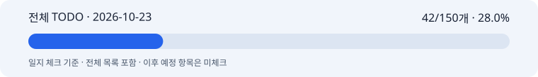
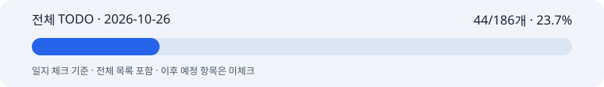

# 박지수 협업일지

화장품 광고 AI 모델 작업의 날짜별 기록입니다.

## 기록

| 날짜 | Markdown | HTML |
| --- | --- | --- |
| 2026-10-20 | [작업일지](worklogs/2026-10-20/park-jisoo-worklog.md) | [HTML 파일](worklogs/2026-10-20/park-jisoo-worklog.html) |
| 2026-10-22 | [모델 작업·완료 체크·스키마 일지](worklogs/2026-10-22/schema-draft-worklog.md) | [HTML 파일](worklogs/2026-10-22/schema-draft-worklog.html) |
| 2026-10-23 | [프롬프트·W&B·FinOps 협업일지](worklogs/2026-10-23/park-jisoo-worklog.md) | [HTML 파일](worklogs/2026-10-23/park-jisoo-worklog.html) |
| 2026-10-26 | [브랜치·프롬프트 안내·백엔드 연동 리뷰](worklogs/2026-10-26/park-jisoo-worklog.md) | [HTML 파일](worklogs/2026-10-26/park-jisoo-worklog.html) |

HTML은 파일을 내려받아 브라우저에서 열 수 있습니다.

## 브랜치 관리

- `박지수_협업일지`: 날짜별 Markdown·HTML 작업 기록을 관리합니다.
- [plan/models](https://github.com/uyt5041-lab/beauty-ai-models/tree/plan/models): 모델 참고 코드·문서·테스트를 관리하는 기본 브랜치입니다.
- 협업일지는 PR·코드 브랜치 병합 없이 별도로 유지합니다.
- 원본 Git 이력과 작업 당시 기록을 보존했습니다. 과거 PR 상태·브랜치 이름은 당시 기록이며, 본문의 이전 안내에 현재 위치를 표시했습니다.
- `CONTRIBUTING.md`는 원본 저장소의 팀 규칙을 보존한 참고 자료입니다. 원본의 `dev`·PM·PR 절차를 이 협업일지 브랜치에 적용하지 않습니다.

## 작성 기준

[협업일지 작성 계약](contracts/collaboration-journal.md)에 따라 2026-10-22부터 본문 8항목을 작성합니다.

- [10/22까지 계획된 항목의 완료 체크](worklogs/2026-10-22/completed-checks.md)
- [10/22 스키마 초안 상세 기록](worklogs/2026-10-22/schema-draft-details.md)

이전 날짜의 일지는 당시 기록으로 보존합니다.

## 전체 TODO 진행률 · 2026-10-23

**공유용 일지 체크: 42 / 150개 (28.0%)**

[전체 TODO 150개](worklogs/2026-10-23/full-todo.md) · [HTML 목록](worklogs/2026-10-23/full-todo.html) · [오늘 협업일지](worklogs/2026-10-23/park-jisoo-worklog.md) · [검증 근거](worklogs/2026-10-23/evidence.md)

전체 계획을 보여 주되 오늘까지 계획된 항목 중 완료한 것만 체크한다. 이후 일정과 일정 미정 항목은 미리 체크하지 않는다. 이전 130개에서 항목이 추가되어 현재 원본은 150개다. 지난 10/22 기록 26/130개·20.0%는 당시 스냅샷으로 보존한다.

## 공유용 목록과 실제 작업 체크

- **공유용:** 이 브랜치의 날짜별 `full-todo.md`·HTML·진행률 바. 보고일에 맞춘 읽기용 기록이다.
- **실제 작업:** [plan/models 원본 TODO](https://github.com/uyt5041-lab/beauty-ai-models/blob/plan/models/docs/imageTodo.md). 실제로 구현한 것은 그곳에서 체크하며, 앞당겨 끝낸 항목을 공유 날짜에 맞추려고 되돌리지 않는다.
- 날짜별 일지는 원본을 읽어 새로 만든다. 일지 체크를 원본으로 역반영하거나 두 브랜치를 병합하지 않는다.
- 진행률은 공유용 일지 체크 기준이며 제품 완성률·당일 자기평가와 다르다. 현재 API 실행 항목은 0/12, SSOT 연결은 0/12다. 전체 분모에 다시 더하지 않는다.

[10/22 전체 TODO·당시 진행률](worklogs/2026-10-22/full-todo.md) · [반복 작성 스킬](skills/beauty-ilji/SKILL.md)

## 전체 TODO 진행률 · 2026-10-26

**공유용 일지 체크: 44/186개 · 23.7%**

[전체 TODO 186개](worklogs/2026-10-26/full-todo.md) · [HTML 목록](worklogs/2026-10-26/full-todo.html) · [협업일지](worklogs/2026-10-26/park-jisoo-worklog.md) · [검증 근거](worklogs/2026-10-26/evidence.md)

기준은 이미지 통합 브랜치 `feature/image-model`의 고정 커밋 `a8d464a`다. 기존 `plan/models`는 계획 이력으로 보존한다. TODO가 150개에서 186개로 재구성되어 이전 퍼센트와 직접 비교하지 않는다. 원본의 구현 체크를 되돌리지 않았고, 보고일까지 계획된 항목만 일지 분자로 센다. 과거 날짜의 기록과 수치는 그대로 보존한다.
