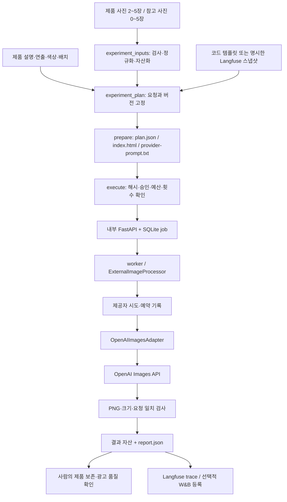
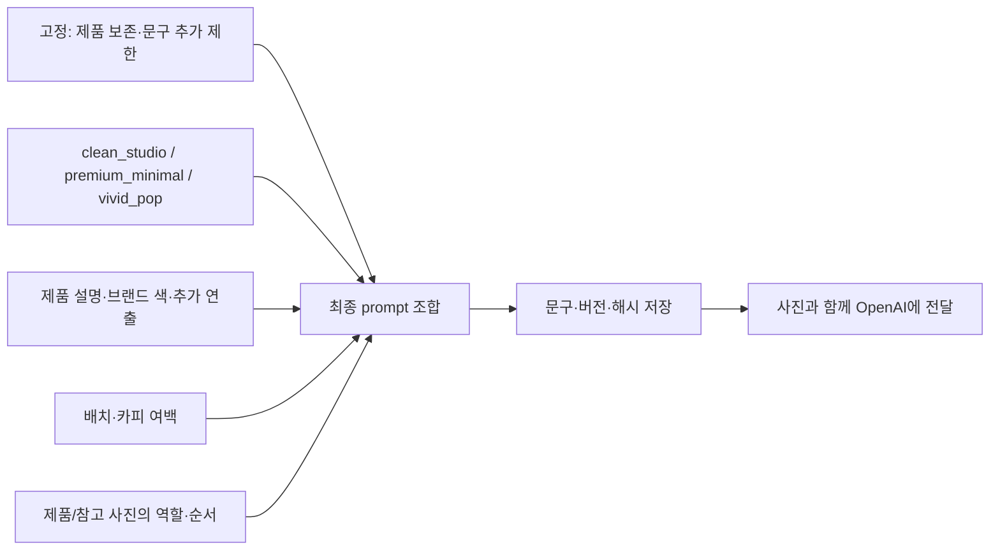
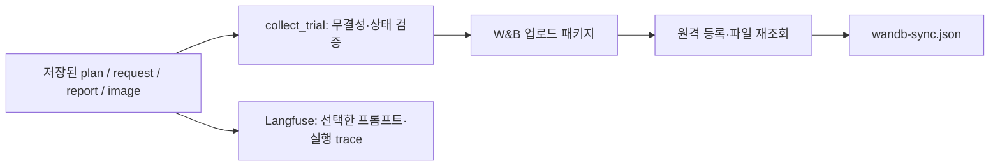

# 이미지 파트 통합 기준: 구조와 실행 흐름

기준일: 2026-10-26 · 통합 브랜치: **`codex/image-main`**

이 브랜치는 이미지 API 래퍼, 프롬프트, 다중 사진 실험 실행기, 결과·비용 기록, 평가, 문서와 테스트를 한곳에 모은다. `plan/models`에서 이어진 이력을 보존한다. 저장소의 기본 브랜치 변경이나 팀 서비스 배포 완료를 뜻하지 않는다. 협업일지는 `박지수_협업일지`에서 별도로 관리한다.

## 1. 지금 제공하는 것

이미지 생성의 중심은 **사진과 조합한 프롬프트를 OpenAI에 보내고 결과를 받는 API 래퍼**다. 앞뒤에 입력 검증, 호출 전 미리보기, 프롬프트 버전 고정, 호출·예산 제한, 자산 저장, 실험 기록을 붙였다. 자체 이미지 모델을 학습하는 프로젝트가 아니다.

| 상태 | 내용 |
| --- | --- |
| 코드 포함·오프라인 검증 | 제품·참고 사진 준비, 프리셋·버전 선택, 불변 계획과 HTML 미리보기, 명시 실행, 영속 호출 제한, 실패/미확인 시 중단, 결과 저장, W&B 재등록 경로 |
| 기존 실제 실행 근거 있음 | 10/23 프리셋 비교, 무광 보존, 아벤느 비율 보존 v3 생성·평가. 이번 브랜치 정리에서 유료 이미지를 새로 생성하지 않았다. |
| 공동 인수 필요 | 다혜의 텍스트 산출물→이미지 요청, 혁상의 UI·실제 서빙 연결, 사용자 검토→최종 한글 합성→다운로드. [LINK-01~05](imageTodo.md) 참조 |
| 보존한 선택 경로 | BiRefNetLite·SDXL·로컬 템플릿 실험. OpenAI 이미지 요청마다 누끼와 SDXL이 실행되는 구조는 아니다. |

## 2. 폴더 트리

아래는 주요 파일이다. 전체 Git 게시 대상은 [전체 트리](repositoryTree.txt)를 참고한다. `outputs/`, `.env`, `graft/` 등은 로컬에만 존재할 수 있으며 공개 트리에 포함하지 않는다.

```text
beauty-ai-models/
├── README.md                    # 사용법·기능·아키텍처·보완점·하지 말 것
├── README2.md                   # 추가 사용법과 문서 입구
├── AGENTS.md                    # 그래프 우선 탐색과 담당 경계
├── pyproject.toml               # Python 패키지·선택 의존성
├── .env.example                 # 변수명 예시. 실제 키는 로컬 .env
├── .gitignore / .ignore         # 게시 제외 / Graft 검색 범위
├── beauty_ai/                   # 구현
│   ├── experiment_inputs.py    # 사진 검사·정규화·역할·순서
│   ├── experiment_plan.py      # 프리셋·버전별 요청 구성
│   ├── experiment_runner.py    # prepare / execute / sync-wandb CLI
│   ├── experiment_execution.py # 고정 계획 실행·호출 제한·중단
│   ├── cosmetics_prompts.py    # 공통 규칙·3개 프리셋·레이아웃
│   ├── langfuse_prompts.py     # 버전 스냅샷·프롬프트·trace
│   ├── openai_images.py        # OpenAI 생성·편집·누끼 요청
│   ├── api_image_processor.py  # 요청 처리·결과 검증·자산 저장
│   ├── contracts.py            # 요청·응답·자산 모델
│   ├── inference_runtime.py    # 내부 앱과 처리기 조립
│   ├── inference_api.py        # 내부 FastAPI 엔드포인트
│   ├── image_worker.py         # 저장된 job 실행
│   ├── job_ledger.py           # SQLite job 상태
│   ├── provider_attempts.py    # 제공자 시도·예약액·실험 상한
│   ├── assets.py               # 파일·해시·프로젝트별 자산
│   ├── experiment_trial_records.py # 저장된 실험 증거 검증·수집
│   ├── experiment_records.py   # 기존/신규 기록 수집
│   ├── experiment_wandb.py     # 신규 실행 결과만 W&B 동기화
│   ├── wandb_experiments.py    # 업로드·비교·FinOps·원격 대조
│   ├── ad_evaluation.py        # 광고 평가 기록
│   ├── image_edits.py / product_approval.py # 선택·승인·revision
│   ├── text_gateway.py / review_service.py # 텍스트 참고 구현
│   └── birefnet_processor.py / sdxl_processor.py # 로컬 실험 경로
├── prompts/cosmetics/           # 프롬프트 버전 자료(v2·v3)
├── schemas/                     # JSON Schema
├── examples/                    # 입력·연결·평가 예시
├── scripts/                     # 비교 CLI 입구·설정 검사
├── tests/                       # 정상·실패·경계·중복·기록 검증
├── docs/                        # TODO·실험·연동·구조 문서
└── fivecircles/                 # 요구사항·계약·단계 판정·작업 기록
```

텍스트 참고 코드가 남아 있다는 사실은 다혜의 모듈과 이미 연동됐다는 뜻이 아니다. pi의 현재 책임은 이미지 API와 이미지 실험·평가·사용량 관리다.

## 3. 사진을 받아 이미지가 나오는 경로



실험 실행기의 `execute_plan`은 `build_app`으로 내부 앱을 만들고 **FastAPI TestClient로 같은 프로세스에서** job 제출·조회·자산 다운로드 경로를 사용한다. 내부 상태 흐름을 사용하면서 LIVE 모드에서는 OpenAI로 실제 요청을 보낸다. TestClient 사용이 곧 외부 API 모의 실행을 뜻하지 않는다. 반대로 이 실행 성공만으로 팀의 배포 서버·웹 UI 연결을 증명하지도 않는다.

별도 서비스 연결에는 `inference_runtime.py`로 조립한 서버와 `image_gateway.py`의 HTTP 클라이언트 경로가 있다. 프로젝트 인증·엔드포인트·자산·오류·사용자 검토 계약은 팀과 맞춰야 한다.

## 4. 프롬프트는 어떻게 만들어지나



- 로컬 기본 템플릿 버전은 `cosmetics-v1`이다. Langfuse 숫자 버전 1과 같은 식별자가 아니다.
- Langfuse 스냅샷을 쓰면 숫자 버전과 최종 렌더링 문구를 고정한다. 준비된 실행은 관리 화면의 `production` 변경을 자동 추종하지 않는다.
- v3 자료에는 제품 폭·길이·캡 비율 보존 지시가 강화돼 있다. 파일을 추가했다고 모든 새 실행에 v3가 자동 적용되지는 않는다. 실행 시 버전과 스냅샷을 선택한다.
- 무광을 모든 제품에 강제하지 않는다. 원본 재질과 제품별 설명을 따른다. 제품 보존은 지시이며 픽셀을 고정하는 기능이나 품질 보장이 아니다.
- 현재 기본 캔버스는 1152×1440으로 정확히 4:5다. 중간 이미지에는 새 광고 카피를 넣지 않고, 사용자 확인 후 최종 한글 합성을 연결하는 것이 서비스 목표다.
- 누끼는 별도 `cutout` 요청이다. 모든 생성 요청 전에 자동으로 수행하는 필수 단계가 아니다.

구현: [프롬프트 조합](../beauty_ai/cosmetics_prompts.py), [Langfuse 관리](../beauty_ai/langfuse_prompts.py), [API 전달](../beauty_ai/openai_images.py).

## 5. 기록과 FinOps 경로



`sync-wandb`는 저장된 결과를 읽는다. 이미지 실행기를 불러서 재생성하지 않는다. W&B 실패는 별도 동기화 기록으로 남기며 원래 `report.json`을 덮어쓰지 않는다. 실행 전 미리보기와 mock 결과를 실제 유료 실행으로 게시하지 않는다.

| 값 | 의미와 한계 |
| --- | --- |
| `planned_calls` / `max_calls` | 예정 작업 수와 실험 상한 |
| `attempt_slots` | 예약된 제출 시도 슬롯. 실제 HTTP 전송 수나 확정 과금 건수와 다름 |
| `reservation_usd` | 호출 허용을 위한 내부 예약액. 제공자 가격표나 실제 청구가 아님 |
| `elapsed_seconds` | 내부 job 제출·조회·자산 다운로드 구간. 순수 모델 생성 시간으로 쓰지 않음 |
| `usage` | 제공자가 반환한 사용량. 없으면 미확인 |
| 추정 비용 / 실제 비용 | 요율 근거가 있을 때의 추정과 확정 청구를 분리. 원 실행 보고서에 추정 근거가 없으면 null로 남을 수 있음 |
| `READBACK_VERIFIED` | 원격 기록을 다시 읽어 일치함. 광고 품질이나 팀 사용자 인수를 뜻하지 않음 |

실패·timeout·제출 결과 미확인은 후속 호출 중단 대상으로 기록한다. 제공자가 계속 처리할 가능성이 있으므로 자동 재제출로 성공을 만들지 않는다. Langfuse 전송 요청과 원격 확인 역시 구분한다. 이미지40%·FinOps40%·서비스20%는 [임시 평가안](imageEvaluationPlan.md)이며 팀 합의 전이다.

## 6. 팀원이 처음 실행하는 순서

Python 3.11 이상에서 저장소 루트 기준으로 실행한다. 첫 준비에는 API 키가 필요하지 않다.

```bash
git clone --branch codex/image-main --single-branch https://github.com/uyt5041-lab/beauty-ai-models.git
cd beauty-ai-models
python3 -m venv .venv
source .venv/bin/activate
python -m pip install -e '.[test,observability,experiments]'
python -m pytest -q -W error
python -m beauty_ai.experiment_runner --help
```

제품 사진을 로컬 `uploads/`에 준비한 뒤 아래 예시를 실행한다. 파일명은 자신의 사진으로 바꾼다.

```bash
python -m beauty_ai.experiment_runner prepare \
  --product uploads/product/front.jpg \
  --product uploads/product/side.jpg \
  --preset vivid_pop \
  --prompt-version cosmetics-v1 \
  --product-description "One cosmetic product. Preserve its original shape, material and label." \
  --quality medium \
  --max-calls 1 \
  --output outputs/experiment-trials/first-preview
```

이 명령은 미리보기만 만든다. 참고 사진·Langfuse 버전·실제 실행·W&B 재등록 명령은 [실험 실행기 사용법](experimentRunner.md)에 있다. `execute`는 검토한 계획 해시, 명시적 LIVE 옵션, 예산·키 설정을 사용한다. 폴더마다 결과를 보존하고 같은 계획을 무작정 재실행하지 않는다. `scripts/compare_cosmetics_presets.py`도 같은 CLI의 입구다.

```text
outputs/experiment-trials/<실험명>/  # 공개 Git 제외
├── inputs/                       # 정규화한 입력 사본
├── index.html                    # 호출 전 미리보기
├── plan.json                     # 고정 계획과 해시
├── cases/<case-id>/
│   ├── request.json
│   ├── provider-prompt.txt
│   ├── report.json
│   └── image.png                 # 성공한 실행의 결과
├── runtime/                      # 자산·작업·시도 DB
├── report.json                   # 실행 결과
├── wandb/                        # 선택적 업로드 패키지
└── wandb-sync.json               # 별도 동기화 상태
```

## 7. 어디를 수정하면 되나

| 수정 목적 | 시작 파일 | 확인할 경계 |
| --- | --- | --- |
| 제품·참고 사진 처리 | `experiment_inputs.py`, `assets.py` | 원본과 전송용 사본, 역할·순서·크기·중복 |
| 프리셋·공통 규칙 | `cosmetics_prompts.py`, `langfuse_prompts.py`, `prompts/cosmetics/` | 공개된 버전의 문구를 덮어쓰지 말고 새 버전으로 관리 |
| 계획·미리보기·CLI | `experiment_plan.py`, `experiment_runner.py` | 계획 해시·선택 버전·호출 상한 |
| 실행·호출 제한 | `experiment_execution.py`, `provider_attempts.py` | 재시작·중복·실패·미확인 결과·예약액 |
| OpenAI 요청·응답 | `openai_images.py`, `api_image_processor.py` | 요청 크기·PNG·결과 일치·오류와 저장 |
| 팀 서버·UI 연결 | `inference_api.py`, `image_gateway.py`, `contracts.py` | 담당자와 스키마 합의, 실제 E2E 근거 |
| 실험·비용 비교 | `experiment_trial_records.py`, `experiment_wandb.py`, `wandb_experiments.py` | 저장 증거 검증, 생성과 재등록 분리 |

함수 변경 전에는 Graft에서 호출자를 확인한다. 생성 모델·예산·외부 전송 변경은 그 영향도 함께 검토한다. 파일 수정만으로 팀 계약을 확정하지 않는다.

## 8. 저장된 Graft 그래프 사용

2026-10-26 확인한 그래프는 **소스 90파일·심볼 1,475개·연결 5,080개**다. 이 숫자는 Graft가 인덱싱한 코드 범위이며 문서와 전체 저장소 파일 수가 아니다. `graft check .`에서 코드와 그래프의 일치를 확인했다.

주요 연결 중심은 `content_hash`, `GatewayError`, `LocalAssetStore`, `JobLedger`, `OpenAIImagesAdapter`, `ProviderAttemptStore`다. 위 Mermaid 그림은 이 관계와 실제 실행 코드를 읽어 만든 설명용 구조도다. 5,080개 연결을 그대로 나열한 파일은 아니다.

```bash
graft check .
graft map .
graft ask "experiment execute preview and W&B result sync" --source
graft callers execute_plan --direction out --depth 2
graft skeleton beauty_ai/experiment_execution.py
```

먼저 목적에 맞는 명령 하나로 범위를 좁힌다. 코드는 지목된 구간만 읽는다. 기존 로컬 저장소의 `graft/`에는 재사용할 그래프와 deep 요약이 있지만, 캐시는 `.gitignore`로 제외한다. 새 clone에는 캐시가 없으므로 설치된 Graft에서 `graft build .`로 구조 그래프를 만든다. deep은 함수 역할을 LLM으로 요약하는 선택 작업이며 별도 API 비용이 생길 수 있다. 매 조회마다 deep을 다시 만들지 않는다.

## 9. 검증과 남은 일

- 2026-10-26 최신 소스 기준: **1,321 tests PASS, 24.16초**, `pytest -q -W error`.
- 이 테스트 결과는 자동화된 오프라인 검증이다. 새 유료 이미지 호출, 계정 청구 확인, GCP 배포 또는 팀 실제 E2E 인수를 뜻하지 않는다.
- 팀 스키마·사진 장수·제품 유형 시점·상태·합성·FinOps 공동 인수는 [원본 TODO](imageTodo.md)의 LINK-01~05를 따른다.
- 실제 실험 근거: [아벤느 결과·비율 비교](imageExperiment-20261023-avene.md). 생성 이미지·개인 사진·로컬 DB는 Git에 포함하지 않는다.
- 공유할 변경 요청: [다혜·혁상 요청문](integrationRequests-20261025.md). 담당자 수락과 메시지 전달은 별도 사실이다.
