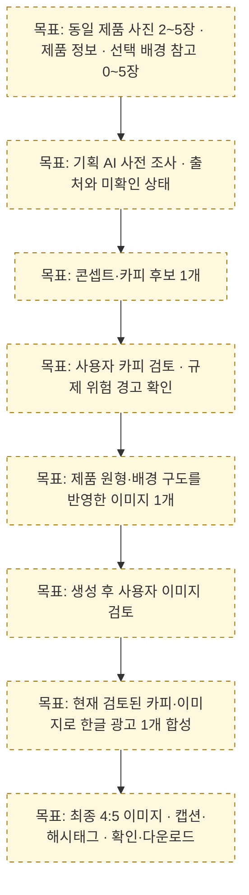

# SSOT 대조 및 전달 기준

작성·로컬 자료 수신: **2026-10-22**. 이 문서는 새 MVP 기준과 현재 코드의 차이, 변경 범위, 인수 조건을 정리한다. 구현 완료나 다른 담당자의 수락을 대신하지 않는다. 실행 항목과 체크 상태의 원본은 [imageTodo.md](imageTodo.md)이며, 이 문서에는 실행 체크리스트를 복제하지 않는다.

## 출처와 확인 범위

- 사용자 전달 자료: **확정된 기준점 (SSOT)**, 문서 ID `401b13f77dbd80f39bbccd2e3a489566`.
- 수신한 Markdown의 SHA-256: `2e3447ee2fd2eda59016942cd90e2e3d04196e6937aabca0baa317714e095af5`.
- 원문 파일·개인 경로·계정 정보는 이 저장소에 복사하지 않는다. 아래 내용은 전달 기준의 요약과 저장소 대조 결과다.
- 코드 근거는 `beauty_ai/`와 `examples/`, 검증 근거는 [릴레이 기록](../fivecircles/work/relay.md) 및 배치별 검증 문서다. 2026-10-22 확인한 코드와 기록을 기준으로 하며, 이 문서 작성 과정에서 코드 변경·추가 시험·실제 모델 호출은 하지 않았다.
- 이미지 담당은 **pi**, 텍스트·영어 이미지 프롬프트 담당은 **김다혜**다. API·자산·승인 UI·렌더러·인프라·최종 인수 담당의 이름과 수락은 미확인이다. 업무 연결 제안은 [modelIntegrationReview.md](modelIntegrationReview.md)를 따른다.
- 노션 동기화, 팀원의 내용 수락, 공동 서비스 인수는 **미확인**이다. 자료 수신·로컬 문서 작성·Git 게시·담당자 인수는 별도 사실로 관리한다.

## 현재 구현과 게시 상태

| 범위 | 2026-10-22 확인된 사실 | 완료로 확대하지 않는 범위 |
| --- | --- | --- |
| B1~B4 기반 | 자산 정규화·작업 캔버스·영속 작업 API/worker·제품 레이어 승인·프롬프트 버전·현재 편집/캐시 구현. [B1](../fivecircles/test/relay-b1.md), [B2](../fivecircles/test/relay-b2.md), [B3](../fivecircles/test/relay-b3.md), [B4](../fivecircles/test/relay-b4.md) | 서비스 사용자 인증·생성 후 이미지 승인·최종 광고 렌더러·부분 편집 UI |
| B5~B7 평가/모델 | 로컬 평가 도구와 고정 BiRefNet/SDXL 어댑터 구현. 실제 MPS 합성 입력으로 누끼·배경 기술 실행 확인. [B5](../fivecircles/test/relay-b5.md), [B6](../fivecircles/test/relay-b6.md), [B7](../fivecircles/test/relay-b7.md) | 다양한 실사진의 광고 품질·권리 확보·CUDA/GCP 검증·팀 인수 |
| B8 제출 조정 | `1e05f945a202ac9e53fccb4d6c7a2b721f5fcb10`(`1e05f94`). 같은 ID 제출 조정·응답 유실 복구를 521 tests와 실제 로컬 TCP 시험으로 확인. [B8 기록](../fivecircles/test/relay-b8.md) | 운영 프록시·실제 사용자 UI·GCP 장애 인수 |
| B9 구현·검증·게시 | 소스 `858c6f7709074b230bdb82192aa529583936fc5c` 일반 push·원격 SHA 일치·로컬 파일 동기화 확인. **624 tests PASS**, 실제 MPS **누끼 1 + 배경 5 jobs**. 동일 512 입력/seed 두 번의 요청·출력 hash 일치, 단계 관찰과 작업 후 메모리 snapshot 확인. [B9 기록](../fivecircles/test/relay-b9.md), [게시 기록](../fivecircles/work/integrate-log.md) | 6 jobs는 여러 실제품 평가가 아니다. 메모리 snapshot은 peak가 아니며 광고 품질·다른 장치 재현·팀 인수는 미완료 |
| B9 종료 게이트 | 최종 HTML 브라우저 검증 **BLOCKED**, 전체 릴레이 종료 검증 미완료. 수정 전 화면을 최종 PASS로 사용하지 않는다. [B9 시각 검증](../fivecircles/test/relay-b9.md#시각-검증과-후속) | 소스 게시와 별개다. 후속 구현 게이트가 열린 것으로 취급하지 않는다. 이번 SSOT 문서 전달은 별도 사용자 요청 범위다 |

위 표는 2026-10-22 소스 게시 후 관찰로 갱신했다. 소스·문서 게시, 정적·모델 검증, 최종 HTML 검증 BLOCKED를 구분한다. 브라우저 우회 및 릴레이 다음 구현은 진행하지 않는다.

## 서비스 목표 흐름 · 계획

**아래 노드는 모두 SSOT의 서비스 목표다. 현재 구현 완료 도식이 아니다.** 현재 이미지 엔진의 세부 흐름·실제 검증·GAP은 [B9 기록](../fivecircles/test/relay-b9.md)과 [기존 상세 흐름](../fivecircles/architecture/spec/image-runtime-flow.html)에 따로 남긴다. 이 Mermaid는 문서 소스이며 브라우저·PNG 렌더 검증을 수행하지 않았다.

주제품 사진 선택 주체·참고 사진 구도 적용 방식·4:5용 모델 작업 해상도는 아직 해결된 결정이 아니다. API·자산·승인 UI·렌더러 담당과 공동 계약도 미정이며, 중간 모델 호출 성공만으로 이 목표 흐름에 도달했다고 판정하지 않는다.

## SSOT와 현재 구현의 차이

표의 **실제로 다름**은 기본값·허용 범위가 다른 경우, **추가 구현 필요**는 목표를 완성할 연결이 없는 경우다. 기존 일부 기능이 있다는 사실과 목표 전체의 완료를 구분한다. ID는 [실행 TODO](imageTodo.md)의 같은 ID와 연결한다.

| ID | 현재 구현·판정 | SSOT에 적힌 기준 | 목표와 범위 |
| --- | --- | --- | --- |
| **SSOT-01** 동일 제품 사진 | **실제로 다름 + 추가 구현 필요.** [CutoutRequest/BackgroundRequest](../beauty_ai/contracts.py)는 단일 `source`, [VLM analyze_product](../beauty_ai/text_gateway.py)는 1~3장. 동일 제품·각도 검증 없음 | 동일 제품 2~5장, 여러 각도 활용 | 입력 묶음·동일 제품 확인·사진 검토 상태를 정의한다. 대표 사진을 선택해 현재 단일 제품 레이어를 만드는 방식은 **구현 전략의 합의 대상**이며 SSOT가 선택 방식을 지정한 것은 아니다. 다각도 3D 재구성을 완료 범위로 추가하지 않는다 |
| **SSOT-02** 입력 운영 상한 | **실제로 다름·운영 합의 필요.** [LocalAssetStore](../beauty_ai/assets.py)는 기본 업로드 20MiB, 1,600만 픽셀, 각 축 16,384 상한. 런타임과 CLI가 적용 | 입력 사진의 파일 용량·해상도 제한 없음 | 사용자 입력 요구와 처리 자원 한도의 충돌을 명시하고 접수·축소/정규화·거절 정책을 합의한다. 현재 decode·크기 가드는 자동 제거하지 않는다. 입력 용량/해상도 문제를 출력 **비율 제한 없음**으로 바꾸어 해석하지 않는다 |
| **SSOT-03** 배경 참고 사진 | **추가 구현 필요.** 요청에 배경 참고 자산 배열 없음. [SDXL](../beauty_ai/sdxl_processor.py)은 단색 바탕+승인 제품에서 시작하며 프롬프트·고정 레이아웃을 사용 | 선택 입력 0~5장, 배경 모습과 구도 반영 | 참고 자산의 목적·우선순위·구도 전달 계약과 실제 조건화 방법을 정한다. 색상만 반영한 결과를 구도 활용 완료로 판정하지 않는다 |
| **SSOT-04** 최종 4:5 | **실제로 다름 + 추가 구현 필요.** [VisualBrief](../beauty_ai/contracts.py)는 256~2048의 8배수 작업 크기, 실제 [SDXL](../beauty_ai/sdxl_processor.py)은 각 축 512/768/1024만 허용하여 4:5 조합 없음. [기본 예제](../examples/bright_visual.json)는 512×512 | 최종 인스타그램 피드 이미지 4:5 고정. 3:4는 후속 | 중간 생성 크기와 최종 출력 크기를 분리한다. 모델 허용 크기 확장 또는 최종 캔버스 변환 전략을 합의하고 제품 비율·Safe Zone·승인 무효화 범위를 검증한다. 기존에 허용되는 768×1024를 MVP 최종 3:4 지원 완료로 쓰지 않는다 |
| **SSOT-05** 기획 AI 조사 | **추가 구현 필요.** [draft_campaign](../beauty_ai/text_gateway.py)은 제공된 facts/options로 바로 콘셉트·카피를 생성. 조사 결과·출처 계약과 외부 검색 호출 없음 | 제품·시장·유사 제품 사전 조사 후 광고 기획 | 조사 단계의 입력·출처·확인 시점·실패/미확인 상태를 후속 카피에 전달한다. 시스템 프롬프트나 `market` 문자열만으로 최신 시장 실검색을 했다고 표시하지 않는다 |
| **SSOT-06** 카피 1개 | **카피 기본값이 실제로 다름.** [구현](../beauty_ai/text_gateway.py)·[Protocol](../beauty_ai/ports.py)의 기본 후보 수는 3, 허용 1~3. 카피 1개 생성 능력은 이미 있으며 [SDXL](../beauty_ai/sdxl_processor.py)은 요청당 이미지 1개를 생성 | MVP 콘셉트·카피 후보 1개, 이미지 후보 1개 | 서비스 호출 기본값·예제·응답/화면을 각 1개로 맞춘다. 내부 복수 생성 능력의 존재를 MVP 다중 시안 UI 완료로 설명하지 않는다 |
| **SSOT-07** 사용자 카피 검토 | **추가 구현 필요.** [ReviewService](../beauty_ai/review_service.py)는 자동 규칙/LLM 검수. 사용자 확인 저장·현재 카피 revision 승인·경고 확인 후 진행 정책 없음 | 카피 확인과 규제 위험 경고 후 이미지 생성으로 진행 | 자동 검수와 사용자 검토를 분리하고 현재 카피에 대한 확인을 기록한다. SSOT의 경고 우선 문구를 기존 blocked/unavailable 가드 삭제 지시로 해석하지 않는다 |
| **SSOT-08** 생성 후 이미지 검토 | **추가 구현 필요.** [ProductApprovalStore](../beauty_ai/product_approval.py)는 생성 전 제품 레이어/마스크/배치 승인. [ImageEditStore](../beauty_ai/image_edits.py)는 현재 결과 연결이며 품질 승인 아님 | 생성된 이미지 사용자 검토 후 카피 합성 | 생성 결과 job·자산 hash·현재 revision에 묶인 별도 사용자 확인 단계와 진행 조건을 추가한다. 기존 제품 레이어 승인을 유지하며 두 승인을 합치지 않는다 |
| **SSOT-09** 최종 한글 렌더 | **추가 구현 필요.** [BackgroundResult](../beauty_ai/contracts.py)는 장면·제품·합성 preview. 현재 CLI `render`는 배경 작업 제출이며 한글 타이포그래피 렌더러 없음 | 한글 카피가 이미지 안에 포함된 최종 광고 1개 | 승인된 생성 이미지와 현재 검토된 카피를 별도 텍스트 레이어로 합성한다. 글꼴·길이·줄바꿈·여백·최종 4:5 및 다운로드 연결을 검증한다. 중간 무문구 이미지와 최종 한글 광고를 구분한다 |
| **SSOT-10** 캡션·태그 출력 | **필드는 구현, 최종 연결 필요.** [CopyBundle](../beauty_ai/contracts.py)에 caption/hashtags가 있고 검수 대상. [다운로드 API/CLI](../examples/run_image.py)는 자산 PNG 저장 | 최종 이미지와 인스타그램 게시글 본문·해시태그 제공 | 최종 이미지·캡션·태그를 같은 현재 카피 revision으로 전달하는 서비스 응답/화면을 연결한다. 기존 자산 다운로드를 완성형 광고 출력 완료로 표시하지 않는다 |
| **SSOT-11** 실제품 평가 자료 | **자료·인수 기준 추가 필요.** [평가 도구](../beauty_ai/evaluation.py)는 구현. B6~B9는 합성 입력의 기술 증거이며 다양한 실제품 품질 증거가 아님 | 세부 카테고리 사전 선택 없이 다양한 화장품 확보 후 분류. 약 30종 수집 방안 논의 | 권리·출처를 확인한 실제품을 확보하고 형태/재질/라벨/투명도 등으로 사후 분류한다. 30제품에 제품당 2~5장을 적용하면 **60~150장의 준비 규모 추정**이며, 수집 확정 수량이나 품질 합격 기준이 아니다 |
| **SSOT-12** 교차 인수 계약 | **서비스 연결·수락 필요.** 내부 모델/자산/작업/승인/hash/cache 계약은 구현. 실제 LLM·서비스 UI·렌더러 공동 인수는 미확인 | 입력→기획→카피→사용자 검토→이미지→사용자 검토→최종 합성의 직렬 MVP | API·자산·승인 UI·렌더러 담당과 제공일·버전·실패 의미·인수 시나리오를 합의한다. 카테고리 사전 선택을 새 필수 입력으로 추가하지 않는다. 각 파트의 완료와 서비스 인수를 따로 기록한다 |

## 전달할 변경 작업과 인수 조건

아래는 요구사항별 설계·인수 기준이다. 실행 순서·진행 체크·완료일은 [imageTodo.md](imageTodo.md)만 갱신한다. 담당 열의 공동 역할은 제안이며 이름이 없는 역할을 배정 완료로 표시하지 않는다.

| ID | 변경 작업 | 담당·미정 | 의존성 | 완료 기준 |
| --- | --- | --- | --- | --- |
| SSOT-01 | 2~5장 자산 묶음과 동일 제품/사진 검토 상태 정의, VLM 장수 경계 조정, 주제품 사진 선택 전략 결정 | 이미지 pi, 텍스트 김다혜; 업로드/API/UI 담당 미정 | SSOT-02·12, 사용자 확인 방식 | 2장·5장과 범위 밖 입력, 다른 제품 혼입·미확인 상태를 구분하고 선택된 제품 레이어의 출처를 추적. 동일 제품 자동 판별 여부·미확인 시 진행 정책까지 공동 확인 |
| SSOT-02 | 입력 크기·픽셀·포맷·정규화 책임과 오류 안내 합의 | 자산/백엔드/인프라 담당 미정, pi 연결 | 자원 측정, SSOT-01·03 | SSOT의 무제한 요구와 유한 처리 한도의 처리 방식을 문서·UI·서버가 일치시킴. 정상/초과/손상 입력의 실제 경계 검증과 운영 담당 수락. 합의 전 기존 상한 유지 |
| SSOT-03 | 배경 참조 자산 계약, 0장 기본 경로, 여러 참조의 우선순위·구도 사용 방법 구현 | pi, 김다혜; 자산/API/UI 담당 미정 | SSOT-02·04·11·12 | 0장·1장·5장 입력과 범위 밖/유효하지 않은 참조를 처리. 합의한 참조 구도 항목을 실제 결과와 비교해 평가하고 미반영/불확실 상태를 숨기지 않음 |
| SSOT-04 | 최종 크기·좌표 변환·제품 보존·승인 범위 계약과 출력 경로 구현 | pi; 렌더러/API 담당 미정 | SSOT-08·09·12, 장치 검증 | 다운로드 파일이 정확한 4:5. 제품 비율·라벨·문구 여백 보존을 최종 파일에서 확인. 변환 뒤 보존 범위를 승인된 최종 캔버스 기준으로 검증하고 임의 늘리기 금지 |
| SSOT-05 | 조사 단계·출처 구조와 실제 외부 자료 수집 여부/실패 처리 연결 | 김다혜; 외부 검색/API/제품 담당 미정 | 제품 입력·권한/비용·출처 정책, SSOT-12 | 조사 결과가 콘셉트·카피 입력에 전달됨. 실검색 실행과 모델 추론을 구분하고 자료 없음·오래된 자료·검색 실패를 확인 가능. 최신 시장 사실을 근거 없이 확정하지 않음 |
| SSOT-06 | MVP 호출 기본값·Protocol·예제·응답 후보 수 정렬 | 김다혜, 이미지 실행 pi; 호출 API/UI 담당 미정 | SSOT-05·12 | 정상 MVP 요청에서 콘셉트/카피 1개와 해당 caption/hashtags를 전달하고 이미지 후보도 1개를 사용. 기존 복수 생성 기능과 MVP 경로를 구분 |
| SSOT-07 | 카피 사용자 검토·경고 확인·승인 무효화 정책 및 저장/조회 연결 | 김다혜; 제품/API/UI/검수 정책 담당 미정 | SSOT-06·12, 규칙집·검수 상태 | 현재 copy revision/hash에 대한 사용자 확인 뒤에만 정한 이미지 진행 조건 충족. 수정·오래된 확인·미확인·blocked/unavailable를 구분. 자동 검수 PASS를 법적 승인으로 표시하지 않음 |
| SSOT-08 | 생성 후 이미지 확인 상태와 최종 합성 진행 조건 추가 | pi; API/UI·실제 확인자 미정 | SSOT-07·12, 기존 job/hash/제품 승인 | 사용자가 확인한 job/자산/hash/revision과 현재 선택이 일치할 때 최종 합성 가능. 오래된 결과·실패 결과·타 프로젝트 결과·이미지 변경 뒤 과거 확인의 재사용 차단 |
| SSOT-09 | 한글 텍스트 레이어·줄바꿈·오버플로·최종 출력 처리 | 렌더러/API 담당 미정; 김다혜 문구, pi 제품 보존 연결 | SSOT-04·07·08·12 | 현재 검토 상태의 카피와 이미지로 최종 광고 1개 생성. 합의한 최대 길이·줄 수·폰트에서 깨짐/잘림/제품 침범 검사, 4:5 파일 다운로드와 다른 담당자 재현 확인 |
| SSOT-10 | 최종 광고 응답과 caption/hashtags 텍스트 전달 연결 | 김다혜; API/UI/렌더러 담당 미정 | SSOT-06·07·09·12 | 최종 이미지와 같은 승인된 카피 revision의 본문/태그를 확인·복사할 수 있음. 변경 뒤 오래된 텍스트와 새 이미지가 섞이지 않으며 다운로드 자산 권한 유지 |
| SSOT-11 | 권리 있는 다양한 실제품 사진·참고 배경 확보, 사후 분류·평가셋/판정 기준 고정 | pi 평가, 제품/자료 수집·사람 평가 담당 미정 | SSOT-01·02·03, 권리/동의·품질 기준 합의 | 사용 가능한 출처·제품/촬영각도·재질·분리된 평가 기준과 수동 판정 기록 확보. 목표 수량과 합격 기준을 별도 합의하고 합성 샘플 점수를 실사진 품질로 대체하지 않음 |
| SSOT-12 | 파트별 입출력 예제·버전·오류·승인·인수 담당 및 교차 시나리오 확정 | pi·김다혜; API/자산/UI/렌더러/인프라/PM 인수자 미정 | SSOT-01~11, 실제 서비스 연결 환경 | 담당자의 명시적 수락과 입력→최종 다운로드 정상/실패/응답 유실/변경 뒤 과거 결과 차단의 공동 증거. 함께 검증한 버전·미달 항목 기록. 노션 반영·Git 게시·사람 인수를 각각 확인 |

## 유지할 구현 경계와 후속 범위

- 제품의 원형 보존은 유지한다. 현재 [BiRefNet](../beauty_ai/birefnet_processor.py)은 입력 RGB에 alpha를 붙이고, [제품 재합성](../beauty_ai/image_integrity.py)은 승인한 동일 작업 캔버스의 불투명 픽셀을 복원한다. 부분 alpha·투명/유리 제품·생성 잔상은 수동 품질 확인 대상이다. 2~5장 입력이 곧 다각도 재구성이나 라벨 완전 보존을 보증하지 않는다.
- [제품 레이어 승인](../beauty_ai/product_approval.py), [job ledger](../beauty_ai/job_ledger.py), 요청 hash·같은 ID 복구·현재 revision·[유효 결과 캐시](../beauty_ai/image_edits.py)를 보존한다. 새 입력을 추가할 때 버전·해시·이전 snapshot 호환성을 계약으로 정하고 기존 기록을 조용히 다른 의미로 재해석하지 않는다.
- `ImageEditStore`와 카피 재작성 후보 함수는 내부 재사용/변경 기반이다. 이를 삭제할 필요는 없으며 사용자 부분 수정 UI·다중 시안 비교가 완성됐다고 표시하지 않는다.
- **MVP 후속:** 부분 수정 UI, 복수 카피/이미지 시안 비교, 3:4 및 비율 선택, 병렬 생성/이미지 우선 생성 실험, 다중 플랫폼 확장. SSOT 문서 전달만으로 이 후속 기능의 구현에 착수하지 않는다.
- 사용자에게 화장품 세부 카테고리 선정을 먼저 요구하지 않는다. `ProductFacts.functional_categories`는 기능성 분류 목록이며 제품 품목 선택 UI와 같지 않다.
- **10/26 카피 길이·기본 Safe Zone·영어 프롬프트/버전 공유는 조기 합의 요청이며 수락 미확인**이다. 상대 팀의 기존 일정과 구분한다. M1은 10/30 통합, M2는 11/06 이미지 범위 완성으로 유지하고, 날짜만 지나거나 문서를 작성했다는 이유로 완료 처리하지 않는다.
