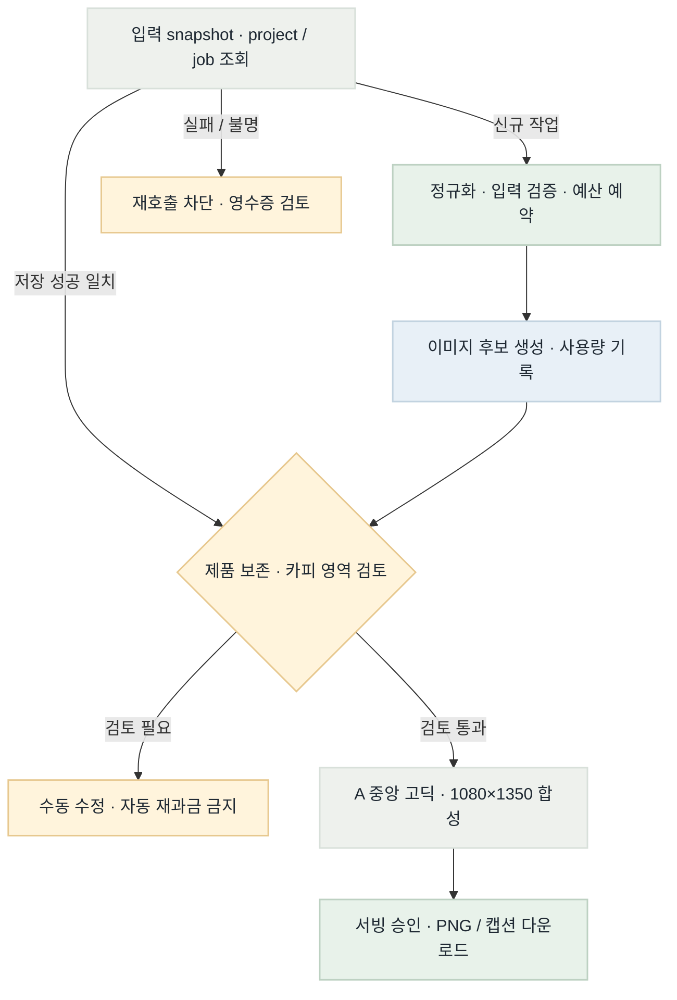
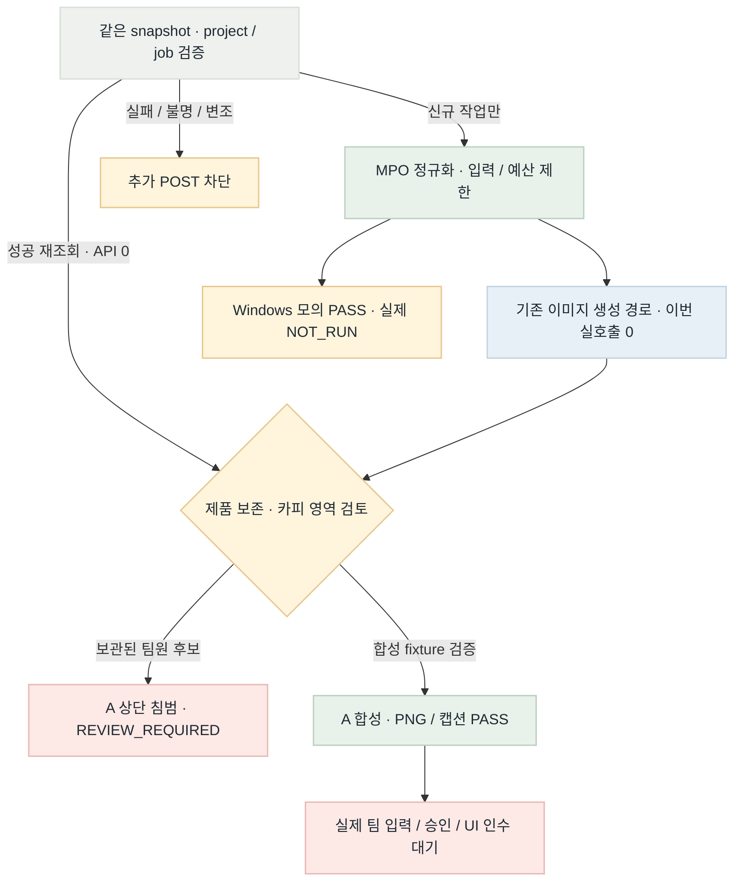

# 이미지 MVP 목표·현재 흐름 · 2026-10-30

상태: GAP / PARTIAL · R3 종료 기준. 미실행 인수를 구현 완료와 구분한다.

## Target Flow

## Current Implementation Flow

## Color Semantics

초록: 검증된 정상 제어 · 파랑: 외부 모델 경로 · 주황: 수동 검토 / 제한 · 빨강: 미완료 / 차단 · 회색: 결정 / 템플릿

## Target vs Current Gap

| 영역 | 상태 | 근거 / 차이 | 다음 조치 |
|---|---|---|---|
| MPO 입력 | PASS | 실제 제품 사진 2개 및 Linux 저장 검증 | 현재 완료 |
| Windows 저장 | PARTIAL | 디렉터리 sync만 분기; 실제 Windows 런타임 없음 | 실환경 파일 저장·재조회·권한 실패 확인 |
| A 템플릿 / safe_zone | PASS_WITH_RISKS | 상단 여백과 A 합성 연결; 모델 지시는 보장된 마스크가 아님 | 실제 생성물 침범·대비 수동 검토 |
| 제품 원형 보존 | REVIEW_REQUIRED | 기존 후보가 A 상단과 겹침; 실제 원본쌍 미확인 | 원본·실제 결과를 같은 기준으로 비교 |
| 원장 / 재시도 / 전달 | VERIFIED_OFFLINE | 성공 재조회 보완·원장/합성 검증; 실제 UI 인수 별도 | 실제 팀 입력·승인/다운로드·정산 인수 |
| HEIC / 디자인 자동화 | DEFERRED | 지원 범위 확정 및 후속 고도화 | MVP 필수로 자동 확대하지 않음 |

## Done / Not Done Priority

| 항목 | 상태 | 점수 | 산식 | 이유 / 다음 조치 |
|---|---|---|---|---|
| R1 입력·저장 | DONE | 10 | 4+3+2+2−1 | 모듈 전달 완료, Windows 실환경 별도 |
| R2 A 연결 | DONE | 8 | 3+3+2+2−2 | 제품 침범 방지·실제 카피 가독성 |
| R3 기존 원장·전달 검증 | DONE_OFFLINE | 7 | 2+3+2+2−2 | 중복 구현 없이 기존 계약 검증 |
| 실제 Windows / 서빙 인수 | NOT_RUN | — | 환경·자료 의존 | 모의 검증으로 완료 표시하지 않음 |

## Scoring Criteria

점수 = 상류 영향(0–4) + 연결 기여(0–3) + 안전성(0–2) + 검증 가능성(0–2) − 변경 위험(0–2).
자료·환경이 없는 항목은 점수만으로 실행 가능하다고 간주하지 않는다.

## Validation

- R1 코드: b9d00152de352499ce7773ac398fe8efb5408e8e (feat/image-generation 원격 일치).
- 전체 이미지 회귀 318 PASS, 실제 MPO 2개 PASS, 동일 assets.py Linux 저장 smoke 10 PASS.
- 실제 Windows NOT_RUN. 실제 팀원 입력 JSON/서빙 승인·다운로드 UI 인수 NOT_RUN.
- 새 이미지 API 호출 0. 이 페이지의 시각 검증은 제품 UI 인수 증거가 아니다.
- CI: 팀 브랜치 workflow 없음. CD: NOT_APPLICABLE(라이브러리 전달).
- 근거: [R1 검증](../../test/image-mvp-relay-20261030-r1.md), [릴레이 폼](../../work/image-mvp-relay-20261030.md), [공유 TODO](../../../docs/imageTodo.md).
- R2 코드: 86de3ece0b5fb14463ae787b8c4eb0e7a515a99d 원격 일치. 전체333 PASS(3.79s), 과거 v1/v2 재사용·A 한글 합성 PASS. [R2 근거](../../test/image-mvp-relay-20261030-r2.md).
- R3 코드: b0cf72e889aa0b975021bccdd6d5eaca6934bc44 원격 일치. 전체348 PASS(4.34s). 저장 성공의 API disabled/budget0 재조회 보완 및 실패/불명 차단. [R3 근거](../../test/image-mvp-relay-20261030-r3.md).
- 실제 후보는 고정 A 상단 카피와 겹쳐 보호 검증에서 거절. 제품 보존 REVIEW_REQUIRED. 예약금액은 추정 비용이나 청구액이 아님.

- 렌더 명령: mmdc -i SOURCE.mmd -o OUTPUT.png -b transparent --scale 2.
- 브라우저 결과는 fivecircles/test/playwright-screenshots/image-mvp-relay-20261030-r3.json 및 .png에 기록한다.

- R3 browser PASS: PNG2개 로드, 필수 제목7개·상태표·범례 표시. 실제 screenshot을 직접 확인했다.
- [최종 JSON](../../test/playwright-screenshots/image-mvp-relay-20261030-r3.json) · [흐름](../../test/playwright-screenshots/image-mvp-relay-20261030-r3.png) · [검토 분기](../../test/playwright-screenshots/image-mvp-relay-20261030-r3-middle.png) · [표](../../test/playwright-screenshots/image-mvp-relay-20261030-r3-tables.png).
- [TaskSpace23 종료 영수증](../../test/playwright-screenshots/image-mvp-relay-20261030-r3-finish.json). keep=[]로 한 번 종료했고 다시 점유하지 않았다.
