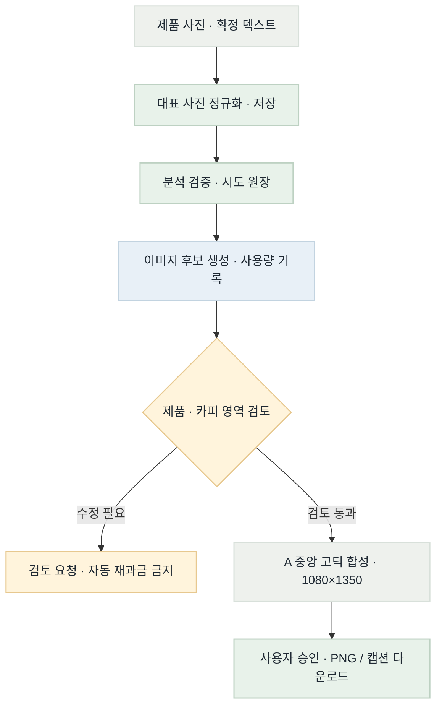
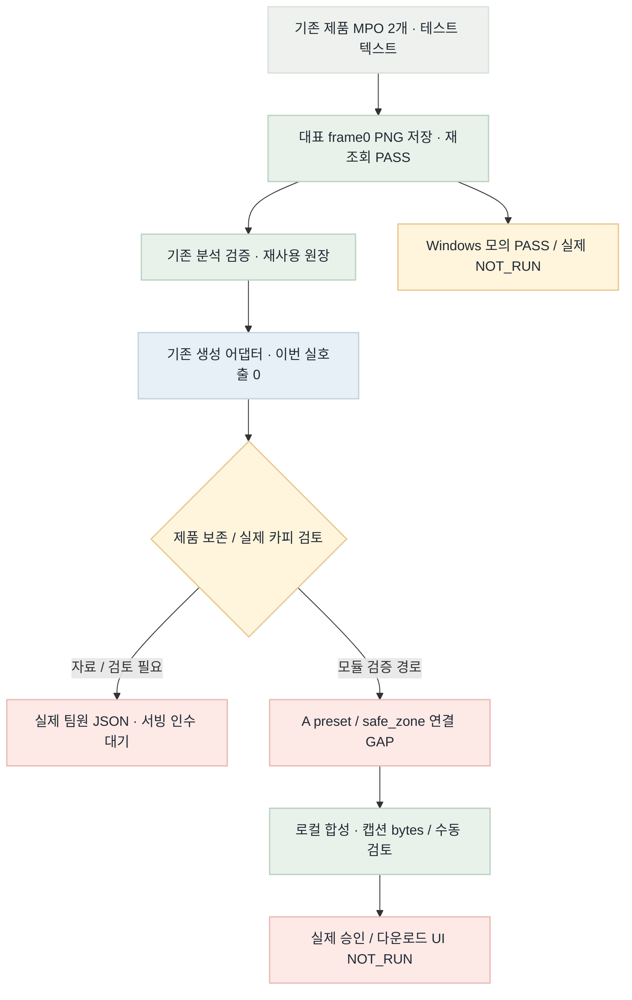

# 이미지 MVP 목표·현재 흐름 · 2026-10-30

상태: GAP / PARTIAL · R1 종료 기준. 미실행 인수를 구현 완료와 구분한다.

## Target Flow

## Current Implementation Flow

## Color Semantics

초록: 검증된 정상 제어 · 파랑: 외부 모델 경로 · 주황: 수동 검토 / 제한 · 빨강: 미완료 / 차단 · 회색: 결정 / 템플릿

## Target vs Current Gap

| 영역 | 상태 | 근거 / 차이 | 다음 조치 |
|---|---|---|---|
| MPO 입력 | PASS | 실제 제품 사진 2개 및 Linux 저장 검증 | 현재 완료 |
| Windows 저장 | PARTIAL | 디렉터리 sync만 분기; 실제 Windows 런타임 없음 | 실환경 파일 저장·재조회·권한 실패 확인 |
| A 템플릿 / safe_zone | GAP | 기존 합성은 있음; A 설정 연결 필요 | R2 구현·오프라인 검증 |
| 제품 원형 보존 | REVIEW_REQUIRED | API 성공만으로 합격 불가; 원본 대비 검토 필요 | 원본·실제 결과를 같은 기준으로 비교 |
| 원장 / 재시도 / 전달 | AUDIT_PENDING | 기존 기능을 먼저 확인; 실제 서빙/UI 인수는 별도 | R3 오프라인 증거와 담당 경계 기록 |
| HEIC / 디자인 자동화 | DEFERRED | 지원 범위 확정 및 후속 고도화 | MVP 필수로 자동 확대하지 않음 |

## Done / Not Done Priority

| 항목 | 상태 | 점수 | 산식 | 이유 / 다음 조치 |
|---|---|---|---|---|
| R1 입력·저장 | DONE | 10 | 4+3+2+2−1 | 모듈 전달 완료, Windows 실환경 별도 |
| R2 A 연결 | NEXT | 8 | 3+3+2+2−2 | 제품 침범 방지·실제 카피 가독성 |
| R3 기존 원장·전달 검증 | PENDING | 7 | 2+3+2+2−2 | 중복 구현 없이 기존 계약 검증 |
| 실제 Windows / 서빙 인수 | NOT_RUN | — | 환경·자료 의존 | 모의 검증으로 완료 표시하지 않음 |

## Scoring Criteria

점수 = 상류 영향(0–4) + 연결 기여(0–3) + 안전성(0–2) + 검증 가능성(0–2) − 변경 위험(0–2).
자료·환경이 없는 항목은 점수만으로 실행 가능하다고 간주하지 않는다.

## Validation

- R1 코드: b9d00152de352499ce7773ac398fe8efb5408e8e (feat/image-generation 원격 일치).
- 전체 이미지 회귀 318 PASS, 실제 MPO 2개 PASS, 동일 assets.py Linux 저장 smoke 10 PASS.
- 실제 Windows NOT_RUN. 실제 팀원 입력 JSON/서빙 승인·다운로드 UI 인수 NOT_RUN.
- 새 이미지 API 호출 0. 이 페이지의 시각 검증은 제품 UI 인수 증거가 아니다.
- CI: 팀 브랜치 workflow 없음. CD: NOT_APPLICABLE(라이브러리 전달).
- 근거: [R1 검증](../../test/image-mvp-relay-20261030-r1.md), [릴레이 폼](../../work/image-mvp-relay-20261030.md), [공유 TODO](../../../docs/imageTodo.md).

- 렌더 명령: mmdc -i SOURCE.mmd -o OUTPUT.png -b transparent --scale 2.
- 브라우저 결과는 fivecircles/test/playwright-screenshots/image-mvp-relay-20261030-r1.json 및 .png에 기록한다.

- 실제 브라우저 렌더: PASS. TaskSpace23 / PNG2개 naturalWidth·Height >0 / 필수 제목7개 표시.
- [JSON receipt](../../test/playwright-screenshots/image-mvp-relay-20261030-r1.json)
- [흐름 screenshot](../../test/playwright-screenshots/image-mvp-relay-20261030-r1.png) · [표 screenshot](../../test/playwright-screenshots/image-mvp-relay-20261030-r1-tables.png).
