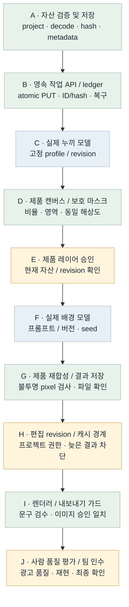
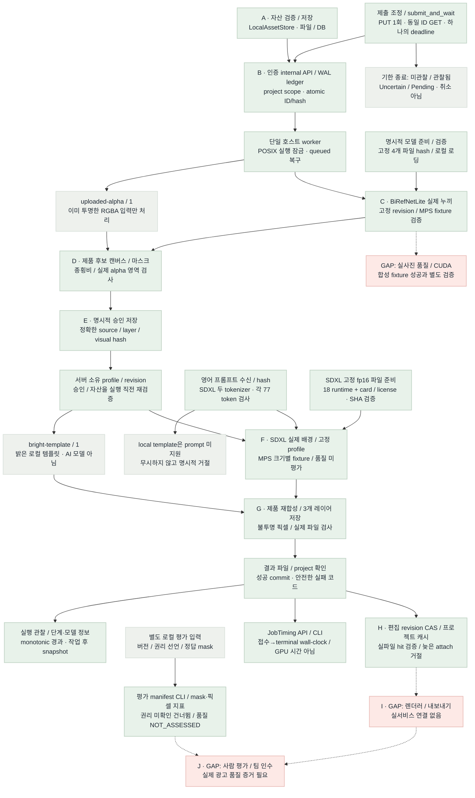

# 이미지 런타임 흐름 비교 · B9

2026-10-22 · 대상: plan/models · 배치 B9 작업별 실행 관찰·로컬 반복 측정

**Flow diagram verification: GAP/PARTIAL.** B9은 작업 ID와 연결한 단계·환경·작업 후 메모리 관찰을 저장한다. 전체 624 tests와 실제 MPS 6 jobs(누끼1·배경5)를 검증했고 동일512 입력/seed 두 번의 출력 hash가 같았다. 크기별 꽃 표현 편차와 제품 잔상이 남아 광고 품질은 미평가다. 단계 경과는 순수 GPU 시간이 아니며 메모리 snapshot은 peak가 아니다. 실사진·CUDA·렌더러·팀 인수는 별도다.

확정 서비스 MVP의 최신 목표와 현재 차이는 [SSOT 대조](../../../docs/ssotAlignment.md), 실행 체크는 [이미지 TODO](../../../docs/imageTodo.md)에 있다. 아래 도식은 B9 이미지 엔진 연결 범위이며 전체 SSOT 서비스 구현 완료를 뜻하지 않는다. 새 SSOT 문서 대조는 2026-10-22 별도 요청으로 작성했다. 후속 코드 릴레이는 최종 HTML 검증 BLOCKED 상태에서 시작하지 않는다.

## Target Flow

의도한 최종 흐름이다. 파란 모델 노드는 계획이며 현재 모델 실행 증거가 아니다.

[Mermaid 원본](image-runtime-target-flow.mmd)

## Current Implementation Flow

실선은 현재 실행 가능한 로컬 연결, 점선은 미연결 경로다. 회색 `uploaded-alpha`와 `bright-template`는 실제 누끼·배경 AI 모델이 아니다. 승인 레코드는 인증된 호스트의 확인 전달을 저장하며 사람 신원·최종 품질을 인증하지 않는다.

[Mermaid 원본](image-runtime-current-flow.mmd)

## Target vs Current Gap

| 노드 / 연결 | 상태 | 확인한 차이 | 다음 근거 / 작업 |
| --- | --- | --- | --- |
| A | MATCHED (모듈) | 파일 decode/정규화/hash/프로젝트 경계와 저장 구현. 최종 사용자 로그인은 별도. | assets.py / 자산 테스트 |
| A → B / B | MATCHED (로컬 서버) | Bearer→project 매핑, atomic PUT, 동일 ID/hash 재사용, WAL ledger와 조회 API. | inference_api.py / job_ledger.py |
| 클라이언트 → B | MATCHED (로컬 TCP 검증) | submit_and_wait는 하나의 monotonic deadline·PUT 1회·동일 ID GET으로 조정. GET 404를 미접수 증거로 삼지 않고, 유효 job 미관찰은 SubmissionUncertain, 관찰 후 미완료는 JobStillPending. 자동 재제출·새 ID·취소 없음. | gateway / CLI / 신규 84 unit + 4 실제 TCP 테스트 |
| B → worker | MATCHED (로컬 실행 기반) | POSIX 잠금, DB queued 검색, owner 검증, 실제 파일 확인 후 success. 단일 호스트 범위. | worker·loopback·프로세스 복구 테스트 |
| 모델 준비 → C / F | MATCHED (실제 파일 검증) | BiRefNet 4개와 SDXL 18개 fp16 런타임+카드/라이선스의 크기·SHA 검증. 명시 prepare만 다운로드하고 API 다운로드·원격 코드·장치 자동 대체 없음. | 실제 verify / 고정 model manifest |
| worker → C / C | PARTIAL (실제 MPS 실행) | BiRefNetLite가 실제 MPS에서 합성 병 fixture를 처리. 원본 RGB 유지, alpha 0..255, RGBA·마스크 저장과 수동 확인 경고. 실사진 품질·CUDA는 별도. | 실제 TCP CLI prepare / 339 tests / B6 실행 기록 |
| C → D / D | MATCHED (로컬 실행) | 실제 누끼 결과를 후보 캔버스·마스크로 준비하고 approved=false로 저장. 사람 확인·품질 통과는 별도. | 실제 MPS job → prepare API → 후보 파일 |
| D → E / E | MATCHED (저장·검증 범위) | 처음에는 미승인. literal true와 candidate hash를 확인하고 project/실파일/마스크/영역을 검증. 사람 신원·품질 승인은 보증하지 않음. | ProductApprovalStore / 승인 API |
| E → profile → template → G | MATCHED (로컬 템플릿 경로) | 고정 ID/revision/style/layout/크기만 허용. 승인·자산을 실행 직전 확인하고 3개 레이어를 저장. 실제 AI 모델 대체 증거는 아님. | LocalTemplateProcessor / runtime / CLI |
| 프롬프트 수신 → F | MATCHED (고정 SDXL 경로) | ImagePrompt 필수, positive/negative를 두 CLIP tokenizer로 각 77 이하 확인. 특수 token 포함, 무음 절단 없음. 기존 None hash 호환·template prompt 거절은 유지. | SDXL adapter / tokenizer 경계 회귀 |
| E → F / F | PARTIAL (실제 MPS 크기별 실행) | 승인·파일·geometry 재검증, 고정 SDXL profile/seed. 512 두 번·768·1024·512×768 배경5건 성공. 꽃 표현·잔상은 크기별 편차. | B9 receipt / 기술 실패0건·품질 미평가 |
| F → G / G | MATCHED (관찰한 배경5건 기술 검증) | 크기별 Safe Zone 중립색·승인 RGBA 재합성·불투명 픽셀·파일 hash 확인. 원출력 전부0·NaN/Inf·형상/범위 거절과 안전/품질 경고 유지. | 배경5건 mismatch 0 / Safe Zone exact / 512 반복 hash 일치 |
| G → H / H | MATCHED (로컬 API/DB/CLI) | SQLite CAS로 현재 selection을 갱신. 성공 job의 입력 hash/project/실파일을 확인한 뒤 attach. 문구 revision만 바뀌면 같은 image key의 결과 재사용. 늦은 revision은 거절하며 자동 생성하지 않음. | image_edits.py / API·CLI·201 tests PASS |
| H → I / I | GAP | 렌더러·내보내기 정책과 현재 문구 검수/이미지 품질/레이아웃 대조가 미연결. | 서비스·렌더러 공동 검증 |
| 별도 파일 → 평가 도구 | MATCHED (로컬 도구) | 권리 선언·dataset/version·dev/holdout을 수신하고 실제 파일 hash·불투명 픽셀·mask IoU·경계를 측정. 권리 미확인은 건너뛰고 정답이 없으면 None. 실제 평가셋·품질 승인은 별도. | evaluation.py / evaluation_metrics.py / CLI |
| ledger → timing | MATCHED (로컬 API/CLI) | terminal 작업의 접수→종료 wall-clock 경과를 기록. 대기·처리·저장을 포함하며 GPU 연산 시간·VRAM·비용은 아님. queued/running·시계 역행은 None. | JobLedger.timing / 인증 API / get-timing |
| worker / adapter → execution | MATCHED (로컬 관찰 범위) | 한정한 단계·모델 revision·환경·동기화·작업 후 snapshot을 job에 연결. terminal과 같은 transaction으로 저장하며 미기록은 NOT_RECORDED/null. 단계는 중첩 가능하며 peak 메모리가 아님. | 624 tests / 실제 MPS 6 jobs / get-execution CLI / source hash 일치 |
| I → J / J | GAP | 사람 품질 평가·팀원 재현·최종 인수 미실행. 측정 도구의 quality_approval은 NOT_ASSESSED이며 점수만으로 합격하지 않음. | 권리 확보 평가셋·합의 기준·사람 판정·팀 인수 |

## Done / Not Done Priority

| 순서 | 작업 | 상태 | 연결 점수 | 선정 이유 | 다음 동작 |
| --- | --- | --- | --- | --- | --- |
| 1 | B10 · SSOT 대조문서·실행 TODO 정리 | 문서 작성 완료 / 구현 미착수 | 사용자 지정 우선 | 기준 문서와 현재 구현·검증·남은 실행 항목을 일치시킴 | SSOT-01~12 대조·TODO 완료. 실제 기능/팀 인수는 미완료 |
| 2 | 실패 뒤 다음 작업 복구·부분 결과 자산 처리 | 미완료 / 로컬 착수 가능 | 3 + 2 + 2 + 2 − 1 = 8 | 같은 worker의 OOM/저장 실패 이후 처리와 자산 게시 경계를 확인 | 실패 주입→다음 정상 job·부분 자산 보존/정리 계약. 실제 GPU 고갈과 구분 |
| 3 | 실사진 품질 / GCP CUDA / 렌더러·팀 인수 | GAP / 공동 준비 필요 | 2 + 2 + 1 + 1 − 2 = 4 | 제품 유형·품질 기준·실서비스 결과 확인 | 권리 확보 데이터·환경·담당과 병행 |
| 완료 | B9 · 실행 관찰·로컬 반복 측정 | MATCHED (관찰한 로컬 범위) | 선정 대상 제외 (당시 6점) | 단계·모델·입력 hash와 실제 실행 연결 | 624 tests·6 MPS jobs·동일512 두 번 hash 일치 / peak·품질 제외 |
| 완료 | B8 · 동일 job ID 제출 조회·조정 | MATCHED (로컬 HTTP 조정 범위) | 선정 대상 제외 (당시 9점) | 상류 응답 유실의 중복 생성·잘못된 상태 판단 방지 | 521 tests·실제 TCP commit 후 응답 유실·PUT/processor 각 1회 |
| 완료 | B7 · SDXL fp16 / inpaint / prompt guard | MATCHED (512 fixture 기술 범위) | 선정 대상 제외 | 실제 배경 경로와 승인 제품·텍스트 여백 연결 | 433 tests·실제 MPS·wheel PASS / 품질 미평가 |
| 완료 | B6 · 고정 실누끼 / MPS / 모델 저장 | MATCHED (합성 fixture 범위) | 선정 대상 제외 | 고정 파일부터 실제 누끼·미승인 후보까지 연결 | 339 tests + 실제 MPS/TCP PASS |
| 완료 | B5 · 평가 manifest / 지표 / timing | MATCHED (로컬 도구) | 선정 대상 제외 | UNKNOWN·측정값·사람 판정 구분 | 280 tests + 실제 CLI PASS |
| 완료 | B1–B4 · 자산 / job / 승인 / revision·cache | MATCHED (로컬 범위) | 선정 대상 제외 | 파일·DB·HTTP·복구·현재 상태 경계 | 기존 검증 기록 유지 |

## Scoring Criteria

연결 점수 = upstream_weight(0–4) + connection_value(0–3) + safety_value(0–2) + validation_value(0–2) + risk_penalty(0∼−3). 같은 점수면 상위 노드, 더 작은 검증 가능한 변경을 먼저 선택한다. 모델/환경/합의가 필요한 항목은 점수만으로 완료하지 않는다.

다음 최우선 배치는 사용자 명시 요청인 **B10 SSOT 대조문서·실행 TODO 정리**다. SSOT는 다음 배치에서 읽고 대조하므로 현재 합의·정리가 끝났다고 표시하지 않는다. 점수 기반 후속 후보는 **실패 뒤 같은 worker의 다음 작업 복구와 부분 결과 자산 처리, 8점**이다. 현재 OOM 시험은 해당 job의 안전한 실패를 확인하지만 후속 정상 job까지의 복구와 여러 자산 저장의 중간 실패 처리는 추가 근거가 필요하다. job 전용 staging·게시/보존 경계를 먼저 정하고, 이미 게시됐거나 commit 결과가 불확실한 자산을 무조건 삭제하지 않는다. 실패 주입을 실제 GPU 메모리 고갈로 표시하지 않는다. 평가 report 비교 CLI는 향후 편의 후보이며 실제 평가셋이 없는 현재 필수 개발로 추가하지 않는다. 실사진 품질·CUDA·렌더러·팀 인수는 공동 준비 대상으로 유지한다.

## Color Semantics

| 색상 | 의미 |
| --- | --- |
| green | 서버 소유 정상 제어 / 구현·로컬 검증 모듈 |
| blue | 외부·GPU 모델 실행 경로 (목표 그림의 계획) |
| amber | 승인·revision·민감 입력 또는 부분 구현 |
| red | 미연결·미검증 GAP |
| gray | 명시적 로컬 template / 기존 alpha 입력 / 보조 제어 |

## Validation

- 이전 배치: [B1](../../test/relay-b1.md)–[B8](../../test/relay-b8.md) 근거 유지.
- B9 root 회귀: **624 tests PASS(36.32s, -W error)**. pip check·wheel·격리 lazy import PASS. [B9 기록](../../test/relay-b9.md).
- 실제 MPS 합성 fixture: 누끼1+배경5 모두 성공(기술 실패0/6). 같은512 입력/seed 두 job은 요청 hash와 3개 출력 hash가 같다. 다른 장치/버전 재현이나 품질 합격을 뜻하지 않는다.
- worker 경과: 누끼 cold9.102s, 배경512 cold47.170s/warm28.488s, 768 warm57.418s, 1024 warm104.426s, 512×768 warm50.855s. 모델 로딩·전처리·inference·합성·저장·검증과 queue를 구분해 기록했다. inference에 일부 preprocess가 중첩돼 단계값을 단순 합산하지 않는다.
- get-execution CLI·모델 재사용·장치 동기화·환경 관찰 PASS. receipt의 source_sha256 6개가 현재 코드와 일치한다. 실제 이미지/receipt는 Git 제외 경로에만 보관한다.
- 최고 관찰 MPS driver snapshot은 19,876,773,888 bytes다. 작업 후 process snapshot의 최댓값이며 실행 peak·요청별 증가량·CUDA VRAM·비용이 아니다. 기록이 없으면 NOT_RECORDED/null이다.
- 배경5건의 opaque mismatch0·Safe Zone exact neutral·결과 파일 hash를 확인했다. root 시각 확인: 512는 꽃 표현이 부족했다. 768은 오른쪽 큰 꽃이 보였지만 turquoise cap 연장과 제품 주변 잔상이 남았다. 1024는 꽃이 보이지 않았고 검은 cap 옆 잔상·바닥 반사가 있었다. 512×768은 오른쪽 가장자리 꽃·분홍 원형 장식이 있었지만 제품 외곽·뚜껑·반사 잔상이 남았다. 기술 실행 PASS이며 광고 품질·안전은 NOT_ASSESSED다.
- 테스트 fixture 수리: worker 시작 시 recovery의 시각 조회를 누락해 iterator가 고갈됐던 시험 fixture에 시각을 추가했다. 제품 코드 결함으로 기록하지 않는다. 최종624 tests PASS.
- Mermaid: 기존 목표 PNG 재사용, B9 현재 PNG 갱신(1568×2628)·직접 시각 검사 완료. 수정된 HTML의 최종 브라우저 검증: **BLOCKED**. Chrome CUA 정책이 `file:` 프로토콜을 금지했으며 우회하지 않았다.
- 수정 전 Task Space 145에서 PNG2개 decode·제목7개·범례5개·GAP18행·우선순위9행·1492px 가로 넘침 없음을 확인했다. 종료 뒤 헤더의 `r4` 오기를 `624`로 바로잡고 현재 도식의 중복 보조선을 정리했으므로, 이전 검증을 최종판 PASS로 재사용하지 않는다.
- 스크린샷: [B9 수정 전 화면 — 최종판 증거 아님](../../test/playwright-screenshots/image-runtime-flow-b9.png) · [보존한 B8 보고서](../../test/playwright-screenshots/image-runtime-flow-b8.png).
- 전체 제품 흐름 판정: GAP/PARTIAL. 실제 사진·CUDA/GCP·렌더러·사람/팀 인수는 미완료다.
