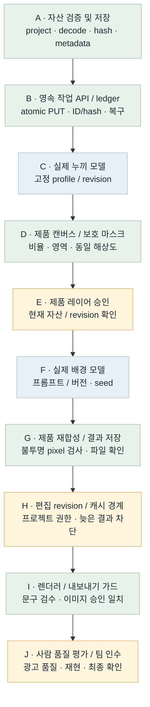
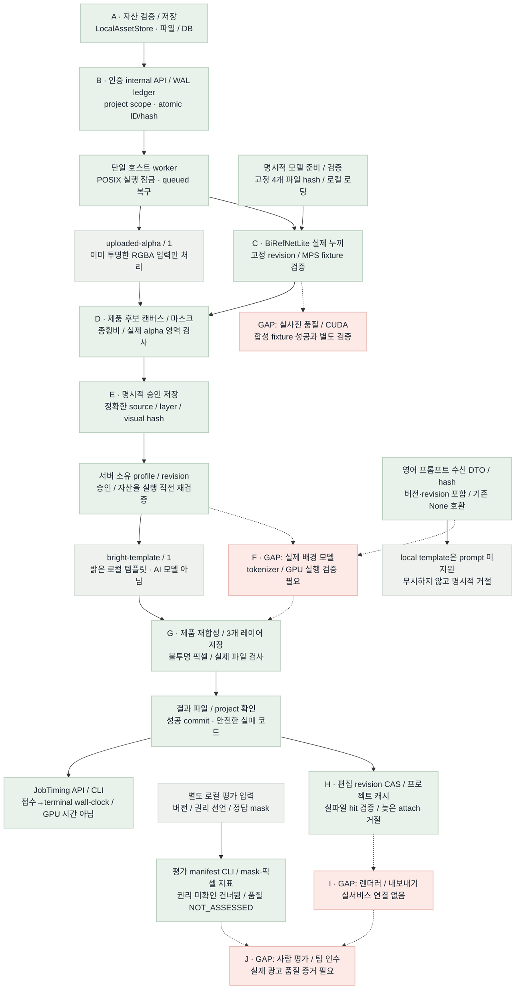

# 이미지 런타임 흐름 비교 · B6

2026-10-22 · 대상: plan/models · 배치 B6 고정 BiRefNetLite / 로컬 MPS 실누끼

**Flow diagram verification: GAP/PARTIAL.** 고정 BiRefNetLite를 실제 MPS에서 실행하고 TCP CLI로 합성 병 512×512의 RGBA·마스크와 미승인 후보를 저장했다. 전체 339 tests와 실제 모델 실행을 각각 검증했다. 실사진 품질·실제 배경 모델·CUDA/GCP·렌더러·팀 인수는 미완료다.

## Target Flow

의도한 최종 흐름이다. 파란 모델 노드는 계획이며 현재 모델 실행 증거가 아니다.

[Mermaid 원본](image-runtime-target-flow.mmd)

## Current Implementation Flow

실선은 현재 실행 가능한 로컬 연결, 점선은 미연결 경로다. 회색 `uploaded-alpha`와 `bright-template`는 실제 누끼·배경 AI 모델이 아니다. 승인 레코드는 인증된 호스트의 확인 전달을 저장하며 사람 신원·최종 품질을 인증하지 않는다.

[Mermaid 원본](image-runtime-current-flow.mmd)

## Target vs Current Gap

| 노드 / 연결 | 상태 | 확인한 차이 | 다음 근거 / 작업 |
| --- | --- | --- | --- |
| A | MATCHED (모듈) | 파일 decode/정규화/hash/프로젝트 경계와 저장 구현. 최종 사용자 로그인은 별도. | assets.py / 자산 테스트 |
| A → B / B | MATCHED (로컬 서버) | Bearer→project 매핑, atomic PUT, 동일 ID/hash 재사용, WAL ledger와 조회 API. | inference_api.py / job_ledger.py |
| B → worker | MATCHED (로컬 실행 기반) | POSIX 잠금, DB queued 검색, owner 검증, 실제 파일 확인 후 success. 단일 호스트 범위. | worker·loopback·프로세스 복구 테스트 |
| 모델 준비 → C | MATCHED (고정 파일) | 별도 prepare만 다운로드. 검토한 source/config/가중치 4개 hash·크기를 검사하고 로컬 safetensors만 로딩. handler.py 제외, 장치 자동 대체 없음. | model_store.py / 실제 파일 verify / 고정 revision |
| worker → C / C | PARTIAL (실제 MPS 실행) | BiRefNetLite가 실제 MPS에서 합성 병 fixture를 처리. 원본 RGB 유지, alpha 0..255, RGBA·마스크 저장과 수동 확인 경고. 실사진 품질·CUDA는 별도. | 실제 TCP CLI prepare / 339 tests / B6 실행 기록 |
| C → D / D | MATCHED (로컬 실행) | 실제 누끼 결과를 후보 캔버스·마스크로 준비하고 approved=false로 저장. 사람 확인·품질 통과는 별도. | 실제 MPS job → prepare API → 후보 파일 |
| D → E / E | MATCHED (저장·검증 범위) | 처음에는 미승인. literal true와 candidate hash를 확인하고 project/실파일/마스크/영역을 검증. 사람 신원·품질 승인은 보증하지 않음. | ProductApprovalStore / 승인 API |
| E → profile → template → G | MATCHED (로컬 템플릿 경로) | 고정 ID/revision/style/layout/크기만 허용. 승인·자산을 실행 직전 확인하고 3개 레이어를 저장. 실제 AI 모델 대체 증거는 아님. | LocalTemplateProcessor / runtime / CLI |
| 프롬프트 수신 → F | PARTIAL | ImagePrompt의 텍스트·버전·revision을 수신/hash에 포함하고 None은 기존 body/hash를 유지. 문자 수 한도이며 실제 tokenizer/GPU 소비는 미검증. local template은 prompt를 거절한다. | test_image_prompt.py / 실제 모델 adapter 필요 |
| E → F / F | GAP | 실제 배경 AI 모델은 미연결. 프롬프트 생성은 텍스트 담당 범위. | GPU 인증·고정 모델·tokenizer·품질 검증 |
| F → G / G | PARTIAL / MATCHED (로컬 경로) | 로컬 template부터 승인 RGBA 재합성·불투명 픽셀·파일 검증까지 연결. 실모델 결과와 광고 품질은 미검증. | 3개 AssetRef / processor·runtime 테스트 |
| G → H / H | MATCHED (로컬 API/DB/CLI) | SQLite CAS로 현재 selection을 갱신. 성공 job의 입력 hash/project/실파일을 확인한 뒤 attach. 문구 revision만 바뀌면 같은 image key의 결과 재사용. 늦은 revision은 거절하며 자동 생성하지 않음. | image_edits.py / API·CLI·201 tests PASS |
| H → I / I | GAP | 렌더러·내보내기 정책과 현재 문구 검수/이미지 품질/레이아웃 대조가 미연결. | 서비스·렌더러 공동 검증 |
| 별도 파일 → 평가 도구 | MATCHED (로컬 도구) | 권리 선언·dataset/version·dev/holdout을 수신하고 실제 파일 hash·불투명 픽셀·mask IoU·경계를 측정. 권리 미확인은 건너뛰고 정답이 없으면 None. 실제 평가셋·품질 승인은 별도. | evaluation.py / evaluation_metrics.py / CLI |
| ledger → timing | MATCHED (로컬 API/CLI) | terminal 작업의 접수→종료 wall-clock 경과를 기록. 대기·처리·저장을 포함하며 GPU 연산 시간·VRAM·비용은 아님. queued/running·시계 역행은 None. | JobLedger.timing / 인증 API / get-timing |
| I → J / J | GAP | 사람 품질 평가·팀원 재현·최종 인수 미실행. 측정 도구의 quality_approval은 NOT_ASSESSED이며 점수만으로 합격하지 않음. | 권리 확보 평가셋·합의 기준·사람 판정·팀 인수 |

## Done / Not Done Priority

| 순서 | 작업 | 상태 | 연결 점수 | 선정 이유 | 다음 동작 |
| --- | --- | --- | --- | --- | --- |
| 1 | B7 · 로컬 실제 배경 모델 | GAP / 다음 후보 | 3 + 3 + 2 + 2 − 2 = 8 | 실누끼 다음의 실제 배경 생성 경로 연결 | B6 게시 후 SDXL 고정 revision·사용 조건·파일·메모리·adapter 계약 |
| 2 | 실사진 평가셋 / 품질 기준 / 사람 판정 | GAP / 데이터·합의 필요 | 2 + 2 + 1 + 1 − 2 = 4 | 합성 fixture 외 실제 제품의 경계·라벨·투명 품질 확인 | 권리 확보 제품·정답/판정자·기준 준비 |
| 3 | GCP CUDA 이전 / 렌더러 / 팀 인수 | GAP / 별도 검증 | 1 + 1 + 1 + 1 − 2 = 2 | 로컬 이후 실제 환경과 최종 광고 연결 | 로컬 모델 경로 검증 후 대상 환경·공동 인수 |
| 완료 | B6 · 고정 실누끼 / MPS / 모델 저장 | MATCHED (합성 fixture 범위) | 선정 대상 제외 | 고정 파일에서 실제 forward·자산·미승인 후보까지 연결 | 339 tests + 실제 TCP MPS CLI PASS |
| 완료 | B5 · 평가 manifest / 지표 / timing | MATCHED (로컬 도구) | 선정 대상 제외 | UNKNOWN·측정값·사람 판정을 구분 | 280 tests + 실제 CLI + wheel PASS |
| 완료 | B4 · 프롬프트 / revision / 캐시 | MATCHED (로컬 범위) | 선정 대상 제외 | 입력 버전·늦은 결과·교차 재사용 차단 | 201 tests + 실제 TCP CLI PASS |
| 완료 | B1 / B2 / B3 · 자산 / worker / 승인 / template | MATCHED (로컬 범위) | 선정 대상 제외 | 파일·DB·HTTP·복구·명시적 승인 | 이전 검증 기록 유지 |

## Scoring Criteria

연결 점수 = upstream_weight(0–4) + connection_value(0–3) + safety_value(0–2) + validation_value(0–2) + risk_penalty(0∼−3). 같은 점수면 상위 노드, 더 작은 검증 가능한 변경을 먼저 선택한다. 모델/환경/합의가 필요한 항목은 점수만으로 완료하지 않는다.

다음 선택: **B7 로컬 실제 배경 모델, 8점**. B6 게시 뒤 SDXL Base의 사용 조건·고정 revision·필요 파일·메모리와 tokenizer를 확인하고 adapter 계약부터 작성한다. 사용자 방향은 로컬 선검증 후 GCP 이전이다. B6에서 SDXL을 설치·실행한 것은 아니며, 현재 배경은 bright-template이다. 실사진 품질·CUDA·렌더러·팀 인수는 별도 근거가 필요하다.

## Color Semantics

| 색상 | 의미 |
| --- | --- |
| green | 서버 소유 정상 제어 / 구현·로컬 검증 모듈 |
| blue | 외부·GPU 모델 실행 경로 (목표 그림의 계획) |
| amber | 승인·revision·민감 입력 또는 부분 구현 |
| red | 미연결·미검증 GAP |
| gray | 명시적 로컬 template / 기존 alpha 입력 / 보조 제어 |

## Validation

- 이전 배치: [B1](../../test/relay-b1.md), [B2](../../test/relay-b2.md), [B3](../../test/relay-b3.md), [B4](../../test/relay-b4.md), [B5](../../test/relay-b5.md) 근거 유지.
- B6 전체 회귀(root): **339 tests PASS(4.30s, -W error)**. 모델 저장의 HTTPException 오류 정제 회귀를 포함한다. optional backend 단위 검증과 실제 MPS 실행은 별도 근거다. [B6 기록](../../test/relay-b6.md).
- 실제 모델: 고정 4개 파일 검증 후 HF_HUB_OFFLINE=1·telemetry off, 실제 TCP runtime + 별도 CLI prepare로 MPS forward. 합성 병 512×512의 RGB 유지·alpha 0..255·RGBA/마스크 저장·approved=false·수동 경고를 확인했다.
- 첫 job ledger_elapsed_ms=6897.11, CLI wall-clock=7.587s. 모델 로딩·대기·파일 처리를 포함하며 순수 GPU 연산 시간이나 반복 성능 수치가 아니다.
- 같은 job 파일 hash를 대조한 dev fixture 1건: IoU 0.9692321320, boundary F1 0.7558205565(tolerance 2px), opaque_preserved=true. 품질은 NOT_ASSESSED이며 실사진 평가셋 통과가 아니다. wheel build PASS.
- 합성 fixture의 픽셀: opaque 978 / transparent 194411 / partial 66755. 실사진 경계·라벨·유리 품질이나 사람 인수를 뜻하지 않는다. 실제 실행에 timm의 torch.jit FutureWarning이 있었고 실패는 없었다.
- 실행 환경: Python 3.11.15, torch 2.14.1, torchvision 0.29.1, transformers 5.20.2, timm 1.0.30, kornia 0.8.3, einops 0.8.2, numpy 2.4.6, Apple M4 Max·64GB·MPS. pip check와 MPS tensor 확인 PASS.
- 실제 배경 모델·CUDA/GCP·실사진 품질·사람 인수: NOT_RUN/NOT_ASSESSED. 실제 모델 파일·fixture 결과 이미지는 Git 제외 로컬 저장소에만 보관한다.
- Mermaid: 기존 목표 PNG 재사용, B6 현재 PNG 갱신. HTML 브라우저 검증 **PASS** (Task Space 142): PNG 2개 decode(552×2540, 1568×2972), 제목 7개·범례 5개·GAP 16행·우선순위 7행, 문서/화면 폭 1492px로 가로 넘침 없음. 최종 339 tests와 실제 MPS 실행 근거를 반영한 스크린샷을 직접 확인했다.
- 스크린샷: [B6 보고서](../../test/playwright-screenshots/image-runtime-flow-b6.png) · [보존한 B5 보고서](../../test/playwright-screenshots/image-runtime-flow-b5.png).
- 전체 제품 흐름 판정: GAP/PARTIAL. 실제 누끼 한 번의 실행과 완성 서비스·광고 품질을 구분한다.
