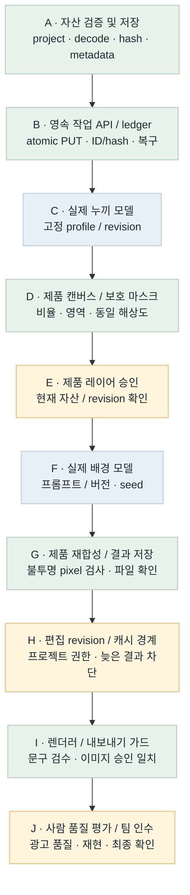
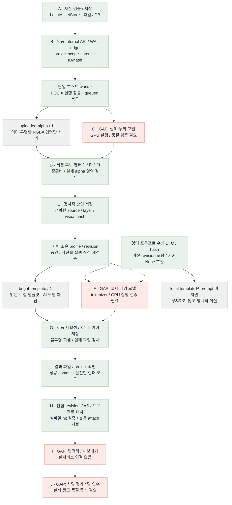

# 이미지 런타임 흐름 비교 · B4

2026-10-22 · 대상: plan/models · 배치 B4 프롬프트 수신 / 편집 revision / 프로젝트 캐시

**Flow diagram verification: GAP/PARTIAL.** 프롬프트 수신·기존 요청 hash 호환, 현재 이미지 선택의 revision CAS, 프로젝트별 성공 결과 재사용과 늦은 결과 차단을 추가했다. 전체 201 tests와 실제 TCP CLI 편집·재사용을 검증했다. 실제 누끼·배경 AI 모델·최종 사용자 로그인/UI·렌더러·사람 품질 인수는 남아 있다. 날짜는 마일스톤이다.

## Target Flow

의도한 최종 흐름이다. 파란 모델 노드는 계획이며 현재 모델 실행 증거가 아니다.

[Mermaid 원본](image-runtime-target-flow.mmd)

## Current Implementation Flow

실선은 현재 실행 가능한 로컬 연결, 점선은 미연결 경로다. 회색 `uploaded-alpha`와 `bright-template`는 실제 누끼·배경 AI 모델이 아니다. 승인 레코드는 인증된 호스트의 확인 전달을 저장하며 사람 신원·최종 품질을 인증하지 않는다.

[Mermaid 원본](image-runtime-current-flow.mmd)

## Target vs Current Gap

| 노드 / 연결 | 상태 | 확인한 차이 | 다음 근거 / 작업 |
| --- | --- | --- | --- |
| A | MATCHED (모듈) | 파일 decode/정규화/hash/프로젝트 경계와 저장 구현. 최종 사용자 로그인은 별도. | assets.py / 자산 테스트 |
| A → B / B | MATCHED (로컬 서버) | Bearer→project 매핑, atomic PUT, 동일 ID/hash 재사용, WAL ledger와 조회 API. | inference_api.py / job_ledger.py |
| B → worker | MATCHED (로컬 실행 기반) | POSIX 잠금, DB queued 검색, owner 검증, 실제 파일 확인 후 success. 단일 호스트 범위. | worker·loopback·프로세스 복구 테스트 |
| worker → C / C | GAP | 실제 누끼 모델과 GPU 품질 검증은 없음. uploaded-alpha/1은 이미 투명한 RGBA만 받으며 불투명 사진을 누끼 성공으로 처리하지 않음. | 모델 선택·접근·고정 환경·평가 조건 필요 |
| C → D / D | PARTIAL / MATCHED (로컬 입력) | 실모델 연결은 GAP. 기존 RGBA의 종횡비 유지 배치·캔버스·마스크 준비와 저장은 동작. | prepare_product_canvas / prepare API |
| D → E / E | MATCHED (저장·검증 범위) | 처음에는 미승인. literal true와 candidate hash를 확인하고 project/실파일/마스크/영역을 검증. 사람 신원·품질 승인은 보증하지 않음. | ProductApprovalStore / 승인 API |
| E → profile → template → G | MATCHED (로컬 템플릿 경로) | 고정 ID/revision/style/layout/크기만 허용. 승인·자산을 실행 직전 확인하고 3개 레이어를 저장. 실제 AI 모델 대체 증거는 아님. | LocalTemplateProcessor / runtime / CLI |
| 프롬프트 수신 → F | PARTIAL | ImagePrompt의 텍스트·버전·revision을 수신/hash에 포함하고 None은 기존 body/hash를 유지. 문자 수 한도이며 실제 tokenizer/GPU 소비는 미검증. local template은 prompt를 거절한다. | test_image_prompt.py / 실제 모델 adapter 필요 |
| E → F / F | GAP | 실제 배경 AI 모델은 미연결. 프롬프트 생성은 텍스트 담당 범위. | GPU 인증·고정 모델·tokenizer·품질 검증 |
| F → G / G | PARTIAL / MATCHED (로컬 경로) | 로컬 template부터 승인 RGBA 재합성·불투명 픽셀·파일 검증까지 연결. 실모델 결과와 광고 품질은 미검증. | 3개 AssetRef / processor·runtime 테스트 |
| G → H / H | MATCHED (로컬 API/DB/CLI) | SQLite CAS로 현재 selection을 갱신. 성공 job의 입력 hash/project/실파일을 확인한 뒤 attach. 문구 revision만 바뀌면 같은 image key의 결과 재사용. 늦은 revision은 거절하며 자동 생성하지 않음. | image_edits.py / API·CLI·201 tests PASS |
| H → I / I | GAP | 렌더러·내보내기 정책과 현재 문구 검수/이미지 품질/레이아웃 대조가 미연결. | 서비스·렌더러 공동 검증 |
| I → J / J | GAP | 사람 품질 평가·팀원 재현·최종 인수 미실행. | 권리 확보 평가셋과 팀 인수 증거 |

## Done / Not Done Priority

| 순서 | 작업 | 상태 | 연결 점수 | 선정 이유 | 다음 동작 |
| --- | --- | --- | --- | --- | --- |
| 1 | B5 후보 · 고정 평가 manifest / 증거 수집 | 미구현 | 2 + 2 + 1 + 2 − 1 = 6 | 평가셋 조건과 실제 결과를 재현 가능한 기록으로 연결 | B4 게시 후 착수 |
| 2 | 실제 누끼·배경 모델 검증 | GAP / 접근 필요 | 3 + 3 + 1 + 1 − 3 = 5 | GPU 인증·모델·사용 조건·평가셋이 필요 | 실행 조건 확보 후 |
| 3 | 렌더러·사람 품질 인수 | GAP | 1 + 1 + 1 + 1 − 2 = 2 | 다른 파트와 실제 출력·승인 확인 필요 | 서비스·평가셋 준비 후 |
| 완료 | B4 · 프롬프트 수신 / revision / 캐시 | MATCHED (범위 한정) | 현재 배치 | 입력 버전·오래된 결과·프로젝트 교차 재사용 차단 | 201 tests + TCP CLI PASS |
| 완료 | B3 · 승인 / profile / 로컬 실행 | MATCHED (범위 한정) | 선정 대상 제외 | 명시적 승인과 template 결과 파일 연결 | 148 tests + TCP CLI smoke PASS |
| 완료 | B1 / B2 · 자산 / 영속 job / worker | MATCHED (범위 한정) | 선정 대상 제외 | 파일/DB/HTTP/프로세스 복구 검증 | 기존 증거 유지 |

## Scoring Criteria

연결 점수 = upstream_weight(0–4) + connection_value(0–3) + safety_value(0–2) + validation_value(0–2) + risk_penalty(0∼−3). 같은 점수면 상위 노드, 더 작은 검증 가능한 변경을 먼저 선택한다. 모델/환경/합의가 필요한 항목은 점수만으로 완료하지 않는다.

다음 안전 후보: **B5 평가 manifest / 증거 수집 도구, 6점**. 원본 TODO 3-A/3-B의 고정 입력·권리 기록·기대 마스크·제품 유형·검사 결과를 묶어 실제 GPU 평가 준비를 돕는다. 기준이나 사람 판정이 없으면 NOT_ASSESSED로 남기며 모델 합격으로 표시하지 않는다. root가 B4 게시 후 다음 배치 범위로 선택했다. GPU/모델/평가 데이터/렌더러·팀 인수는 외부 조건이 필요하다.

## Color Semantics

| 색상 | 의미 |
| --- | --- |
| green | 서버 소유 정상 제어 / 구현·로컬 검증 모듈 |
| blue | 외부·GPU 모델 실행 경로 (목표 그림의 계획) |
| amber | 승인·revision·민감 입력 또는 부분 구현 |
| red | 미연결·미검증 GAP |
| gray | 명시적 로컬 template / 기존 alpha 입력 / 보조 제어 |

## Validation

- 이전 배치: [B1](../../test/relay-b1.md), [B2](../../test/relay-b2.md), [B3 148 tests + 실제 TCP CLI](../../test/relay-b3.md) 근거 유지.
- B4 제품 검증(root): **201 tests PASS(20.04s)**. 실제 TCP CLI prepare→approve→select revision1→render→attach→문구 수정 select revision2→get-edit에서 같은 job 재사용 PASS. [검증 기록](../../test/relay-b4.md).
- 코드 범위: ImagePrompt 수신·해시·기존 None 직렬화 호환, ImageEditStore selection CAS·project cache·현재 revision attach, API/CLI 연결. 최종 사용자 로그인·CampaignService·UI 인수는 별도.
- 실제 영어 프롬프트 생성·누끼/배경 AI 모델·GPU·tokenizer 한도·광고 품질: NOT_RUN. local template은 image_prompt를 명시적으로 거절한다.
- Mermaid: 기존 목표 PNG 재사용, B4 현재 PNG 갱신. HTML 브라우저 검증: **PASS** (Task Space 139). PNG 2개가 각각 552×2540, 1568×3316으로 decode됐고 제목 7개·범례 5개·GAP 13행·우선순위 6행을 확인했다. 문서/화면 폭은 모두 1492px이며 가로 넘침이 없다. 스크린샷을 직접 확인했다. 스크린샷은 최종 201 tests 결과를 문서에 반영하기 전에 촬영했다.
- 스크린샷: [B4 보고서](../../test/playwright-screenshots/image-runtime-flow-b4.png) · [보존한 B3 보고서](../../test/playwright-screenshots/image-runtime-flow-b3.png).
- 전체 제품 흐름 판정: GAP/PARTIAL. 문서·코드·로컬 회귀와 실제 모델 품질/팀 인수를 구분한다.
