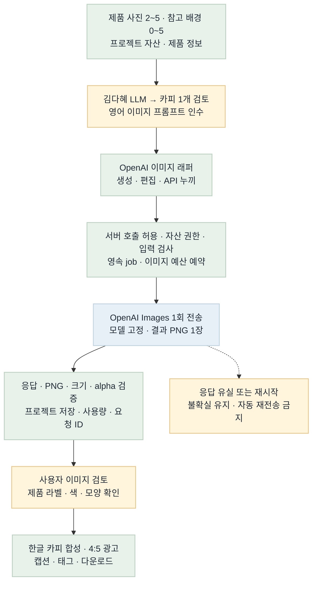
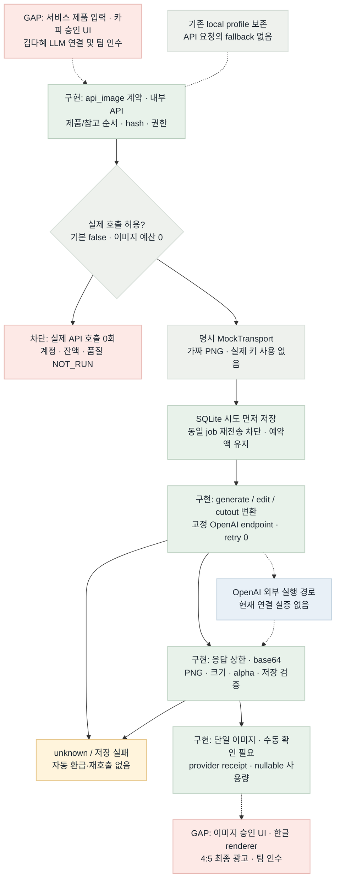

# 이미지 런타임 흐름 비교 · B10

2026-10-22 · plan/models · OpenAI 이미지 생성·편집·API 누끼 래퍼

**오프라인 래퍼 연결 PASS / 전체 서비스 GAP/PARTIAL.** 실제 API 호출은 사용자 지시로 금지했다. 과거 B9 로컬 모델 결과는 [역사 검증](../../test/relay-b9.md)에 보존하며 OpenAI 품질 근거로 쓰지 않는다.

## Target Flow

[원본](image-runtime-target-flow.mmd)

## Current Implementation Flow

실선은 모의 검증한 연결, 점선은 아직 실증하지 않은 외부/서비스 연결이다.

[원본](image-runtime-current-flow.mmd)

## Target vs Current Gap

| 노드/연결 | 상태 | 차이와 근거 |
| --- | --- | --- |
| 입력·카피 검토 → 래퍼 | GAP/PARTIAL | 내부 제품/배경 배열 계약은 구현. 서비스 입력 UI·김다혜 LLM·카피 검토 상태 인수는 별도. |
| 호출 가드 → 시도 예약 → 어댑터 | MATCHED (offline) | 기본OFF·예산0. 같은 job 1회 전송, 예약경합·응답유실·재시작 모의 검증. |
| OpenAI → 실제 품질 | NOT_RUN | 사용자 호출 금지. 계정권한·잔액·제품 보존·가격/지연은 확인하지 않음. |
| 응답 → 자산·receipt | MATCHED (offline) | 단일 PNG·크기·alpha·hash·권한 검증. 실패 시 불완전 결과 미게시·예약 유지. |
| 이미지 검토 → 한글 최종 광고 | GAP | 승인 UI·한글 renderer·4:5 내보내기·팀 인수는 래퍼 이후 작업. |
| 기존 3레이어 승인/cache | SEPARATE | 기존 로컬 계약 유지. 새 단일 PNG에 자동 적용하지 않음. |

## Done / Not Done Priority

| 후보 | 상태 | 점수 | 다음 판단 |
| --- | --- | --- | --- |
| 호출 차단·입력 계약 | DONE/offline | 4+3+2+2−1=10 | B10 구현·모의 회귀 통과 |
| 시도·예산·응답/저장 실패 | DONE/offline | 3+3+2+2−2=8 | B10 구현·경합/복구 회귀 통과 |
| 실제 계정·품질·비용 확인 | NOT_RUN | 3+3+1+0−3=4 | 다음 작업 후보. 사용자 실제 호출 금지로 실행하지 않음 |
| 서비스 검토·최종 renderer | GAP / 별도 담당 | 2+3+1+1−3=4 | 김다혜·API·UI/렌더러 인수 계약이 필요, 이번 하위 래퍼 밖 |

## Scoring Criteria

upstream 0–4 + connection 0–3 + safety 0–2 + validation 0–2 − risk 0–3. 점수가 있어도 사용자 호출 금지나 담당 범위를 넘지 않는다. 안전하게 남은 오프라인 래퍼 결함은 수정했고, 다음 주요 간격은 실호출 인수와 서비스 연결이다.

## Color Semantics

녹색=구현·검증 경로, 파랑=외부 모델 경로, 노랑=검토·불확실 상태, 빨강=금지·미연결, 회색=분기·mock·기존 보조 경로. 녹색은 실제 제공자 품질이나 최종 서비스 인수의 보증이 아니다.

## Validation

전체 `.venv/bin/python -m pytest -q -W error`: **806 passed in 51.05s**. 실제 OpenAI 요청·모델 목록·키 조회·로컬 모델 실행 0회. MockTransport만으로 정상/거절/잘못된 응답·응답 유실·타 프로젝트·예산 경쟁·저장 실패·재시작·후속 작업을 확인했다.

`python -m beauty_ai.openai_images_demo` 실행: actual_provider_calls=0, mock_provider_calls=3, quality_approval=NOT_ASSESSED. 이는 직접 그린 테스트 fixture이며 실제 AI 생성 결과가 아니다.

Mermaid CLI 11.12.0으로 두 PNG를 갱신하고 직접 열어 연결·문자·색상을 확인했다. HTML 이미지 참조·제목·표는 정적 검사한다. **최종 HTML의 브라우저 렌더 검증은 BLOCKED 상태**다. 이전 file 접근 자동승인 거절을 다른 브라우저·주소로 우회하지 않았고 과거 screenshot을 새 최종판 증거로 재사용하지 않는다. 코드 회귀 PASS와 브라우저 시각검증 BLOCKED를 구분한다.

패키지·설정·게시 근거는 [B10 검증](../../test/relay-b10.md), Git SHA/readback은 [게시 기록](../../work/integrate-log.md)에 남긴다. 운영 CD는 NOT_APPLICABLE: 호출이 비활성인 Python 참조 소스 전달이며 배포 요청·운영 대상이 없다.
