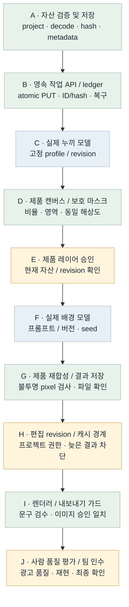
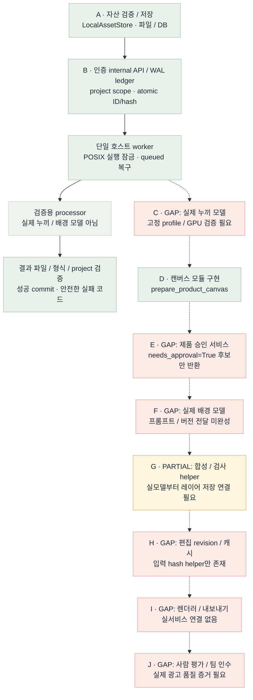

# 이미지 런타임 흐름 비교 · B2

2026-10-22 · 대상: plan/models · 배치 B2 영속 작업 API / 단일 호스트 worker

**Flow diagram verification: GAP/PARTIAL.** B1 자산·캔버스와 B2 인증 API·영속 ledger·단일 호스트 worker가 구현됐다. 실제 모델·승인·렌더러를 잇는 전체 목표 흐름은 아직 완성되지 않았다. 날짜는 마일스톤이며 구현 가능한 다음 작업을 기다리지 않는다.

[HTML 보고서](image-runtime-flow.html) · [구현 계약](../contract/image-runtime.md) · [작업 인덱스](../todolist.md)

## Target Flow

목표 그림의 정상 경로는 구현 상태가 아니라 의도한 아키텍처다.

[Mermaid 원본](image-runtime-target-flow.mmd)

## Current Implementation Flow

실선은 현재 실행 가능한 로컬 연결, 점선은 아직 없는 모델·서비스 연결이다. 개별 helper가 존재해도 점선 연결을 통합 완료로 표시하지 않는다.

[Mermaid 원본](image-runtime-current-flow.mmd)

## Target vs Current Gap

| 노드 / 연결 | 상태 | 확인한 차이 | 다음 근거 / 작업 |
| --- | --- | --- | --- |
| A | MATCHED (모듈) | 파일 decode/정규화/hash/프로젝트 경계와 저장 구현. 최종 사용자 로그인은 별도 범위. | assets.py / test_assets.py |
| A → B / B | MATCHED (로컬 서버) | 서버 소유 Bearer→project 매핑, 파일 검증 뒤 atomic PUT, 동일 ID/hash 재사용, WAL ledger와 조회 API 구현. | inference_api.py / job_ledger.py / API 테스트 |
| B → worker → 검증용 결과 | MATCHED (로컬 실행 기반) | 프로세스 간 POSIX 잠금, DB queued 검색, owner 검증, 결과 파일 확인 후 success. 테스트 processor이며 GPU 모델 품질 증거는 아님. | image_worker.py / worker·loopback 테스트 |
| worker → C / C | GAP | 실제 누끼 모델·고정 profile·GPU 실행 검증 미연결. 다중 VM 실행 조정은 지원 범위 밖. | 다음 B3: profile / runtime adapter |
| C → D / D | PARTIAL / MATCHED (모듈) | 실제 누끼 결과 연결은 GAP. 독립 RGBA 입력의 종횡비·캔버스·마스크 준비는 구현. | image_preparation.py / test_image_preparation.py |
| D → E / E | GAP | 제품 후보는 needs_approval=True. 승인 레코드·현재 revision guard는 없음. | 다음 B3: 명시적 승인 저장 / stale approval 차단 |
| E → F / F | GAP | 배경 모델과 영어 프롬프트/버전 전달·tokenizer 검증 미연결. | 팀 계약과 서버 profile adapter |
| F → G / G | PARTIAL | 합성·불투명 픽셀 검사·저장 helper와 worker 결과 검증 존재. 실제 모델부터 레이어 생성까지 연결 필요. | image_integrity.py / image_worker.py / assets.py |
| G → H / H | GAP | content_hash는 있으나 편집 snapshot CAS·프로젝트 캐시/늦은 결과 연결 없음. | DB revision guard와 재사용 정책 |
| H → I / I | GAP | 렌더러·내보내기 정책이 실서비스로 연결되지 않음. | 현재 문구 검수/이미지 승인/레이아웃 대조 |
| I → J / J | GAP | 사람 품질 평가·팀원 재현·인수 미실행. | 권리 확보 평가셋과 팀 인수 증거 |

## Done / Not Done Priority

| 순서 | 작업 | 상태 | 연결 점수 | 선정 이유 | 다음 동작 |
| --- | --- | --- | --- | --- | --- |
| 1 | B3 · profile / 승인 / 실행 adapter | GAP | 3 + 3 + 2 + 2 − 1 = 9 | 검증된 자산과 durable job을 통제된 실제 처리로 연결 | 즉시 다음 릴레이 |
| 2 | B4 · revision / 캐시 / 인계 | GAP | 2 + 2 + 2 + 2 − 1 = 7 | 오래된 결과와 프로젝트 교차 노출 차단 | B3 입력·출력 고정 후 |
| 3 | 실제 누끼·배경 모델 검증 | GAP | 3 + 3 + 1 + 1 − 3 = 5 | 실행 환경 접근과 고정 모델/평가 조건 확인 필요 | 실행 조건 확보 후 |
| 4 | 렌더러·사람 품질 인수 | GAP | 1 + 1 + 1 + 1 − 2 = 2 | 다른 파트와 실제 출력/승인 확인 필요 | 서비스·평가셋 준비 후 |
| 완료 | B2 · 영속 작업 API / worker | MATCHED (범위 한정) | 선정 대상 제외 | 실제 파일/DB/HTTP 기반. 테스트 processor가 실제 모델을 대체하지 않음 | 112 tests 및 health API 회귀 PASS |
| 완료 | B1 · 자산 / 캔버스 모듈 | MATCHED (범위 한정) | 선정 대상 제외 | 72 tests 및 CLI smoke 통과한 이전 배치 | 기존 B1 근거 유지 |

## Scoring Criteria

연결 점수 = upstream_weight(0–4) + connection_value(0–3) + safety_value(0–2) + validation_value(0–2) + risk_penalty(0∼−3). 같은 점수면 상위 노드, 더 작은 검증 가능한 변경을 먼저 선택한다. 모델/환경/합의가 필요한 항목은 점수가 있어도 근거 없이 완료하지 않는다.

선정: **B3 profile / 승인 / runtime adapter, 9점**. B의 검증된 실행 기반과 C/D/E/F/G를 연결한다. 서버 소유 ID/revision·실행 설정, 승인된 제품 snapshot, processor adapter와 레이어 결과 계약을 추가하고 파일/DB/실패 경로로 검증한다. 실제 GPU 모델 품질은 별도 증거가 필요하다.

## Color Semantics

| 색상 | 의미 |
| --- | --- |
| green | 서버 소유 정상 제어 / 현재 그림에서는 구현·로컬 검증 모듈 |
| blue | 외부·GPU 모델 실행 경로 (목표 그림의 계획) |
| amber | 승인·revision·민감 입력 또는 부분 구현 |
| red | 미연결·미검증 GAP |
| gray | 로컬 검증 입력 / 보조 제어 |

## Validation

- B1 근거: 72 tests PASS, 루트 모듈 CLI 파일/DB smoke PASS. [명령과 범위](../../test/relay-b1.md).
- B2 코드/테스트: `beauty_ai/job_ledger.py`, `image_worker.py`, `inference_api.py`, `tests/test_job_ledger.py`, `test_image_worker.py`, `test_inference_api.py`.
- B2 전체 회귀: **112 passed in 8.52s**; health 추가 후 API **8 passed in 2.31s**. 실제 loopback TCP→gateway→worker→파일/DB 성공과 재전송을 확인했다. [명령과 범위](../../test/relay-b2.md). 테스트 processor는 실모델 품질 증거가 아니다.
- Mermaid: mmdc 11.15.0. 목표 PNG는 바뀌지 않아 B1 것을 재사용하며, B2 현재 흐름 PNG만 갱신한다.
- HTML 렌더 검증: PASS. Ego Lite TaskSpace 137, file URL에서 PNG 2개 decode(552×2540, 1150×3132), 필수 heading 7개·범례 5개·GAP 11행·우선순위 6행 확인. 가로 넘침 없음(1470/1470px).
- 스크린샷: [B2 보고서](../../test/playwright-screenshots/image-runtime-flow-b2.png) · [보존한 B1 보고서](../../test/playwright-screenshots/image-runtime-flow-b1.png).
- 실모델/GPU 품질·외부 배포·사람 인수: NOT_RUN. 비공개 환경 식별자는 보고서에 기록하지 않는다.
- 전체 제품 흐름 판정: GAP/PARTIAL.
