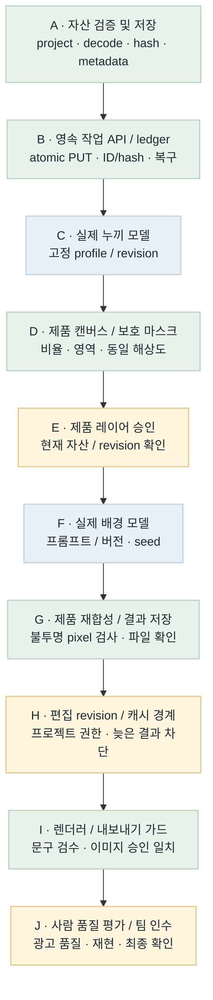
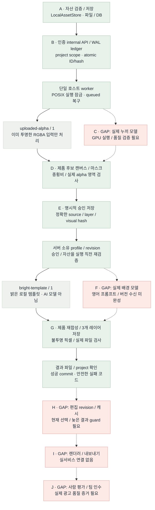

# 이미지 런타임 흐름 비교 · B3

2026-10-22 · 대상: plan/models · 배치 B3 명시적 제품 승인 / 서버 프로필 / 로컬 템플릿 실행

**Flow diagram verification: GAP/PARTIAL.** 자산·영속 job·worker에서 제품 후보 준비, 정확한 snapshot 승인, 고정 profile의 로컬 템플릿, 결과 레이어 저장까지 연결했다. 실제 누끼·배경 AI 모델과 현재 편집 상태·렌더러·사람 품질 인수는 남아 있다. 날짜는 마일스톤이며 구현 가능한 작업을 기다리지 않는다.

## Target Flow

의도한 최종 흐름이다. 파란 모델 노드는 계획이며 현재 모델 실행 증거가 아니다.

[Mermaid 원본](image-runtime-target-flow.mmd)

## Current Implementation Flow

실선은 현재 실행 가능한 로컬 연결, 점선은 미연결 경로다. 회색 `uploaded-alpha`와 `bright-template`는 실제 누끼·배경 AI 모델이 아니다. 승인 레코드는 인증된 호스트의 확인 전달을 저장하며 사람 신원·최종 품질을 인증하지 않는다.

[Mermaid 원본](image-runtime-current-flow.mmd)

## Target vs Current Gap

| 노드 / 연결 | 상태 | 확인한 차이 | 다음 근거 / 작업 |
| --- | --- | --- | --- |
| A | MATCHED (모듈) | 파일 decode/정규화/hash/프로젝트 경계와 저장 구현. 최종 사용자 로그인은 별도. | assets.py / 자산 테스트 |
| A → B / B | MATCHED (로컬 서버) | Bearer→project 매핑, atomic PUT, 동일 ID/hash 재사용, WAL ledger와 조회 API. | inference_api.py / job_ledger.py |
| B → worker | MATCHED (로컬 실행 기반) | POSIX 잠금, DB queued 검색, owner 검증, 실제 파일 확인 후 success. 단일 호스트 범위. | worker·loopback·프로세스 복구 테스트 |
| worker → C / C | GAP | 실제 누끼 모델과 GPU 품질 검증은 없음. uploaded-alpha/1은 이미 투명한 RGBA만 받으며 불투명 사진을 누끼 성공으로 처리하지 않음. | 모델 선택·접근·고정 환경·평가 조건 필요 |
| C → D / D | PARTIAL / MATCHED (로컬 입력) | 실모델 연결은 GAP. 기존 RGBA의 종횡비 유지 배치·캔버스·마스크 준비와 저장은 동작. | prepare_product_canvas / prepare API |
| D → E / E | MATCHED (저장·검증 범위) | 처음에는 미승인. literal true와 candidate hash를 확인하고 project/실파일/마스크/영역을 검증. 사람 신원·품질 승인은 보증하지 않음. | ProductApprovalStore / 승인 API |
| E → profile → template → G | MATCHED (로컬 템플릿 경로) | 고정 ID/revision/style/layout/크기만 허용. 승인·자산을 실행 직전 확인하고 3개 레이어를 저장. 실제 AI 모델 대체 증거는 아님. | LocalTemplateProcessor / runtime / CLI |
| E → F / F | GAP | 실제 배경 모델과 영어 프롬프트/버전 전달·tokenizer 검증 미연결. 프롬프트 생성은 텍스트 담당 범위. | B4 수신 DTO/hash와 실제 모델 adapter 분리 |
| F → G / G | PARTIAL / MATCHED (로컬 경로) | 로컬 template부터 승인 RGBA 재합성·불투명 픽셀·파일 검증까지 연결. 실모델 결과와 광고 품질은 미검증. | 3개 AssetRef / processor·runtime 테스트 |
| G → H / H | GAP | 승인 기록이 현재 프로젝트 선택을 뜻하지 않음. 편집 revision CAS·프로젝트 캐시·늦은 결과 차단 필요. | 다음 B4: 요청 버전 / 편집 상태 / 캐시 |
| H → I / I | GAP | 렌더러·내보내기 정책과 현재 문구 검수/이미지 품질/레이아웃 대조가 미연결. | 서비스·렌더러 공동 검증 |
| I → J / J | GAP | 사람 품질 평가·팀원 재현·최종 인수 미실행. | 권리 확보 평가셋과 팀 인수 증거 |

## Done / Not Done Priority

| 순서 | 작업 | 상태 | 연결 점수 | 선정 이유 | 다음 동작 |
| --- | --- | --- | --- | --- | --- |
| 1 | B4 · 프롬프트 버전 / revision / 캐시 | GAP | 3 + 2 + 2 + 2 − 1 = 8 | 입력 버전 누락·오래된 결과·프로젝트 교차 재사용을 차단 | 다음 릴레이 |
| 2 | 실제 누끼·배경 모델 검증 | GAP | 3 + 3 + 1 + 1 − 3 = 5 | GPU 인증·모델·사용 조건·평가셋이 필요 | 실행 조건 확보 후 |
| 3 | 렌더러·사람 품질 인수 | GAP | 1 + 1 + 1 + 1 − 2 = 2 | 다른 파트와 실제 출력/승인 확인 필요 | 서비스·평가셋 준비 후 |
| 완료 | B3 · 승인 / profile / 로컬 실행 | MATCHED (범위 한정) | 선정 대상 제외 | 명시적 승인과 template 결과를 실제 파일로 연결 | 148 tests + TCP CLI smoke PASS |
| 완료 | B2 · 영속 작업 API / worker | MATCHED (범위 한정) | 선정 대상 제외 | 파일/DB/HTTP/프로세스 복구 검증 | 기존 B2 증거 유지 |
| 완료 | B1 · 자산 / 캔버스 모듈 | MATCHED (범위 한정) | 선정 대상 제외 | 72 tests 및 CLI smoke 통과한 이전 배치 | 기존 B1 증거 유지 |

## Scoring Criteria

연결 점수 = upstream_weight(0–4) + connection_value(0–3) + safety_value(0–2) + validation_value(0–2) + risk_penalty(0∼−3). 같은 점수면 상위 노드, 더 작은 검증 가능한 변경을 먼저 선택한다. 모델/환경/합의가 필요한 항목은 점수만으로 완료하지 않는다.

선정: **B4 프롬프트 버전 수신 / 편집 revision / 프로젝트 캐시, 8점**. 영어 프롬프트 생성 담당은 바꾸지 않고 수신한 유효 입력을 hash에 반영한다. 문구만 수정했을 때 이미지 재사용과 늦은 결과의 현재 편집 덮어쓰기 차단을 연결한다. 팀 계약 수락과 실제 GPU 실행은 별도다.

## Color Semantics

| 색상 | 의미 |
| --- | --- |
| green | 서버 소유 정상 제어 / 구현·로컬 검증 모듈 |
| blue | 외부·GPU 모델 실행 경로 (목표 그림의 계획) |
| amber | 승인·revision·민감 입력 또는 부분 구현 |
| red | 미연결·미검증 GAP |
| gray | 명시적 로컬 template / 기존 alpha 입력 / 보조 제어 |

## Validation

- B1/B2: [B1 72 tests](../../test/relay-b1.md), [B2 112 tests 및 HTTP·프로세스 복구](../../test/relay-b2.md) 근거 유지.
- B3: 전체 **148 passed in 12.14s**, 관련 승인/processor/runtime **35 passed in 3.95s**. [명령과 범위](../../test/relay-b3.md).
- 실제 TCP CLI: 서버 기동 → prepare → candidate download → 명시적 approve → render → get-job → preview download PASS. 512×512 PNG 확인, `TEMPLATE_NOT_AI_GENERATION` 경고 유지. 합성 fixture이며 실모델을 호출하지 않았다.
- 독립 검토: 승인 literal true/hash/project/파일/마스크/영역, 등록·실행 재검증, 고정 profile에서 차단 결함 미발견. GET 후보는 저장 기록 조회이며 파일은 승인/실행에서 재검증한다.
- Mermaid: 기존 목표 PNG 재사용, B3 현재 PNG 갱신. HTML 브라우저 검증: PASS. Ego Lite TaskSpace 138에서 PNG 2개 decode(552×2540, 1172×3644), 필수 제목 7개·범례 5개·GAP 12행·우선순위 6행을 확인했다. 가로 넘침 없음(1492/1492px).
- 스크린샷: [B3 보고서](../../test/playwright-screenshots/image-runtime-flow-b3.png) · [보존한 B2 보고서](../../test/playwright-screenshots/image-runtime-flow-b2.png).
- 실제 GPU/모델 품질·외부 배포·사람 인수: NOT_RUN. 전체 제품 흐름 판정: GAP/PARTIAL.
