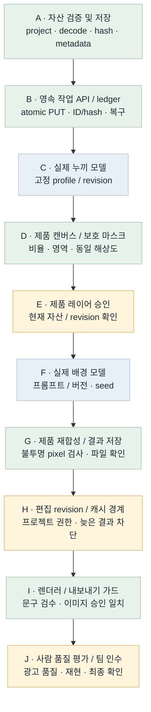
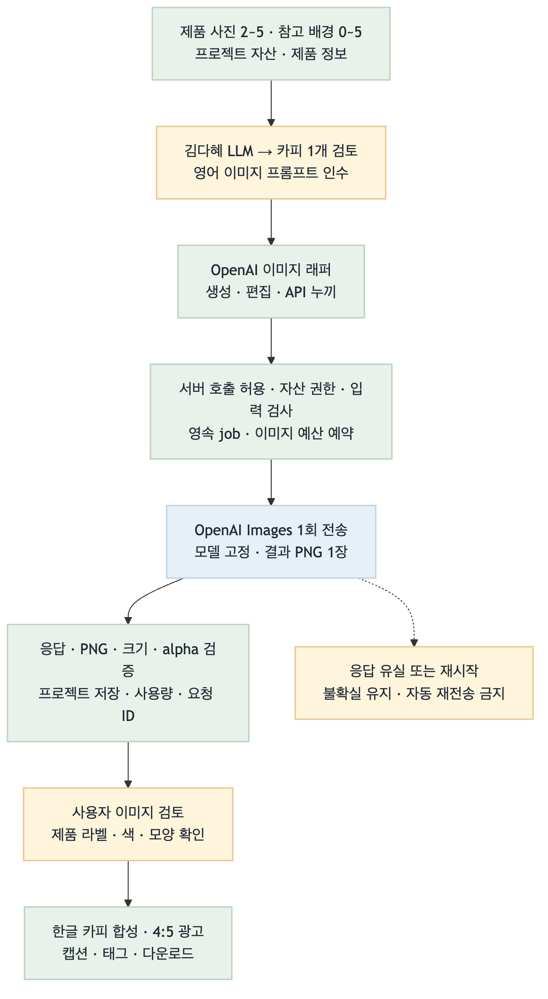
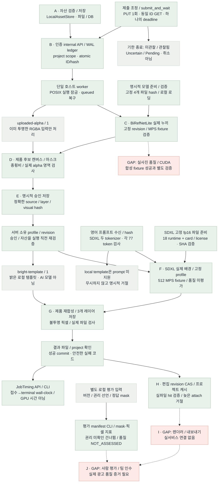
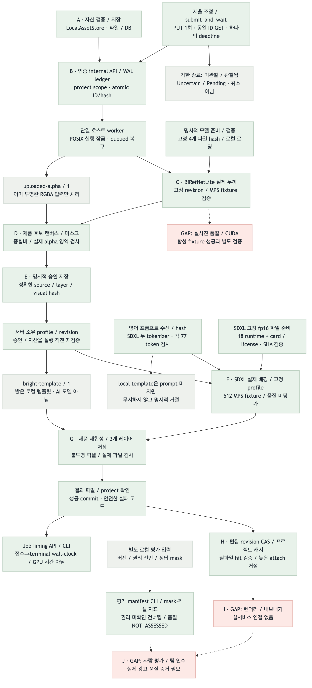

# 이미지 런타임 흐름 비교 · B8

2026-10-22 · 대상: plan/models · 배치 B8 동일 작업 ID 제출 조회·조정

**Flow diagram verification: GAP/PARTIAL.** B8은 하나의 deadline 안에서 PUT을 한 번만 보내고 같은 작업 ID의 상태 조회로 조정한다. 접수 미확인과 접수 후 대기 종료를 구분한다. 전체 521 tests와 실제 TCP 서버의 commit 후 응답 유실·동일 ID 조회·단일 실행을 검증했다. B6/B7 실제 MPS fixture 증거는 유지하며 광고 품질·실사진·CUDA·렌더러·팀 인수는 별도다.

## Target Flow

의도한 최종 흐름이다. 파란 모델 노드는 계획이며 현재 모델 실행 증거가 아니다.

[Mermaid 원본](image-runtime-target-flow.mmd)

## Current Implementation Flow

실선은 현재 실행 가능한 로컬 연결, 점선은 미연결 경로다. 회색 `uploaded-alpha`와 `bright-template`는 실제 누끼·배경 AI 모델이 아니다. 승인 레코드는 인증된 호스트의 확인 전달을 저장하며 사람 신원·최종 품질을 인증하지 않는다.

[Mermaid 원본](image-runtime-current-flow.mmd)

## Target vs Current Gap

| 노드 / 연결 | 상태 | 확인한 차이 | 다음 근거 / 작업 |
| --- | --- | --- | --- |
| A | MATCHED (모듈) | 파일 decode/정규화/hash/프로젝트 경계와 저장 구현. 최종 사용자 로그인은 별도. | assets.py / 자산 테스트 |
| A → B / B | MATCHED (로컬 서버) | Bearer→project 매핑, atomic PUT, 동일 ID/hash 재사용, WAL ledger와 조회 API. | inference_api.py / job_ledger.py |
| 클라이언트 → B | MATCHED (로컬 TCP 검증) | submit_and_wait는 하나의 monotonic deadline·PUT 1회·동일 ID GET으로 조정. GET 404를 미접수 증거로 삼지 않고, 유효 job 미관찰은 SubmissionUncertain, 관찰 후 미완료는 JobStillPending. 자동 재제출·새 ID·취소 없음. | gateway / CLI / 신규 84 unit + 4 실제 TCP 테스트 |
| B → worker | MATCHED (로컬 실행 기반) | POSIX 잠금, DB queued 검색, owner 검증, 실제 파일 확인 후 success. 단일 호스트 범위. | worker·loopback·프로세스 복구 테스트 |
| 모델 준비 → C / F | MATCHED (실제 파일 검증) | BiRefNet 4개와 SDXL 18개 fp16 런타임+카드/라이선스의 크기·SHA 검증. 명시 prepare만 다운로드하고 API 다운로드·원격 코드·장치 자동 대체 없음. | 실제 verify / 고정 model manifest |
| worker → C / C | PARTIAL (실제 MPS 실행) | BiRefNetLite가 실제 MPS에서 합성 병 fixture를 처리. 원본 RGB 유지, alpha 0..255, RGBA·마스크 저장과 수동 확인 경고. 실사진 품질·CUDA는 별도. | 실제 TCP CLI prepare / 339 tests / B6 실행 기록 |
| C → D / D | MATCHED (로컬 실행) | 실제 누끼 결과를 후보 캔버스·마스크로 준비하고 approved=false로 저장. 사람 확인·품질 통과는 별도. | 실제 MPS job → prepare API → 후보 파일 |
| D → E / E | MATCHED (저장·검증 범위) | 처음에는 미승인. literal true와 candidate hash를 확인하고 project/실파일/마스크/영역을 검증. 사람 신원·품질 승인은 보증하지 않음. | ProductApprovalStore / 승인 API |
| E → profile → template → G | MATCHED (로컬 템플릿 경로) | 고정 ID/revision/style/layout/크기만 허용. 승인·자산을 실행 직전 확인하고 3개 레이어를 저장. 실제 AI 모델 대체 증거는 아님. | LocalTemplateProcessor / runtime / CLI |
| 프롬프트 수신 → F | MATCHED (고정 SDXL 경로) | ImagePrompt 필수, positive/negative를 두 CLIP tokenizer로 각 77 이하 확인. 특수 token 포함, 무음 절단 없음. 기존 None hash 호환·template prompt 거절은 유지. | SDXL adapter / tokenizer 경계 회귀 |
| E → F / F | PARTIAL (실제 512 MPS 실행) | 승인·파일·geometry 재검증, SDXL 고정 profile·seed·steps20·guidance7.5·strength0.99. 꽃 예제는 호스트 작성 prompt. | 실제 TCP/MPS receipt / 합성 fixture의 시험 확인 |
| F → G / G | MATCHED (512 fixture 기술 검증) | 생성 후 Safe Zone 중립색 복원·승인 RGBA 재합성·불투명 픽셀·3개 레이어 검증. 원출력 전부0·NaN/Inf·형상/범위 오류 거절. 안전/품질 경고 유지. | opaque 770 / mismatch 0 / Safe Zone exact / 3개 hash |
| G → H / H | MATCHED (로컬 API/DB/CLI) | SQLite CAS로 현재 selection을 갱신. 성공 job의 입력 hash/project/실파일을 확인한 뒤 attach. 문구 revision만 바뀌면 같은 image key의 결과 재사용. 늦은 revision은 거절하며 자동 생성하지 않음. | image_edits.py / API·CLI·201 tests PASS |
| H → I / I | GAP | 렌더러·내보내기 정책과 현재 문구 검수/이미지 품질/레이아웃 대조가 미연결. | 서비스·렌더러 공동 검증 |
| 별도 파일 → 평가 도구 | MATCHED (로컬 도구) | 권리 선언·dataset/version·dev/holdout을 수신하고 실제 파일 hash·불투명 픽셀·mask IoU·경계를 측정. 권리 미확인은 건너뛰고 정답이 없으면 None. 실제 평가셋·품질 승인은 별도. | evaluation.py / evaluation_metrics.py / CLI |
| ledger → timing | MATCHED (로컬 API/CLI) | terminal 작업의 접수→종료 wall-clock 경과를 기록. 대기·처리·저장을 포함하며 GPU 연산 시간·VRAM·비용은 아님. queued/running·시계 역행은 None. | JobLedger.timing / 인증 API / get-timing |
| I → J / J | GAP | 사람 품질 평가·팀원 재현·최종 인수 미실행. 측정 도구의 quality_approval은 NOT_ASSESSED이며 점수만으로 합격하지 않음. | 권리 확보 평가셋·합의 기준·사람 판정·팀 인수 |

## Done / Not Done Priority

| 순서 | 작업 | 상태 | 연결 점수 | 선정 이유 | 다음 동작 |
| --- | --- | --- | --- | --- | --- |
| 1 | 로컬 반복/크기 측정·단계별 trace | 미구현 / 로컬 진행 가능 | 1 + 2 + 2 + 2 − 1 = 6 | 실제 모델의 cold/warm·처리 단계·메모리 차이를 기록 | B8 게시 후 측정 계약과 반복 실험 |
| 2 | 실사진 품질 / GCP CUDA / 렌더러·팀 인수 | GAP / 공동 준비 필요 | 2 + 2 + 1 + 1 − 2 = 4 | 제품 유형·품질 기준·실서비스 결과 확인 | 권리 확보 데이터·환경·담당과 병행 |
| 완료 | B8 · 동일 job ID 제출 조회·조정 | MATCHED (로컬 HTTP 조정 범위) | 선정 대상 제외 (당시 9점) | 상류 응답 유실의 중복 생성·잘못된 상태 판단 방지 | 521 tests·실제 TCP commit 후 응답 유실·PUT/processor 각 1회 |
| 완료 | B7 · SDXL fp16 / inpaint / prompt guard | MATCHED (512 fixture 기술 범위) | 선정 대상 제외 | 실제 배경 경로와 승인 제품·텍스트 여백 연결 | 433 tests·실제 MPS·wheel PASS / 품질 미평가 |
| 완료 | B6 · 고정 실누끼 / MPS / 모델 저장 | MATCHED (합성 fixture 범위) | 선정 대상 제외 | 고정 파일부터 실제 누끼·미승인 후보까지 연결 | 339 tests + 실제 MPS/TCP PASS |
| 완료 | B5 · 평가 manifest / 지표 / timing | MATCHED (로컬 도구) | 선정 대상 제외 | UNKNOWN·측정값·사람 판정 구분 | 280 tests + 실제 CLI PASS |
| 완료 | B1–B4 · 자산 / job / 승인 / revision·cache | MATCHED (로컬 범위) | 선정 대상 제외 | 파일·DB·HTTP·복구·현재 상태 경계 | 기존 검증 기록 유지 |

## Scoring Criteria

연결 점수 = upstream_weight(0–4) + connection_value(0–3) + safety_value(0–2) + validation_value(0–2) + risk_penalty(0∼−3). 같은 점수면 상위 노드, 더 작은 검증 가능한 변경을 먼저 선택한다. 모델/환경/합의가 필요한 항목은 점수만으로 완료하지 않는다.

후속 우선 후보: **로컬 반복/크기 측정·단계별 trace, 6점**. cold/warm·모델 로딩·대기·전처리·생성·재합성·저장과 메모리 관찰을 구분하고 ledger 경과를 순수 GPU 시간으로 부르지 않는다. 동일 job ID 제출 조정은 선정 점수 9점의 B8에서 로컬 검증을 마쳤다. 운영 proxy와 실제 UI의 상태 표시는 별도 통합 대상이다. 실제 사진 품질·CUDA·렌더러 공동 준비와 병행할 수 있다. 다음 폼 확정 전 구현 완료나 환경 의존만 남았다고 표시하지 않는다.

## Color Semantics

| 색상 | 의미 |
| --- | --- |
| green | 서버 소유 정상 제어 / 구현·로컬 검증 모듈 |
| blue | 외부·GPU 모델 실행 경로 (목표 그림의 계획) |
| amber | 승인·revision·민감 입력 또는 부분 구현 |
| red | 미연결·미검증 GAP |
| gray | 명시적 로컬 template / 기존 alpha 입력 / 보조 제어 |

## Validation

- 이전 배치: [B1](../../test/relay-b1.md)–[B7](../../test/relay-b7.md) 근거 유지. B7 실제 MPS 512 fixture와 433 tests는 B8 응답 조정 검증과 별도다.
- B8 root 전체 회귀: **521 tests PASS(15.01s, -W error)**. 신규 84 unit + 4 실제 TCP 테스트, wheel·격리 lazy import PASS. [B8 기록](../../test/relay-b8.md).
- 실제 TCP 서비스·SQLite commit을 확인한 뒤 클라이언트 경계에서 응답 유실/503을 주입했다. 같은 ID GET으로 완료했고 PUT 1회·processor 1회·DB job 1개·결과 파일 hash와 인증 경계를 확인했다. 미관찰/관찰 후 기한 종료는 각각 Uncertain/Pending이며 작업은 계속 실행돼 기존 ID wait로 완료했다.
- 검토 수리: failed.error_code의 임의 원문을 안전 코드로 노출할 수 있어 decode에서 첫 글자 ASCII 대문자·이후 대문자/숫자/_·총 1–80자와 failed/interrupted 상태만 허용했다. 잘못된 코드/상태는 프로토콜 오류이며 정상 코드는 보존한다. 기존 submit/get/wait도 같은 검증을 통과한다.
- 새 메서드는 기존 submit/get/wait와 wire/hash를 유지한다. 요청 snapshot을 고정하고 작업 ID·입력 hash·결과 종류를 대조한다. 프로토콜·인증·입력 충돌은 폴링 성공으로 숨기지 않는다.
- PUT 응답 유실·5xx·408/425/429는 같은 ID GET으로 조정한다. GET 404만으로 재제출하지 않는다. 하나의 monotonic deadline이 PUT/GET/대기를 포함하며 클라이언트 종료는 서버 취소가 아니다.
- B8에는 실제 모델 추가 호출·광고 품질·운영 proxy·GCP 검증이 포함되지 않는다. 실사진·CUDA·렌더러·팀 인수는 미완료다.
- Mermaid: 기존 목표 PNG 재사용, B8 현재 PNG 갱신. **브라우저 검증 PASS** (Task Space 144). PNG 2개 decode(552×2540, 1568×3448), 제목 7개·범례 5개·GAP 17행·우선순위 7행, 문서/화면 폭 1492px로 가로 넘침 없음. 1492×4473 최종 스크린샷을 직접 확인했다.
- 스크린샷: [B8 보고서](../../test/playwright-screenshots/image-runtime-flow-b8.png) · [보존한 B7 보고서](../../test/playwright-screenshots/image-runtime-flow-b7.png).
- 전체 제품 흐름 판정: GAP/PARTIAL. 로컬 반복·크기·단계 측정은 다음 구현 후보로 남아 있다.
