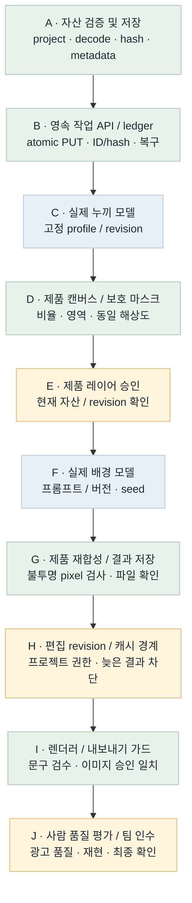
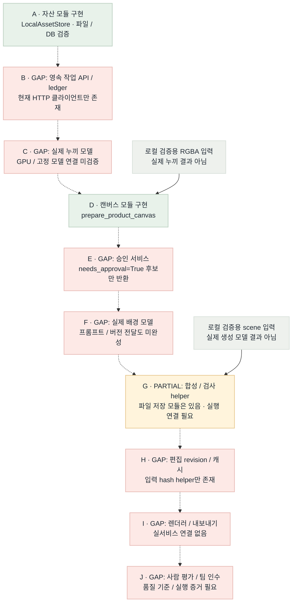

# 이미지 런타임 흐름 비교 · B1

2026-10-22 · 대상: plan/models · 배치 B1 자산 입력과 제품 캔버스

**Flow diagram verification: GAP/PARTIAL.** B1의 로컬 모듈 구현은 존재하지만 실제 모델·작업 서버·승인·렌더러를 잇는 전체 목표 흐름은 아직 완성되지 않았다. 날짜는 마일스톤이며 구현 가능한 다음 작업을 기다리지 않는다.

[HTML 보고서](image-runtime-flow.html) · [B1 계약](../contract/image-runtime.md) · [작업 인덱스](../todolist.md)

## Target Flow

목표 그림의 정상 경로는 구현 상태가 아니라 의도한 아키텍처다.

[Mermaid 원본](image-runtime-target-flow.mmd)

## Current Implementation Flow

실선은 현재 실행 가능한 로컬 연결, 점선은 아직 없는 모델·서비스 연결이다. 개별 helper가 존재해도 점선 연결을 통합 완료로 표시하지 않는다.

[Mermaid 원본](image-runtime-current-flow.mmd)

## Target vs Current Gap

| 노드 / 연결 | 상태 | 확인한 차이 | 다음 근거 / 작업 |
| --- | --- | --- | --- |
| A | MATCHED (모듈) | 파일 decode/정규화/hash/프로젝트 경계와 저장 코드·로컬 테스트 존재. 사용자 인증 자체를 구현한 것은 아님. | assets.py / test_assets.py |
| A → B / B | GAP | 영속 작업 등록·접수 응답·조회·복구 API가 없음. | 다음 B2: SQLite job ledger + internal API |
| B → C / C | GAP | 누끼 모델 실행·GPU 프로필·실제 품질 증거 없음. | 고정 backend와 실행 환경 확보 |
| C → D / D | PARTIAL / MATCHED (모듈) | 실제 누끼 결과 연결은 GAP. 독립 RGBA 입력의 종횡비·캔버스·마스크 준비는 구현. | image_preparation.py / test_image_preparation.py |
| D → E / E | GAP | 제품 후보는 needs_approval=True. 승인 레코드·현재 revision guard는 없음. | 명시적 승인 저장 및 stale approval 차단 |
| E → F / F | GAP | 배경 모델과 영어 프롬프트/버전 전달·tokenizer 검증 미연결. | 팀 계약과 서버 profile adapter |
| F → G / G | PARTIAL | 합성·불투명 픽셀 검사·자산 저장 helper 존재. 실제 모델부터 레이어 저장·성공 commit까지 연결 필요. | image_integrity.py / image_preparation.py / assets.py |
| G → H / H | GAP | content_hash는 있으나 편집 snapshot CAS·프로젝트 캐시/늦은 결과 연결 없음. | DB revision guard와 재사용 정책 |
| H → I / I | GAP | 렌더러·내보내기 정책이 실서비스로 연결되지 않음. | 현재 문구 검수/이미지 승인/레이아웃 대조 |
| I → J / J | GAP | 사람 품질 평가·팀원 재현·인수 미실행. | 권리 확보 평가셋과 팀 인수 증거 |

## Done / Not Done Priority

| 순서 | 작업 | 상태 | 연결 점수 | 선정 이유 | 다음 동작 |
| --- | --- | --- | --- | --- | --- |
| 1 | B2 · 영속 작업 API | GAP | 4 + 3 + 2 + 2 − 1 = 10 | 상위 실행 진입점을 열고 파일/DB/API로 검증 가능 | 즉시 다음 릴레이 |
| 2 | B3 · profile / 승인 / 실행 adapter | GAP | 3 + 3 + 2 + 2 − 1 = 9 | 검증된 자산과 job을 안전한 실행으로 연결 | B2 완료 후 |
| 3 | B4 · revision / 캐시 / 인계 | GAP | 2 + 2 + 2 + 2 − 1 = 7 | 오래된 결과와 프로젝트 교차 노출 차단 | B2/B3 입력·출력 고정 후 |
| 4 | 실제 누끼·배경 모델 검증 | GAP | 3 + 3 + 1 + 1 − 3 = 5 | 실제 GPU/모델/평가 조건 미확보 | 실행 조건 확보 후 |
| 5 | 렌더러·사람 품질 인수 | GAP | 1 + 1 + 1 + 1 − 2 = 2 | 다른 파트와 실제 출력/승인 확인 필요 | 서비스·평가셋 준비 후 |
| 완료 | B1 · 자산 / 캔버스 모듈 | MATCHED (범위 한정) | 선정 대상 제외 | 코드·로컬 테스트가 있음. 통합/품질 완료와 별개 | root의 최종 테스트 결과로 확인 |

## Scoring Criteria

연결 점수 = upstream_weight(0–4) + connection_value(0–3) + safety_value(0–2) + validation_value(0–2) + risk_penalty(0∼−3). 같은 점수면 상위 노드, 더 작은 검증 가능한 변경을 먼저 선택한다. 모델/환경/합의가 필요한 항목은 점수가 있어도 근거 없이 완료하지 않는다.

선정: **B2 영속 작업 API, 10점**. A→B 연결을 먼저 연다. 동일 ID/hash는 같은 작업, 다른 hash는 409, durable queued 복구와 결과 확인 후 성공 저장을 검증한다.

## Color Semantics

| 색상 | 의미 |
| --- | --- |
| green | 서버 소유 정상 제어 / 현재 그림에서는 구현·로컬 검증 모듈 |
| blue | 외부·GPU 모델 실행 경로 (목표 그림의 계획) |
| amber | 승인·revision·민감 입력 또는 부분 구현 |
| red | 미연결·미검증 GAP |
| gray | 로컬 검증 입력 / 보조 제어 |

## Validation

- 코드/테스트 존재 확인: `beauty_ai/assets.py`, `beauty_ai/image_preparation.py`, `tests/test_assets.py`, `tests/test_image_preparation.py`.
- B1 제품 테스트의 최종 명령/개수/결과는 root의 배치 검증 기록으로 갱신한다. 이 보고서의 PNG/HTML 렌더 성공은 모델 품질 증거가 아니다.
- Mermaid: mmdc 11.15.0, target/current `.mmd`에서 투명 배경 PNG 생성.
- HTML: Ego Lite TaskSpace 136, file URL에서 이미지 2개 decode(552×2540, 1360×2732), 필수 heading 7개·범례 5개·GAP 10행·우선순위 6행 확인. 가로 넘침 없음(1470/1470px).
- 스크린샷: [B1 보고서](../../test/playwright-screenshots/image-runtime-flow-b1.png).
- 실모델/API/GPU 품질·사람 인수: NOT_RUN.
- 리포트 렌더 판정: PASS. 생성 PNG/HTML 표시는 확인했으며 제품의 전체 흐름 판정은 GAP/PARTIAL이다.

B1 최종 제품 검증: 72 tests PASS, 루트 모듈 CLI 파일/DB smoke PASS. [명령과 범위](../../test/relay-b1.md).
