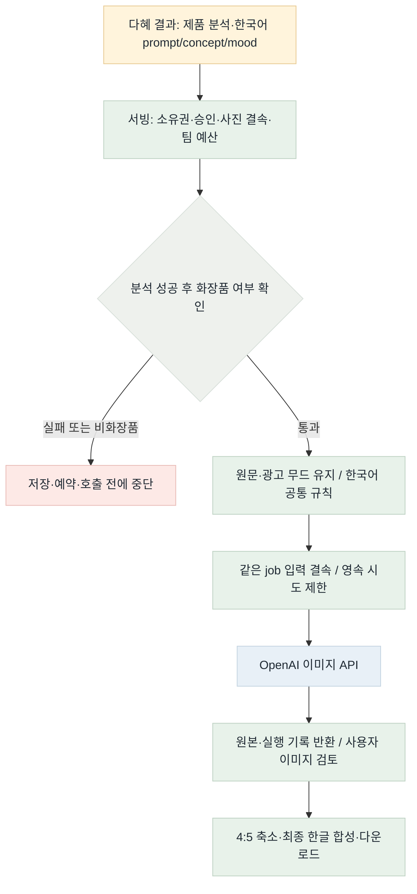
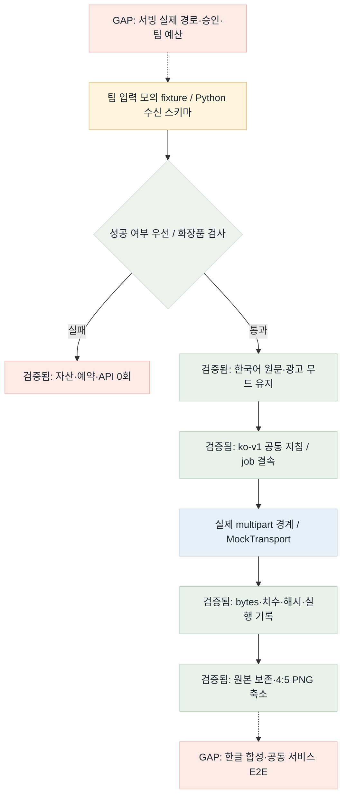

# VLM 결과·한국어 이미지 연결 검증 · 2026-10-28

Flow diagram verification: **GAP/PARTIAL (전체 서비스)**. 요청한 A1~A3 Python 라이브러리 범위는 MATCHED. 서빙 실제 연결·최종 한글 합성·팀 E2E는 이번 구현 밖이며 미완료다.

## 목표

## 현재

## 경로 대조

| 경로 | 판정 | 근거 |
| --- | --- | --- |
| 분석 결과 수신→실패 우선 중단 | MATCHED | 엄격한 bool/실패 기본값, 자산·예약·processor 호출 0 |
| 통과→한국어 원문·광고 mood→공통 정책 | MATCHED | multipart 원문 시작/한국어 규칙, VLM 분위기 대체 금지 |
| 요청 결속→재시작 재사용→파일/실행 기록 | MATCHED | 변경 입력 충돌·동시 요청·기존 해시 golden 회귀 |
| 원본→4:5 별도 PNG | MATCHED | 기존 K3 회귀; 축소 정보 손실과 원본 보존을 구분 |
| 서빙 승인·팀 예산→모델→사용자 검토 | GAP | 실제 서빙 연결·공동 인수 미수행 |
| 한글 합성→다운로드 | GAP | 후속 pi 합성 및 서비스 E2E 필요 |

## 다음 우선순위

점수 = 상류 영향(0~4) + 연결 가치(0~3) + 안전성(0~2) + 검증 용이성(0~2) − 위험(0~3).

| 후보 | 점수 | 다음 조건 |
| --- | --- | --- |
| 서빙 실제 매핑·승인·예산 | 4+3+2+2−2=9 | 서빙 담당과 W2~W4 연결·동일 fixture 시험 |
| 최종 한글 합성 | 2+3+1+2−1=7 | pi 후속 범위; 글자 방식 실험과 공동 인수 |

STOP_WITH_REASON: 요청한 수신·차단·한국어 정책·문서·공유 TODO 범위를 마무리한다. 다른 담당 코드 변경·유료 실험·한글 합성까지 범위를 늘리지 않는다. 새 서빙 조사는 하지 않고 기존 10/27 W0~W6 보고서를 사용했다.

## 검증

A1 13 PASS, A2 59 PASS, A3 중점 52 PASS, 전체 1,394 PASS (24.52초). `pytest -q -W error`. 설정 검사 PASS. 실제 API 0회, 외부 관측 업로드 0회. PNG는 mmdc 렌더, HTML은 outputs/vlm-ko-20261028/flow/index.html에 생성한다. 배포 CD는 라이브러리 게시 범위이므로 해당 없음.

색상: 초록=검증한 정상 경로, 파랑=제공자 경계, 노랑=입력 데이터, 빨강=중단/미연결, 회색=판정.

HTML 브라우저 확인: BLOCKED. 브라우저 URL 정책이 file: 열기를 거절했다. 우회하지 않았다. Mermaid PNG 생성·로컬 파일/참조 검증은 PASS, 브라우저 이미지 로드·스크린샷은 NOT_RUN. 코드 테스트와 별도 상태다.
