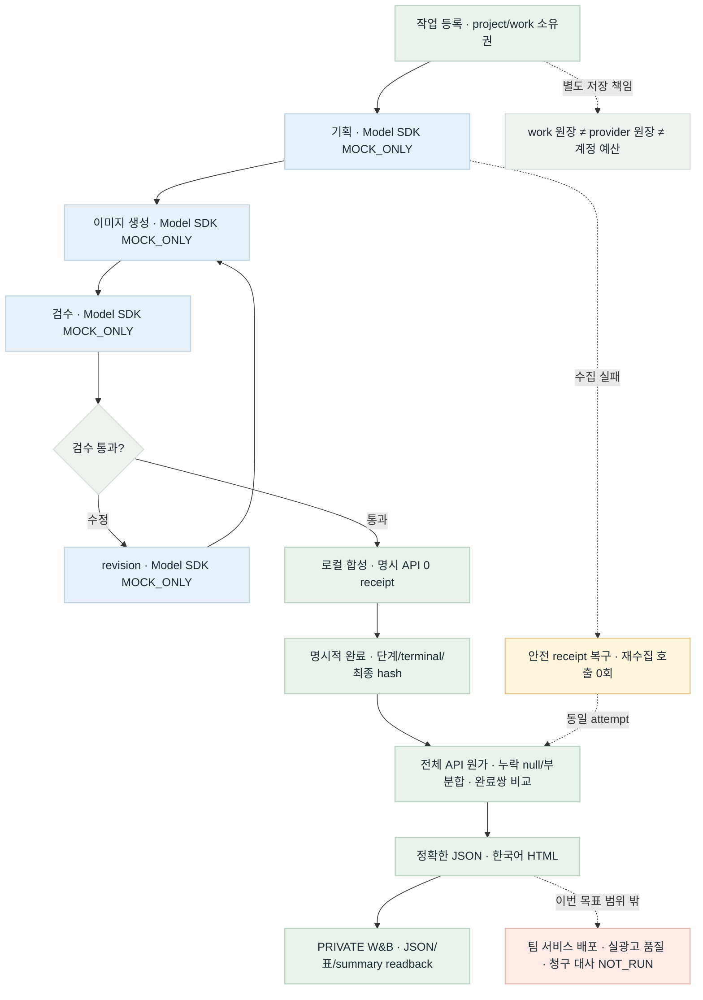
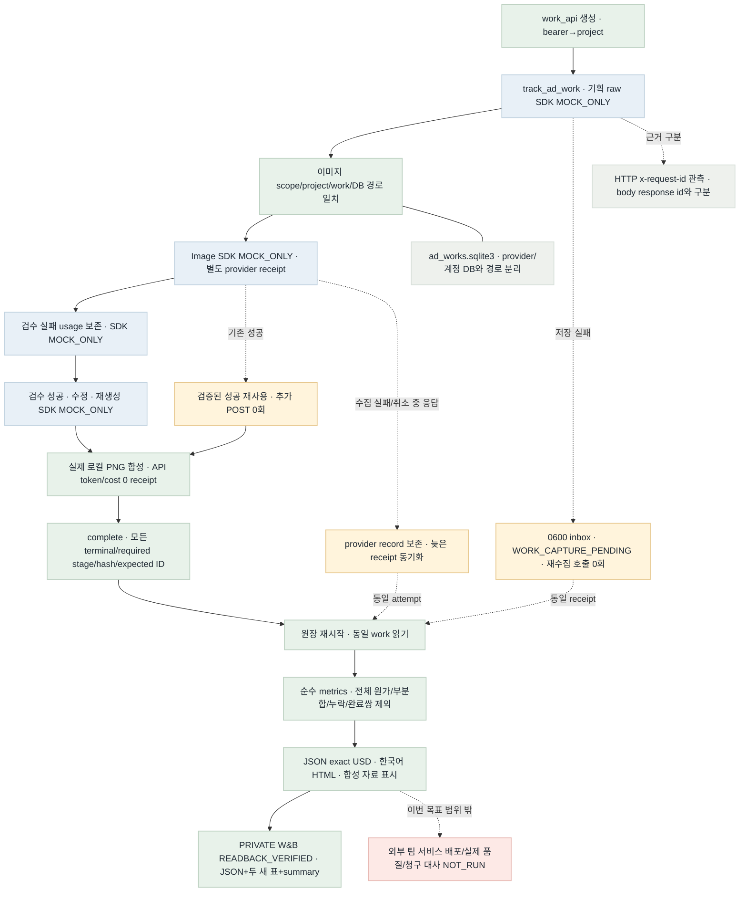

# 광고 작업 흐름 목표·현재 검증 · 2026-11-03

2026-11-03 · W1–W3 로컬/mock PASS · W4 PRIVATE W&B 2회 READBACK_VERIFIED(2회차 deduplicated=true). PR/merge는 진행 중이며 기능 노드가 아니다.

## 목표 흐름

[목표 MMD 원본](../architecture/spec/ad-work-target-flow.mmd)

## 현재 구현 흐름

[현재 MMD 원본](../architecture/spec/ad-work-current-flow.mmd)

## 색 의미

- 초록: 구현 연결·로컬/mock 검증. W&B 노드만 명시된 원격 readback 검증.
- 파랑: Model SDK MOCK_ONLY. 유료 모델·실제 팀 베타 배포 NOT_RUN.
- 호박: 복구·늦은 수집·성공 재사용. 새 호출 없이 같은 근거를 보존.
- 빨강: 이번 목표 밖의 팀 서비스 배포·실제 광고 품질·청구 대사 NOT_RUN.
- 회색: 결정·원장 분리·정확한 식별자 구분.

## 목표와 현재 차이

| 항목 | 상태 | 근거·한계 | 다음 확인 |
|---|---|---|---|
| 기획→이미지→검수 실패→수정→합성→명시 완료 | 연결 검증 완료 | 4 work/12 attempts. mock SDK 7회·image POST 3회·유료 호출 0회. | 추가 코드 연결 없음 |
| 누락·비용·비교·복구·재시작 | 검증 완료 | 전체 추정 null, 확인된 부분합 $0.002584000. 비교 1쌍/제외 2쌍. | 누락을 0원·전체 절감으로 바꾸지 않음 |
| W&B JSON/두 새 표/summary | 원격 검증 완료 | PRIVATE readback 2회, 두 번째 동일 run 재사용·새 init/upload 없음. | 중복 게시하지 않음 |
| 목표/현재 PNG와 HTML | 렌더·브라우저 검증 완료 | mmdc 11.15.0. 두 PNG natural size와 범례·차이·점수표 실제 표시를 확인했다. | 두 이미지/범례/차이·점수표 확인 |
| 외부 팀 배포·실품질·청구 | 범위 밖 · NOT_RUN | 실제 청구액 null. 기술 검증은 채택·절감 효과 근거가 아님. | 서빙 인수 또는 별도 실험 요청 때 검증 |

## 완료·미완료 우선순위와 점수

점수 = 5×영향(I) + 3×실패 위험(R) + 2×후속 차단(B), 각 0–5점·최대 50점. 검증 순서를 위한 값이며 품질·절감 효과 점수가 아니다.

| 항목 | 상태 | I/R/B | 점수 | 이유 |
|---|---|---|---|---|
| work/SDK/API/합성/집계 연결 | DONE | 5/5/5 | 50 | 현재 기능 차단점 해소 |
| 복구·늦은 영수증·중복 방지 | DONE | 5/5/3 | 46 | 실패·재시작 때 비용 근거 보존 |
| W&B 실제 readback·멱등 재게시 | DONE | 5/4/4 | 45 | 보여진 데이터·원본 JSON 일치 |
| HTML 흐름 화면 확인 | DONE | 3/2/5 | 31 | 이미지·범례·표의 실제 표시 확인 |
| 팀 배포·품질 효과·청구 대사 | OUT_OF_SCOPE | N/A | N/A | 이번 완료 점수에 넣지 않음 |

## 검증 근거

- 계약: [ad-work-costs.md](../architecture/contract/ad-work-costs.md). 구조: [adWorkCosts-architecture.md](../../docs/adWorkCosts-architecture.md).
- 전체 2335 tests PASS(-W error,36.58s).
- PRIVATE W&B run `compare-e236da2f35e68cac2d06`: 정확한 report.json·work_costs·work_stage_usage·summary readback. 첫 receipt `W4-wandb-first.json`, 두 번째 receipt는 root가 별도 보존한다.
- 렌더: `mmdc -i SOURCE.mmd -o FLOW.png -b transparent --scale 2` PASS. PNG·HTML·MMD 사본은 로컬 `outputs/work-costs-20261103/flow/`에만 둔다.
- Root Ego 브라우저 검증 PASS: PNG1568×2218/1568×1906 로드, 범례·차이/점수표 확인. 스크린샷은 로컬 outputs/work-costs-20261103/flow/browser.png 및 browser-gaps.png.
- 실제 모델 API·팀 배포·실광고 품질·청구 대사 NOT_RUN. 실제 청구액·절감 효과를 확정하지 않는다.
