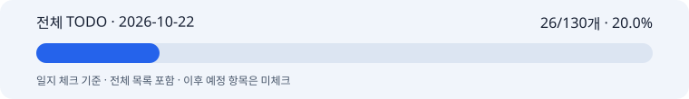

# 박지수 협업일지

2026년 10월 22일 · 모델 작업 완료 체크와 스키마 초안

일지 ID: BEAUTY-SCHEMA-DRAFT-20261022

이전 스키마 작업일지의 ID와 URL을 유지하고 본문을 8항목으로 고쳤다. 기록 범위를 당일 모델 작업까지 넓혔다. [작성 계약](../../contracts/collaboration-journal.md)에 따른다.

## [1] 오늘 날짜 / 이름 / 팀명

- 날짜: 2026-10-22 (Asia/Seoul)
- 이름: 박지수 (작업 식별자 pi)
- 팀명: 고급프로젝트 2팀
- 기록 기간: 2026-10-22 00:00 KST부터 2026-10-22T19:05:07+09:00까지
- 작성 지원: Codex. 원본 TODO와 저장소 기록으로 확인한 작업을 정리했다. 본인이 제공하지 않은 감정이나 팀원 수신 사실은 쓰지 않았다.

## [2] 오늘 맡은 역할 및 구체적인 작업 내용

이미지 담당으로 로컬 자산·작업 API·제품 보존 기반과 실험용 이미지 엔진을 구현·검증한 기록을 정리했다. 후속 사용자 결정에 따라 현재 MVP 방향을 외부 이미지 API 래퍼로 맞췄다. 텍스트·카피·영어 이미지 프롬프트는 김다혜의 담당이다.

오늘까지 계획된 범위 중 완료 근거가 있는 26개를 체크했다. 전체 계획은 별첨 목록에 모두 표시한다. 실제 완료일은 2026-10-22다. 이후 예정 단계의 작업은 이 일지에서 제외했다. 프레임워크 구성과 스키마 초안 작성 기록은 별도로 남겼다.

### 전체 계획과 진행률

**전체 이미지 TODO 130개 중 오늘 기준 일지 체크 26개: 20.0%.**

**[전체 TODO 130개 보기](full-todo.md)** · [HTML 전체 목록](full-todo.html) · [진행률 데이터](progress.json)

전체 계획과 이후 일정을 빠짐없이 보여준다. 체크는 오늘까지의 계획 중 완료 근거가 있는 항목에만 표시한다. 따라서 이 수치는 일지 체크 진행률이며 실제 코드나 제품의 완성률과는 다르다. 단계에 여러 날짜가 있으면 단계 시작일을 보고 범위 기준으로 사용한다.

| 현재 필수 묶음 | 완료 / 전체 | 진행률 |
| --- | --- | --- |
| 외부 이미지 API 래퍼 | 0 / 6 | 0.0% |
| SSOT 서비스 연결 | 0 / 12 | 0.0% |

위 두 묶음은 전체 130개에 이미 포함돼 있다. 분모에 다시 더하지 않는다. 아래 당일 작업 자기평가 75%와 자동 체크 진행률 20.0%도 서로 다른 지표다.

### 오늘까지의 계획 체크

**[오늘까지 계획된 항목의 완료 체크](completed-checks.md)**에서 완료한 26개를 모두 체크했다. 아직 끝나지 않은 당일 계획은 빈 체크로 남겼다. [동일 자료 JSON](completed-checks.json)도 함께 보관한다. 이후 예정 단계의 항목은 넣지 않았다.

| 계획 범위 | 완료 체크 | 근거 |
| --- | --- | --- |
| 입력·파일·마스크 계약 | 3개 | 로컬 파일 검증과 AssetRef·마스크 정의 |
| 실행 프로필·버전·재현 범위 | 2개 | 고정 프로필과 제한된 로컬 재현 검사 |
| 누끼·제품 레이어 | 3개 | 파일 무결성, 실제 누끼 기술 실행, 수동 확인 경고 |
| 품질 평가 도구 | 2개 | manifest와 마스크·픽셀 지표 도구 |
| 시간·반복 측정 기반 | 3개 | 경과 시간·단계 관찰·반복 기록 |
| API·자산 병렬 준비 기반 | 9개 | 작업 저장·인증·동일 ID 처리·복구·결과 파일 확인 |
| 프롬프트·버전 연결 준비 | 4개 | 입력 hash·재사용·늦은 결과 차단·실행 추적 |

실제 외부 API의 지원 기능·인증·쿼터, 다양한 제품 사진의 품질 점검, 품질 실패/수동 확인 흐름, 파트별 담당과 합의는 아직 끝나지 않았다. 전체 계획이 완료된 것으로 체크하지 않았다.

FiveCircles 구성과 스키마 자료 확인은 기존 문서·검증 기록을 읽어 정리했다. 일지를 쓰기 위해 모델이나 전체 테스트를 새로 실행하지 않았다. 원본 개발 기록과 체크 상태는 유지한다.

### 스키마 초안 공유

기존 코드에서 추출한 계약 13종, 제안 2종, 가상 예제 4종을 [plan/models의 스키마 안내](https://github.com/uyt5041-lab/beauty-ai-models/blob/64124ed119dc6cf96a4e211e6b96d2d62e26060a/docs/schemaDraft.md)에 게시했다. **초안·팀 미합의**로 표시했으며 다혜님이 만든 계약이나 확정 API로 설명하지 않았다.

현재 코드 계약과 JSON Schema의 일치, JSON 파싱/내부 참조, 공개 파일의 로컬 절대 경로 제거와 비밀값 패턴을 확인했다. 최초 초안 작성 때 제안 예제와 사진 1장/6장 및 revision 불일치 거절을 확인했다. 게시 검사에서 그 제안 런타임 검증을 다시 실행한 것으로 적지 않았다.

스키마 상세 본문과 기존 스키마 작업 기록은 **[스키마 별첨](schema-draft-details.md)**으로 보존했다.

### 관측 원천

| 원천 | 기준과 차이 |
| --- | --- |
| plan/models 원격 | `64124ed119dc6cf96a4e211e6b96d2d62e26060a`을 고정해 읽음 |
| 당일 시작 전 원격 이력 | `00e455e979f3061b3a1aed9609d994bc713757e4`. 이미지 완료 체크 0개 |
| 참고 코드 checkout | 현재 `bdddddea453c0eab23c99cfa37b9ee15f9b386ca`. 미커밋 변경 없음. origin보다 스키마 문서 커밋 1개 뒤이며 TODO 내용은 동일 |
| 원본 beautyAi 소스 | Git 저장소가 아님. 이미지·LLM·프레임워크 TODO는 참고 checkout과 일치 |
| 협업일지 원격 | 수정 전 `c6a240ac0e5269ebe877eef8060d3f8e07aeeebe`. 기존 기록을 보존하고 이 형식 수정만 게시 |

## [3] 오늘 작업 완료도 체크

**75% (근거를 바탕으로 정리한 잠정 평가).**

오늘 범위의 완료 항목 26개는 모두 체크했다. 외부 API 지원 기능·권한, 실사진 품질과 수동 확인 흐름, 파트별 계약 합의가 남아 전체 계획 완료로 표시하지 않았다. 이 값은 전체 MVP 완료율이나 체크 개수의 산술 비율이 아니다.

## [4] 오늘 협업 중 제안하거나 피드백한 내용

- 텍스트 담당과 이미지 담당 사이의 필드·revision·프롬프트 버전, Safe Zone·카피 길이 및 출력 계약을 문서로 정리했다. 10/26 조기 합의 요청을 팀 수락으로 표시하지 않았다.
- 사용자 지시인 외부 이미지 API 전환을 반영했다. 이 방향을 본인이 제안한 아이디어로 기록하지 않았고 기존 로컬 실험 결과는 보존했다.
- 스키마를 비교 가능한 파일과 예제로 GitHub에 게시했다. 문서 게시 사실과 팀원이 읽거나 동의했다는 사실을 구분한다. 팀원 수신·인수 확인은 아직 없다.

## [5] 오늘 분석/실험 중 얻은 인사이트나 발견한 문제점

누끼 모델의 기술 실행 성공과 실제 제품 사진의 품질 판정은 구분해야 한다. 합성 입력에서 alpha와 파일 저장이 정상이어도 펌프·라벨·투명/반사 제품의 품질 기준을 통과한 것은 아니다.

작업 후 메모리 snapshot은 최대 메모리 사용량이 아니며, 접수부터 종료까지의 경과 시간도 순수 GPU 연산 시간과 다르다. 측정값의 범위를 명시했다.

스키마는 필드 모양뿐 아니라 담당자가 같은 의미로 쓰는지도 맞춰야 한다. 초안 작성을 팀 계약 합의나 외부 API 구현 완료로 체크하지 않았다.

## [6] 일정 지연이나 협업 중 어려웠던 점

서비스/API/렌더러 담당의 이름과 인수, 실제 제품 평가 자료와 기준, 외부 제공자·모델·인증·예산이 아직 확정되지 않았다. 이를 구현 완료로 표시하면 10/30 통합 판단이 잘못될 수 있다.

외부 API 방향에서는 GCP GPU 구축을 필수 선행조건으로 잡지 않는다. 필요한 제공자 계정·지원 기능·권한과 비용 조건을 먼저 확인해야 한다.

앞서 협업일지를 스키마 작업 보고서 형식으로 올려 공식 8항목을 빠뜨렸다. 이번 수정에서 작성 계약을 브랜치에 남기고 본문을 고쳤으며 스키마와 상세 완료 체크는 별첨으로 연결했다. 개인적인 협업 소감은 제공된 기록이 없어 추가하지 않았다.

## [7] 오늘 발표 준비나 커뮤니케이션에서 기여한 부분

오늘 범위에서 완료한 26개와 남은 일, 스키마 초안을 다른 담당자가 찾아볼 수 있게 GitHub 문서로 정리했다. 전체 TODO와 진행률 바도 연결했다. 8항목 작성 계약과 날짜별 Markdown·HTML 및 인덱스도 마련했다. 반복 작성은 [beauty-ilji 스킬](../../skills/beauty-ilji/SKILL.md)로 묶었다.

슬라이드 작성·발표 연습·팀 시연을 수행했다는 근거는 없다. 문서 공개를 팀 설명 완료나 공동 인수로 기록하지 않았다.

## [8] 내일 목표 / 할 일

1. 다혜님 스키마 초안을 받으면 제품 분석·카피·검수·영어 프롬프트 필드와 revision 의미를 대조한다. 차이 목록과 정상/실패 예제를 남긴다. 미제공이면 미확인으로 유지한다.
2. 외부 이미지 API 제공자의 입력 수·참고 구도·마스크·seed·negative prompt·4:5 지원·가격·조건을 확인한다. 실제 지원 기능표와 API-01 차이 목록을 만든다.
3. 실제품 사진의 권리·동일 제품 묶음·라벨·펌프·투명/반사 유형과 평가 기준을 확보한다. 합성 fixture 결과와 분리한다.
4. API·자산·렌더러 담당과 Safe Zone·카피 길이·사용자 검토·최종 파일 계약을 확인한다. 담당 수락과 다음 연결 작업을 문서로 남긴다.

목표 마일스톤은 10/30 서비스 통합, 11/06 이미지 디테일·고도화다. 날짜를 기다리는 작업 순서가 아니라 준비된 의존성부터 진행한다. 현재 미완료를 날짜만으로 완료 처리하지 않는다.
