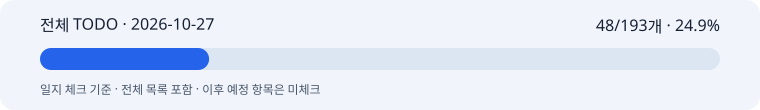

# 2026-10-27 박지수 협업일지

## 1. 날짜·이름·팀명

2026-10-27 · 박지수(pi) · 고급 프로젝트 2팀 · 이미지 모델 담당.

기록 범위는 2026-10-27의 확인된 작업까지다. 근거 수집 시각: 2026-10-27T16:09:54+09:00. 작업별 정확한 시작·종료 시각은 별도로 확인하지 않았다.

## 2. 오늘의 역할과 구체적인 작업

오늘 구현 목표는 한국어 입력, 백엔드용 Python 연결 어댑터, 광고 크기 변환이다. 단계별 시험을 통과한 뒤 다음 단계로 진행했다.

- W0: 기본 프롬프트에 워터마크 제외 정책을 반영했다. 제품에 인쇄된 로고와 라벨은 보존한다. Langfuse 새 버전을 게시하고 다시 조회했다. 실제 사진의 워터마크 제거 품질은 시험하지 않았다.
- K1: 한국어 원문을 API 요청에 전달한다. 기존 영어 요청의 해시를 유지한다. 관련 시험 268개가 통과했다.
- K2: 백엔드 입력을 모델 요청으로 바꾼다. 같은 요청은 저장된 결과를 재사용한다. 변경된 요청, 동시 요청, 재시작과 시간 초과를 시험했다. 관련 시험 123개가 통과했다.
- K3: 원본을 별도로 보존하고 4:5 이미지를 1080×1350 PNG로 한 번 축소한다. 크기·해시·색상·투명도를 확인했다. 연결 시험 35개가 통과했다.

최종 전체 회귀 시험은 **1,363개 통과, 실패 0개, 23.80초**다. 단계별 시험 수는 중복이 있어 더하지 않는다. 모의 실행은 제공자 대역 1회, 실제 유료 API 0회다. 재전송 결과가 같고 원본 1152×1440과 최종 1080×1350을 따로 보존함을 확인했다.

구현과 안내를 `feature/image-model`에 게시했다. 실제 서비스 HTTP 연결, 서버 승인·예산 처리, 최종 한글 문구 합성은 아직 완료하지 않았다.

**공유용 일지 체크: 48/193개 · 24.9%**

[전체 TODO Markdown](full-todo.md) · [전체 TODO HTML](full-todo.html) · [수치 원본](progress.json) · [검증 근거](evidence.md)

이 수치는 보고일까지 계획된 항목 중 확인한 완료 수다. 제품 완성률이 아니다. 원본 TODO의 실제 구현 체크는 보존했다. 이후 일정과 일정 미정 항목도 목록에 표시하되 일지에서는 미리 체크하지 않았다. 기준 커밋은 `a062c19b5bd16a77a9330f84cbbd2dd321f1b86d`다.

## 3. 오늘 작업 완료도

**100% · 이번 W0·K1·K2·K3 구현 범위에 대한 잠정 평가.** 요청한 코드와 해당 시험을 끝냈다. 작성자의 직접 자기평가는 아직 받지 않았다. 전체 서비스, 실제 통합, 광고 품질 평가가 100%라는 뜻은 아니다. 타이포그래피 10장 실험은 계획 검토 상태이며 생성 완료에 포함하지 않았다.

## 4. 협업 제안·피드백

10/26 회의와 계약 v0.2를 기준으로 한국어 입력과 이미지·합성 담당 범위를 다시 정리했다. 백엔드에는 Python 어댑터 사용법과 요청·결과 예시를 제공할 수 있도록 문서를 작성했다.

서버는 승인 상태와 카피 버전·해시, 팀 공통 예산을 확인해야 한다. 모델은 입력 변환, 실행 기록, 중복 요청 방지와 결과 크기를 맡는다. Langfuse와 W&B는 모델 내부에서 관리한다. 문서 게시와 팀원 전달·확인·합의는 서로 다르다. 이번 작업에서 팀원에게 별도 메시지를 보내거나 인수 확인을 받지는 않았다.

## 5. 인사이트·문제

기존 모의 합성 경로에서는 실제 파일이 1152×1440인데 응답 값만 1080×1350일 수 있었다. 새 경로에서는 최종 파일을 실제로 1080×1350으로 만든 뒤 그 파일의 크기와 해시를 반환한다.

PNG 저장은 무손실 압축이다. 다만 픽셀 수를 줄이는 축소는 정보를 줄인다. 따라서 화질 저하가 전혀 없다고 보장하지 않는다. 원본을 보존하고 LANCZOS로 한 번만 축소한다. 자르기·늘이기·확대는 기본으로 하지 않는다. 기존 화장품 이미지 비교에서 눈에 띄는 형태·색 변화는 없었지만 모든 제품의 품질을 보장하는 결과는 아니다.

중복 호출은 비용과 기록 누락 문제로 이어질 수 있다. 같은 요청을 다시 만들지 않고 실행 기록을 조회한다. 실제 청구액이 없으면 미확인 값으로 남긴다. 예약 예산을 실제 사용 비용으로 표시하지 않는다.

## 6. 일정·협업의 어려움

10/30 통합과 11/06 고도화 완료는 마일스톤이다. 현재 어댑터는 Python 호출 경로까지다. 팀 서버의 실제 HTTP 경로, 인증, 승인 상태, 공통 비용 기록이 연결되어야 서비스 통합을 판정할 수 있다.

필요한 입력은 백엔드의 확정 요청 예시와 승인 상태 전달 방식이다. 팀원의 구현 완료 여부나 지연 사유는 이번 일지에서 추정하지 않는다. 확인된 연결 시험과 서비스 통합을 구분해 일정 판단에 사용한다.

## 7. 발표·커뮤니케이션 기여

사용법, 목표·현재 흐름도, 원본과 축소본 비교 자료를 만들었다. 모델 내부에서 끝난 부분과 서버에서 이어야 할 부분을 문서로 나눴다. 오늘까지의 전체 TODO, 진행률 바, 검증 근거를 이 일지에 연결했다. 자료 제작과 저장소 게시까지 기록하며 실제 발표를 했다고 표시하지 않는다.

## 8. 내일 목표

2026-10-28의 계획이며 완료 성과가 아니다.

- 백엔드 요청 예시를 어댑터에 넣고 결과·오류·재조회 규칙을 함께 확인한다. 완료 기준은 동일 입력 재사용과 변경 입력 거절이 양쪽에서 일치하는 것이다.
- 최종 한글 문구 합성의 입력·출력과 담당 경계를 확정한다. 완료 기준은 글자 위치와 최종 이미지 크기를 파일로 확인할 수 있는 것이다.
- 타이포그래피 10장 실험의 비교 항목과 호출·비용 상한을 실행 전에 정리한다. 실제 생성과 점수 평가는 실행 후에 기록한다.
