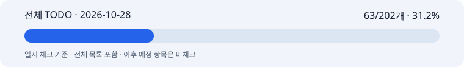

# 2026-10-28 박지수 협업일지

## 1. 날짜·이름·팀명

2026-10-28 · 박지수(pi) · 고급프로젝트 2팀. 담당은 이미지 모델 API 래퍼와 최종 이미지 합성이다.

기록 범위는 10/28 구현·검증·Git 게시와 전달받은 협업 피드백이다. 자료 확인 기준 시각은 2026-10-28 18:27 KST다. 하루 전체 활동을 관측한 기록은 아니다. 구현 체크의 고정 원본은 `3480c34282c4ac0c6bedb1369eb0c2c6247cf34c`이며, 게시 결과는 이 일지의 Git 이력으로 확인한다.

## 2. 오늘의 역할과 구체적인 작업

목표는 다혜님의 한국어 산출물을 받는 이미지 MVP를 팀 브랜치에 제공하고, 서빙 담당자가 직접 테스트할 수 있게 하는 것이었다.

- ProductAnalysisResult를 받고 분석 실패를 먼저 막았다. 성공 표시와 error가 동시에 있으면 이미지 호출·예산 예약·자산 저장 전에 차단한다. 한국어 프롬프트는 영어로 번역하지 않는다.
- 한국어 concept·prompt·mood 구조형, prompt 문자열, prompt-only 객체를 받는다. 문자열 copy_revision도 바꾸지 않고 유지한다. 사용자 무드는 텍스트 쪽 산출물에 반영된 내용을 사용하며 별도 프리셋 선택을 요구하지 않는다.
- 잇템 `feat/image-generation/src/image_generation/`에 MVP를 분리했다. 한글 폰트 레이어 합성, 4:5 PNG, 여백·보호 영역·문구 넘침 검사를 구현했다. 원본 생성 파일과 합성 결과를 구분한다.
- 팀원이 요청한 테스트 301개를 잇템의 `tests/image_generation/`에 게시했다. 개인 로컬 경로와 시스템 폰트 의존을 없앴다. 별도 환경에서 실행할 의존성과 검증용 폰트 라이선스를 포함했다.
- Python 3.11에서 301 PASS, 새 Python 3.14 환경의 별도 체크아웃에서도 301 PASS였다. 같은 301개를 두 환경에서 검사한 것이므로 602개로 합산하지 않는다. 테스트 중 외부 네트워크는 차단했다.
- 노션에 연결된 `plan/models` TODO는 10/28까지 갱신했다. 날짜별 마일스톤 7개 중 3개 완료, 4개 부분 완료다. 10/28의 실제 LLM·두 사용자 검토·서빙 최종 다운로드 연결은 미검증으로 남겼다.

**전체 TODO 일지 체크: 63/202개 · 31.2%. 제품 완성률이 아니다.**

[전체 TODO](full-todo.md) · [전체 TODO HTML](full-todo.html) · [진행률 데이터](progress.json) · [검증 근거](evidence.md)

원본은 202개이고 실제 체크는 70개다. 보고일 범위에 포함되는 63개만 일지에 반영했다. 일정 미정인 API 세부 항목 5개와 현재 자체호스팅 계획에서 제외된 2개는 분자에 넣지 않았다. 외부 API 묶음은 일지 기준 0/12, SSOT 서비스 연결 묶음은 0/12다. 이는 기존 API 호출 성공이 없다는 뜻이 아니다. 10/29 이후 계획도 전체 목록에 표시하되 미리 체크하지 않았다.

## 3. 오늘 작업 완료도

**잠정 75%.** 본인의 자기평가 응답이 없어 문서 작성자가 정한 잠정값이다. 이미지 MVP 모듈과 테스트 재현 자료는 게시했지만, 오늘 마일스톤의 실제 텍스트 결과·사용자 카피/이미지 검토·서비스 합성/저장/다운로드는 공동 검증하지 못했다. 전체 TODO 31.2%와 당일 완료도 75%는 다른 지표다.

## 4. 협업 제안·피드백

다혜님은 텍스트 생성·검수를 텍스트 쪽에서 맡고 한국어 프롬프트를 그대로 넘기는 방향을 요청했다. 이미지 쪽은 결과만 받으며 공통 지시도 한국어로 정리했다. 사진 1번 정면 기준과 이미지 쪽 4:5 크기 변환을 문서에 남겼다.

사용자가 전달한 팀원 피드백에는 이미지 코드·연동 문서를 확인했지만 테스트 301개 소스가 보이지 않는다는 요청이 있었다. 발신자 실명은 인용문만으로 확정하지 않는다. 테스트를 Git에 게시하고 실행법을 사용자에게 전달했다. 팀원은 나머지 연결·검증을 직접 진행하고 구체적인 불일치가 있을 때 문의하겠다고 했다. 이후 실행 성공이나 공동 인수는 확인하지 않았다.

[서빙 MVP 요청문](https://github.com/taemin050-sys/project-it-tem/blob/fbb7cb0ad9fc7733a1e252fd59a683cb71ecea42/docs/servingMvpAlignment.md)에는 이미 있는 업로드·JobStore·승인·저장·다운로드를 중복 요청하지 않고, 실제 이미지/합성 모듈 호출과 승인 스냅샷·기록 연결을 남겼다. #4~9는 문서에 고정한 커밋 기준이다. 이후 #9 변경을 모두 확인했다는 뜻은 아니다. 별도 외부 메시지는 보내지 않았다.

## 5. 인사이트·문제

테스트 수만 전달하면 팀원이 재현할 수 없다. 실행 소스, 의존성, 폰트와 라이선스, 테스트 경로를 함께 제공해야 한다. 처음 전체 테스트를 수집했을 때는 이미지 범위 밖 서빙 의존성이 필요했다. 최종 명령은 이미지 테스트 경로만 지정했다.

Python 3.14 첫 검사에서 테스트용 SQLite 연결의 닫기 누락으로 5개가 실패했다. 테스트 코드를 contextlib.closing으로 고친 뒤 다시 통과했다. 경고를 숨기지 않았고 제품 코드를 바꿔 우회하지 않았다.

합성 검증에 쓴 제품은 도형 fixture다. 로컬 렌더러 동작과 보호 영역 검증은 실제품 광고 품질 인수가 아니다. 이 구현·테스트 게시 작업에서 새 이미지 API 호출은 0회였다. 실제 청구액이나 팀 잔액은 새로 확인하지 않았다.

## 6. 일정·협업의 어려움

10/30 통합까지 필요한 것은 실제 서비스 경로의 공동 확인이다. 텍스트 결과, 승인한 카피·이미지의 버전과 해시, 실제 모듈 호출 설정, 결과 기록·다운로드를 연결해야 한다. 모델 단위 테스트가 통과해도 이 단계가 자동으로 완료되지는 않는다.

잇템 CONTRIBUTING의 dev 기반 작업, PM 검토, 한국어 커밋 제목 규칙을 확인했다. 테스트 게시 커밋은 `test: 한국어 요약` 형식을 사용했다. 이전 scope 포함 커밋은 이력을 다시 쓰지 않았다. 사용자 지시에 따라 PR·병합·force push는 하지 않았다.

## 7. 발표·커뮤니케이션 기여

한글 합성 예시와 서빙 요청문, 기존 이미지 연동 문서의 링크, 팀원용 테스트 실행법을 준비했다. 이번 일지는 협업 내용과 구현 완료를 나눠 적고 전체 TODO·진행률 바를 함께 제공한다. 실제 발표나 팀원 테스트 시연 성공은 확인하지 않았다.

## 8. 내일 목표

- 서빙 담당자가 현재 테스트를 실행한 결과를 확인한다. 실패가 있으면 입력·오류·재현 절차를 받아 해당 경계부터 고친다.
- 실제 텍스트 산출물과 사용자 검토를 거쳐 이미지 생성·한글 합성·저장·다운로드로 이어지는 흐름을 공동 확인한다. 승인 버전과 결과 파일의 연결이 맞아야 완료다.
- 비용 원장과 중복 호출 차단을 서비스 경로에서 확인한다. 실제 호출 전 사용 모델·횟수·예산을 정하고, 유료 실행은 별도 승인 범위에서 진행한다.
- 10/30 통합 판정에서 미달 항목과 담당·후속 작업을 기록한다. 실제품 품질과 타이포그래피 10장 비교는 실행하지 않은 상태로 유지한다.
