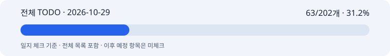

# 2026-10-29 박지수 협업일지

## 1. 날짜·이름·팀명

**작업일: 2026-10-29 · 기록일: 2026-10-30** · 박지수(pi) · 고급프로젝트 2팀. 담당은 이미지 모델 API 래퍼와 최종 이미지 합성이다.

10/29의 연동 보고 분석·텍스트 리뷰·광고 표현 실험·후속 계획을 남긴 회고 기록이다. 자료 확인 시각은 2026-10-30 09:44 KST이며 개별 작업의 정확한 완료 시각은 미확인이다. Git 게시 시각은 이 일지의 커밋 이력과 별도 게시 영수증으로 확인한다. 10/30에 구현한 MPO·Windows·A 템플릿·저장 결과 재조회 보완은 이 날짜의 완료 성과에 포함하지 않는다.

## 2. 오늘의 역할과 구체적인 작업

목표는 실제 텍스트 산출물을 이미지 모듈에 연결한 결과를 검토하고, 업로드·저장·카피 가독성 문제와 후속 작업을 구체화하는 것이었다.

- 사용자가 전달한 다혜님의 연결 시험 보고와 첨부 PNG를 기록했다. ImagePromptOutput·AdCopyOutput·ProductAnalysisResult를 BackendImageInput에 전달해 1152×1440 이미지를 약 49초에 생성했다는 보고다. 첨부 크기와 해시를 확인했으며 동일 입력의 API 호출을 재현한 것으로 쓰지 않는다.
- 첫 MPO 사진을 JPEG로 수동 변환했고 Windows 디렉터리 동기화를 시험에서 건너뛰었다는 우회를 확인했다. MPO 대표 프레임 처리, Windows 저장 분리, 기존 safe_zone과 A 합성 연결을 후속 계획으로 정리했다. HEIC는 휴대폰 원본 지원 범위에 따라 분리하기로 했다. 이 항목들은 10/29에는 구현 전이었다.
- 텍스트 브랜치 `2d7c1a7..c558539`의 새 커밋 5개를 검토했다. 서로 무관한 ‘연출’ 문구가 같은 문장의 다른 위험 표현 검출까지 제외하는 사례를 오프라인으로 재현했다. 문구 6개와 기존 하이라이트 10개 issue의 위치·escaping을 확인했다. 외부 API 파이프라인은 실행하지 않았고 담당 코드를 수정하지 않았다.
- 제품 사진과 온실 장면, A/B/C 타이포그래피, 밝은 색조와 새 피치 스튜디오 장면을 비교했다. 사용자는 A 중앙 고딕을 선호했다. 기존 장면 재색칠의 부자연스러움, 제품 비율과 카피 의미 반영 문제를 기록했다. 피치 v2는 ‘봄’의 계절 단서가 부족하다는 피드백 뒤 합성을 보류했고 v3-spring은 생성하지 않았다.
- 카피의 ‘봄·빛·머금다’와 소품의 관계를 수동으로 정리하고 꽃봉오리·어린잎 가지를 후보로 두었다. 사전에서 받은 임베딩 점수나 자동 추천 기능으로 표시하지 않았다. 디자인 자료는 로컬 실험이며 팀 서비스 기능으로 반영하지 않았다.
- 공유 TODO의 10/29 보고와 후속 계획은 로컬 초안으로 갱신했다. **당일에는 미게시 WIP였고 10/30에 게시했다.** 한글 최종 합성·1080×1350 리사이즈·301개 테스트는 10/28에 이미 게시한 기준선이다.

**전체 TODO 일지 체크: 63/202개 · 31.2%. 제품 완성률이나 10/29 신규 완료 수가 아니다.**

[전체 TODO](full-todo.md) · [전체 TODO HTML](full-todo.html) · [진행률 데이터](progress.json) · [검증 근거](evidence.md)

구현 원본은 개인 레포 feat/image-generation의 고정 커밋 `3480c34282c4ac0c6bedb1369eb0c2c6247cf34c`다. 원본 실제 체크 70개 중 기존 일정 매핑과 10/29 보고 범위에 맞는 63개를 반영했다. 일정 미정 API 세부 5개와 자체호스팅 제외 2개는 분자에서 제외했다. 10/28과 같은 값이며 이날의 보고 분석·리뷰·로컬 실험을 구현 완료 수에 추가하지 않았다. 외부 API 묶음과 SSOT 연결 묶음은 각각 일지 기준 0/12이고 전체 분모에 다시 더하지 않는다.

## 3. 오늘 작업 완료도

**잠정 75%.** 본인의 자기평가 응답이 없어 문서 작성자가 정한 잠정값이다. 당일 목표인 연동 보고 분석·후속 계획·광고 표현 검토 중 문제 정리와 비교 자료는 준비했지만, 실제 카피 가독성과 제품 보존 검토는 마무리하지 못했다. 다음날 예정인 구현을 당일 미완료 사유로 세지 않는다. 이 값은 전체 TODO의 31.2%와 별개다.

## 4. 협업 제안·피드백

다혜님의 실실행 보고를 실제 텍스트 입력 연결의 근거로 기록했다. 이미지 담당은 포맷 정규화·저장·카피 영역·최종 합성·제품 보존·비용 기록을 맡고, 텍스트 담당의 한국어 산출물과 확정 카피를 임의로 재작성하지 않는 경계를 유지했다.

배경이 화려해 카피가 묻힐 수 있다는 문의에는 생성 전에 카피 자리를 예약하고, 생성 후 실제 배치·대비를 확인하는 방향의 답변 초안을 준비했다. 초안 작성과 팀원 전송·확인은 구분하며 이 작업에서 외부 메시지는 전송하지 않았다.

사용자의 디자인 피드백은 밝은 화장품 광고 톤과 A 중앙 고딕 선호, 이유 없는 꽃 자동 추가 지양이었다. 꽃을 전역 금지한 것은 아니며 봄 카피를 표현하는 소품 후보로는 허용했다.

## 5. 인사이트·문제

생성 성공과 광고 인수는 다르다. 첨부 이미지에서 제품 위쪽이 약 y=12%에 있어 상단 25% 카피 자리와 겹칠 수 있다. 이는 수동 시각 추정이다. safe_zone은 모델 지시이며 픽셀 마스크 보장이 아니므로 실제 카피·제품 가림·배경 복잡도를 확인해야 한다. 생성된 제품의 원형 보존도 원본 픽셀 보존과 구분한다.

팀원 보고의 입력 6,491토큰 중 사진 5,808토큰은 약 89.5%다. 보고된 사진 비용 비중 75%와 같은 수치가 아니다. 약 $0.06은 팀원 추정이며 모델·단가·정산액은 미확인이다. 내장 생성 실험은 반환된 비용·토큰이 없어 이 추정치와 합산하지 않았다.

텍스트 리뷰에서 확인한 것은 검수 로직의 누락과 자동화용 실패 종료 코드의 부족이다. 문구의 법적 위반 여부를 판단한 것이 아니며 이미지 MVP 인수의 새 선행 조건으로 만들지 않는다.

## 6. 일정·협업의 어려움

팀원이 사용한 정확한 원본 사진과 실행 JSON, 실제 Windows 런타임이 없어 같은 입력·환경의 공동 재현은 남았다. 사용량 부족을 전달받은 이후에는 추가 호출을 하지 않는 조건으로 후속 작업을 정리했다. 10/29의 기존 디자인 생성 실험과 이번 일지 보완 작업의 신규 API 호출 0회를 혼동하지 않는다.

공유 마일스톤의 기존 10/28 집계인 완료 3개·부분 완료 4개는 당시 기록으로 보존한다. 날짜가 도래했다는 이유로 10/29 또는 10/30 통합 인수를 완료 체크하지 않았다.

## 7. 발표·커뮤니케이션 기여

팀원 연동 보고의 수치와 우회 조건, 텍스트 코드 리뷰, 디자인 비교 자료, 후속 배치 계획과 회신 초안을 준비했다. 노션의 기존 연결 문서는 유지했으며 노션을 직접 편집하지 않았다. 실제 발표·팀원 시연·회신 전송·팀의 인수 승인은 확인하지 않았다.

## 8. 내일 목표

아래는 10/29 시점에서 정리한 다음 목표다.

- 실제 MPO 표본의 대표 프레임을 기존 정규화 경로에 연결하고, Windows 디렉터리 동기화만 제한적으로 분리한다. 실제 Windows 확인은 별도로 남긴다.
- 기존 safe_zone과 A 합성을 연결하고 실제 카피로 줄바꿈·대비·제품 침범·1080×1350 PNG와 캡션 전달을 확인한다.
- 원본과 생성물의 정확한 입력쌍을 확보해 비율·색·라벨·접지·반투명 경계를 검토한다. API 성공만으로 제품 보존을 승인하지 않는다.
- 기본 사용량·시간·비용 상태·중복 호출 방지와 저장 결과 재사용을 확인한다. 추가 유료 호출은 별도 지시 범위에서만 수행한다.
- HEIC 지원 경계, 자동 팔레트·소품·서체 확장, 내부 수집 도구와 텍스트 담당 정렬 사항은 후속 TODO로 유지한다.

10/30에 실제 진행한 R1–R3 결과는 [10/30 공유 TODO](https://github.com/uyt5041-lab/beauty-ai-models/blob/bbff00b7c2769c97e3ccc65e32ea01846124702a/docs/imageTodo.md)의 별도 날짜 기록을 따른다.
