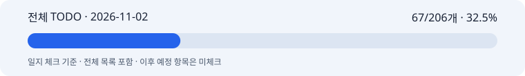

# 2026-11-02 박지수 협업일지

## 1. 날짜·이름·팀명

**작업일: 2026-11-02 · 기록일: 2026-11-03 · 박지수(pi) · 고급프로젝트 2팀.** 담당은 이미지 API 래퍼·제품 보존·최종 합성이다. 보고 범위는 11/02 23:59 KST까지다. 원격 조회와 누락 기록 보완은 11/03에 수행했다. 개별 작업의 정확한 시작 시각은 미확인이고, 모델 실행 시각은 보관된 영수증을 따른다.

## 2. 오늘의 역할과 구체적인 작업

목표는 통합 서비스의 이미지 입력·반환을 확인하고, 기존 A 배치와 실제 광고 결과의 차이를 정리하는 것이었다.

- 잇템 통합 스냅샷 `92c51a7`의 이미지 경계를 검토했다. 제품 분석·한국어 프롬프트·카피·사진 입력과 PNG·캡션 반환은 연결돼 있었다. 생성 safe_zone 누락, 기존 하단 서브/우측 CTA 사용, 고정 보호 영역, 합성 receipt 미보존, 합성만 재개하는 화면 동작 부족을 당시 코드 기준으로 기록했다.
- 해당 스냅샷의 이미지 경계 관련 31개 시험과 기존 A helper의 15개 시험을 각각 확인했다. MockTransport·로컬 합성 범위이며 실제 서비스 전체 품질 인수가 아니다.
- 팀원이 제공한 실제 롬앤 카피를 저장된 피치 글로우 이미지에 합성하고 360px 축소본을 확인했다. 헤드/서브/CTA는 64/48/54px, 모두 1줄이었다. 제품 보호 사각형과 CTA 영역이 겹쳐 검증이 거절됐으며 최종 배치 완료로 표시하지 않았다.
- 사용자 제공 광고 참고로 핑크 젤 배경을 이미지 모듈에서 1장 생성했다. 33.265초, 1152×1440, 입력 4,566토큰·출력 418토큰이다. 제품 크기가 요청보다 크게 표현돼 원형 검토를 남겼다.
- 별도 요청으로 고정 프롬프트 없이 직접 이미지 API에서 인물·제품·한국어 타이포그래피를 함께 생성했다. CLI 1회, 결과 1장, 46.118초다. SDK 내부 HTTP 시도 수·usage·청구액은 미확인이다. 서비스 생성/합성 계약을 변경하지 않았다.
- A 배치 좌표·요청 JSON·제품 보호·합성만 재시도하는 절차를 프론트 전달용 Markdown으로 정리했다. 이번 날짜에는 제품 코드를 수정하거나 배포하지 않았다.

**전체 TODO 일지 체크: 67/206개 · 32.5%.** 제품 완성률이나 당일 신규 완료 수가 아니다.

[전체 TODO](full-todo.md) · [전체 TODO HTML](full-todo.html) · [데이터](progress.json) · [근거](evidence.md) · [마일스톤 체크](milestones.md)

원본은 개인 레포 `feat/image-generation`의 `096053eafacb6a77796126364f37fba3f2b8e593`다. 원본 202개에 이미 10/30 게시된 MPO·Windows 저장 분리·A helper·저장 결과 재조회 4개를 보완해 전체 206개가 됐다. 과거 63/202 기록은 보존한다. 이번 증가 4개는 11/02 신규 구현이 아니다. 일정 미정·보고일 이후 항목은 분자에서 제외한다. 별도 일별 마일스톤은 **11/02까지 3/10 전체 확인, 7개 부분 완료**다.

## 3. 오늘 작업 완료도

**잠정 75%.** 본인 자기평가가 없어 문서 작성자가 정한 잠정값이다. 코드 검토·전달 자료·이미지 시험은 수행했지만 A의 실제 제품 보호 조건과 최종 배치, 공동 서비스 인수는 남았다. 이 값은 전체 TODO 32.5%와 별개다.

## 4. 협업 제안·피드백

사용자가 전달한 프론트 담당 문의에서 ‘A 좌표로 고정’과 ‘생성이 아니라 합성만 재시도’라는 두 작업의 이해를 확인했다. “작업에 저장한 확정 layout”이라는 설명은 구현 제안까지 섞여 혼동을 줬으므로 공통 A 설정과 재시도에서 같은 설정을 사용한다는 뜻으로 풀어 설명했다. 현재 helper 좌표가 과거 디자인 시안과 같지 않다는 점도 분리했다.

서빙에는 생성 여백·합성 layout 일치, 실제 제품 보호 영역, 합성 receipt와 경고 보존을 요청문으로 정리했다. Text의 한국어 원문·concept/mood와 의미 단위 줄바꿈을 유지하며 이미지 쪽에서 카피 생성·검수를 중복하지 않는다. 문서는 사용자에게 전달했고 에이전트가 팀원에게 직접 메시지를 보내지는 않았다. 팀원 최종 인수 승인은 미확인이다.

11/03 원격 조회에서 11/02 저녁 통합 커밋 `0eef75d`와 `3ddbf73`을 확인했다. A 설정·receipt·복구·manifest 관련 변경이 있으므로 이전 누락 판정을 최신 코드에도 그대로 적용하지 않는다. 이 커밋의 기능 재검증·GCP 배포 상태는 다음 확인 대상으로 남긴다.

## 5. 인사이트·문제

A helper가 레포에 존재하는 것과 실제 서비스가 그 설정을 사용하는 것은 다르다. 또한 같은 ‘A’ 이름이어도 로컬 Fabric 디자인 시안과 합성 helper의 글자 크기·좌표가 다르다. 배치 좌표와 폰트를 함께 고정해야 비교가 가능하다.

피치 사진에서 CTA 글자는 실제 제품 아래에 있지만 지정된 제품 보호 사각형과 CTA 사각형은 겹쳤다. 진단을 위해 보호 영역 없이 만든 이미지에는 `PRODUCT_REGION_NOT_PROVIDED` 경고가 있으며 인수 결과로 사용할 수 없다. 실패 검사를 제거해 완료 처리하지 않는다.

핑크 젤 실험에서는 재질·굴절·광원·소품의 위치를 구체화하자 참고 분위기가 반영됐다. 직접 API의 한글 타이포그래피는 가능성을 확인한 1건이며 정확도 확률이나 특정 글꼴 재현을 보장하지 않는다. 두 실험은 모델·구도·프롬프트가 달라 래퍼 유무만의 비교가 아니다. 실제 청구액이 없으므로 예약금을 비용으로 표시하지 않는다.

## 6. 일정·협업의 어려움

11/02까지 마일스톤 10개 중 3개만 전체 확인했고 7개는 부분 완료다. M1의 실제품 품질·사용자 승인·다운로드·공유 예산·팀 인수 근거가 부족하다. 개발셋 전체의 개선 전후 평가도 끝나지 않았다. 개별 생성 성공으로 11/03 개발 최종 10결과나 11/04 독립 검증 10결과를 앞당겨 체크하지 않는다.

서빙 후속 코드가 검토 뒤 추가됐다. 최신 코드 확인과 실서비스 인수가 필요하지만, 커밋 존재만으로 상대 작업 실패나 성공을 단정하지 않는다.

## 7. 발표·커뮤니케이션 기여

이미지 입력·반환 경계 리뷰, 담당별 MVP 요청문, A 배치 프론트 가이드, 실제 팀 카피 합성 진단과 두 광고 스타일 프롬프트·결과 자료를 준비했다. 생성 이미지·원본 사진·인물 참고 광고·비밀값은 공개 Git에 올리지 않고 근거 요약과 해시만 기록한다. 실제 발표·팀 공동 시연·배포 인수는 확인하지 않았다.

## 8. 다음 목표

11/02 작업에서 남긴 후속이며 완료 체크가 아니다.

- 최신 통합 커밋에서 A 설정·합성만 재시도·receipt 재조회·기존 작업 복구를 확인한다.
- 실제 제품 보호 영역과 CTA가 함께 통과하는 좌표·운영 폰트를 정하고 실제 카피 가독성을 검증한다.
- 사용자 카피 승인→이미지 승인→최종 PNG·캡션 다운로드를 공동 확인한다.
- 고정 개발/검증 평가셋과 동일 설정의 결과, 실제 비용 근거를 확보한다. 새 유료 호출은 이번 기록 작업에서 수행하지 않는다.
- 과거 10/30 게시 구현과 11/02 관측을 구분해 공유 TODO·독립 일지를 갱신한다. 11/03 이후 마일스톤은 미체크로 유지한다.
