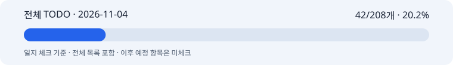

# 박지수 협업일지 · 2026-11-04

세 비율 실제 생성·재배치·공유 시안

## 1. 날짜·이름·팀명

작업일: 2026-11-04 (KST) · 이름: 박지수 · 팀: 고급프로젝트 2팀.

기록일: 2026-11-12. 누락 일지의 사후 기록이며 원본 작업일·커밋일·기록일을 구분한다. 보고일 말까지 확인 가능한 자료만 사용하고 오늘의 성과를 과거 날짜에 넣지 않는다.

## 2. 오늘의 역할과 구체적인 작업

이미지 크기·카피 배치·제품 보존과 실험 기록 담당.

저장된 11/04 실험 기록에서 3:4·4:5·9:16 이미지 15건(초기12·후속3)과 사용량 15건을 확인했다. 토큰 합계 77,901, 당시 단가 추정 $1.10906이며 실제 청구액과 사람 최종 채택은 미확인이다.

생성 크기와 최종 크기를 구분하고 카피 영역·제품 위치·CTA를 로컬 재합성했다. 배치 변경 3건은 추가 이미지 API 호출 0회다. 초기/후속 생성 15건과 섞지 않는다.

공유용 세 비율 좌표·시안과 Instagram UI 모의 가림 확인 자료를 정리했다. 모의 화면 가독성을 실제 휴대폰·플랫폼 검증으로 확대하지 않는다.

당시 원본 전체 일지 체크: 42/208개 · 20.2%. 이 수치는 일지 체크이며 코드/제품 전체 완성률이나 당일 자기평가가 아니다.

11/05 재분류 전의 당시 고정 원본을 사용한다. 이후 활성28개와 분모가 달라 증감이나 제품 완성률로 비교하지 않는다.

[전체 TODO](full-todo.md) · [HTML 전체 목록](full-todo.html) · [진행률 데이터](progress.json) · [날짜별 근거](evidence.md)

## 3. 오늘 작업 완료도

본인 자기평가: 미확정. 당일 0·25·50·75·100% 평가가 제공되지 않아 임의의 숫자를 만들지 않았다. 확인된 작업 결과는 2번에 적었으며 자동 TODO 비율로 대체하지 않는다.

## 4. 협업 제안·피드백

비율마다 필요한 것은 텍스트를 다시 생성하는 횟수보다 합성 좌표·상하 여백·플랫폼 UI 회피 조건이었다. 공유용 CTA와 카피 배치를 설명하되 최종 수락을 임의로 기록하지 않는다.

## 5. 인사이트·문제

생성 이미지와 로컬 글자 합성은 비용 단위가 다르다. 좌표·카피 변경만 한 작업을 새 이미지 생성으로 세지 않는다.

## 6. 일정·협업의 어려움

초기 배치 문제와 제품·소품 겹침이 있어 후속 생성 및 로컬 재배치로 구분해 기록했다. 독립 품질 인수와 실제 청구 대조는 남았다.

M1 10/30·M2 11/06은 목표일 이력이다. 미확인 표본·합격 기준·청구·공동 인수는 완료로 처리하지 않는다.

## 7. 발표·커뮤니케이션 기여

세 비율 생성/최종 크기와 좌표를 공유용 보고서로 정리하고 저장된 실험을 비교할 수 있게 했다. W&B 수집 영수증은 READBACK_VERIFIED이며 새 호출 수와 별도로 기록한다.

## 8. 다음 목표

당시 후속 계획: 사용자 배치 선택을 모듈 프로필과 맞추고 서비스 비율 입력·저장·합성 계약을 확인한다.
