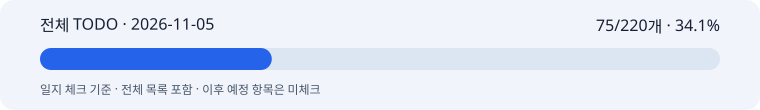

# 2026-11-05 박지수 협업일지

## 1. 날짜·이름·팀명

**2026-11-05 · 박지수(pi) · 고급프로젝트 2팀.** 이미지 API 래퍼·제품 보존·광고 합성을 담당한다. 보고 기간은 한국시간 오늘00:00부터 **2026-11-05 14:48 KST**까지다. 이번 활성 범위 재분류의 관측은 2026-11-05 16:58 KST까지 보완했다. 이전 날짜 시안·실험은 오늘 새 실행으로 세지 않고 오늘의 게시·검토·공유 상태와 구분했다.

## 2. 오늘의 역할과 구체적인 작업

오늘 목표는 비율·세이프존·타이포그래피 변경의 게시 상태를 확인하고, 팀 문의와 다음 기능의 담당 경계를 정리하는 것이었다.

- **커밋 기록09:57~09:58 KST:** 3:4·4:5·9:16 생성/최종 크기, 릴스·스토리B의 영역 지시, 선택별 합성·리사이즈와 재현 자료가 개인 통합/팀 이미지 브랜치에 게시된 사실을 확인했다.
- **커밋 기록10:29 KST:** 신규 요청 기본 모델gpt-image-2.6-sunburst·complexity=high·quality=medium 설정과 구형 모델/저장 해시 호환의 게시를 확인했다. 실제 모델 품질 향상을 실측한 것은 아니다.
- 게시 문서의 **전체395개 테스트 통과 기록**과 테스트 소스를 확인했다. 일지 작성 중 새로 실행한 시험 수가 아니며, 과거374/370/365개와 더하지 않는다.
- 기존 로컬 시안을 바탕으로 중복 이미지CTA를 빼고 광고문구를 키우는 방향, 9:16 헤드를 상단 중앙·한 줄로 둔 사용자 선택과 좌표를 정리했다. 최종1080×1920과 생성1152×2048 좌표를 구분했다. 상단 중앙 시안을 원격 프로필에 반영하는 일은 남았다.
- 태민님의 질문을 사용자에게 전달받아 보호 영역 검사와 실제 제품 위치 검수의 의미를 구분한 답변을 작성했다.
- 자유형:합성형1:1·2:1·3:1의 담당별 작업과 PM 설명을 정리하고 금붕어5단계 리뷰·기능 지적 수리 확인을 마쳤다. 사용자 요청으로 **구현은 보류**했다.
- 오늘 기록 작업에서는 실제 이미지 API 호출·배포·팀 메시지 전송을 하지 않았다. 앞선 날짜의 유료 이미지 실험을 오늘 새 호출로 집계하지 않는다.

**활성 체크: 12/28개 · 42.9%.** 2026-11-05 16:58 KST에 사용자 요청으로 현재 범위를 다시 분류했다. 과거·비적용·보류와 중복 요약은 활성 분모에서 제외한다. 새 코드 완료가 늘어난 것이 아니라 서로 다른 판정 단위를 구분한 것이다.

| 구분 | 완료 | 남음 | 전체 |
|---|---:|---:|---:|
| 현행 MVP · 이미지 모듈 구현 | 10 | 0 | 10 |
| 고도화 7개 · 구현/연결 | 2 | 7 | 9 |
| 공동 검증/인수 | 0 | 9 | 9 |
| **활성 체크 합계** | **12** | **16** | **28** |

현행 MVP10/10은 이미지 모듈 구현, 고도화2/9는 7개 기능을 나눈 작업 단위, 공동 검증0/9는 인수 증거 미확인이다. 타 파트의 미구현을 단정하지 않는다. E05-B 상단 중앙 원격 반영과 J01 서비스 계약 연결이 우선이다. 자유형 다수+합성형1장은 보류한다.

[전체 활성 TODO](full-todo.md) · [HTML](full-todo.html) · [진행률 데이터](progress.json) · [220개 이관표](reclassification.md) · [과거220개/75개 원기록](archive/before-active-reclassification/full-todo.md) · [마일스톤 이력](milestones.md) · [검증 근거](evidence.md).

기존75/220·34.1%와 원시 체크82/220은 원문/일정/완료일 그대로 보존했다. 새 활성12/28과 기준이 달라 상승률이나 제품 완성률로 비교하지 않는다. 재분류 검증은 별도 기록하며 기존395개 코드 시험을 오늘 새로 실행했다고 쓰지 않는다.

## 3. 오늘 작업 완료도

**잠정75%.** 본인 자기평가가 입력되지 않아 문서 작성자가 둔 임시값이다. 게시된 이미지 모듈과 협업·설계 자료를 정리했지만, 서비스 사이즈 수신 연결·상단 중앙 프로필 반영·실제품/청구/팀 인수는 남았다. 활성 체크 진행률과 구분한다.

## 4. 협업 제안·피드백

사용자는 스토리 하단 여백 비교에서B를 선택했고, 중복된 ‘제품 보러가기’보다 광고문구가 눈에 띄어야 한다고 지적했다. 이후 두 줄로 끊긴 헤드보다 제품 위쪽·화면 좌우 중앙의 한 줄 배치를 선호했다. 선택한 시안과 원격에 게시된 왼쪽 두 줄 프로필은 같은 상태가 아니다.

태민님의 protected_region_check 질문에는 지정한 보호 영역과 문구 영역의 겹침 검사라는 뜻이며 실제 생성 제품 검출/위치 확인은 아니라고 정리했다. needs_manual_check는 수동 확인이 필요하다는 안내이고, 검수 완료·승인은 서빙의 별도 기록으로 관리해야 한다.

복수 방식 안은 프론트가 선택·결과 표시, 서빙이 장수 계산·후보/상태·예산·승인·미확인 대조, 이미지가 후보1개씩 생성/합성, 텍스트가 공통 카피와 방식별 프롬프트를 맡는 제안이다. PM에게는 ‘제작 방식 비교 생성’의 범위·담당·선행 계약·완료 기준으로 설명하도록 정리했다. 문서 작성·사용자에게 답변한 사실과 팀원 직접 전송·수신·수락은 구분한다.

## 5. 인사이트·문제

큰 글자가 항상 좋은 배치는 아니었다. 버튼과 중복되는 이미지CTA를 키우기보다 헤드·서브의 위계와 의미 단위 줄바꿈을 먼저 확인해야 했다. 세이프존은UI를 피하는 내부 영역이고 글자 대비·배경 복잡도를 대신 검증하지 않는다.

보호 영역 검사를 통과해도 실제 제품이 그 영역 안에 생성됐다는 뜻은 아니다. 실제 결과의 라벨·형태·가림 확인이 필요하다. 신규 모델/complexity 설정도 품질 개선 효과가 이미 입증됐다는 뜻으로 쓰지 않는다.

합성형도 배경·제품 후보 생성에는 이미지 API를 쓴다. 이후 글자 합성만 추가 API 호출이 없는 로컬 작업이다. 자유형은 승인 카피를 넘겨도 실제 이미지에 다른 글자가 그려질 수 있어 후보별 최종 확인이 필요하다.

오늘 Git 이력에는 중간 프롬프트 문서 게시와 되돌림이 있다. 최종적으로 남은 게시 커밋을 근거로 삼고 중간 문서를 현재 계약으로 쓰지 않았다.

## 6. 일정·협업의 어려움

11/05까지 일별 마일스톤은13개 중 전체 확인3개·부분 완료/미인수10개다. 11/04의 독립 검증10결과·2인 판정·최종20결과와11/05의 실제 서비스 사용성·청구·총원가를 새로 확인하지 않아 체크하지 않았다. 11/06 이후 일정도 미체크로 남겼다.

이미지 모듈 게시만으로 프론트·서빙의 사이즈 전달과 서비스 합성이 연결되지는 않는다. 공유 예산과 후보별 승인, 실제 모델 접근/품질·청구 확인도 공동 작업이다. 새 기능 분담은 제안이며 상대 담당자의 수락이나 구현 완료를 확인한 것은 아니다.

범위 재분류에서는 텍스트/서빙/UI의 작업을 이미지 모듈 미구현으로 세지 않고 공동 계약·검증으로 남겼다. 기존 임시 표본·합격선은 팀 확정 전 제안 상태를 유지한다. 과거·비적용 항목을 제외해도 품질·권한·실제 청구·팀 인수는 현재 필수 검증에 남긴다.

## 7. 발표·커뮤니케이션 기여

비율별 생성/최종 크기·세이프존·제품·문구 좌표와 UI 모의 시안을 공유용 HTML·ZIP으로 정리해 사용자에게 제공했다. 오늘은 그 선택·설명 상태와 게시된 모듈의 차이를 체크리스트에 남겼다. 공개 Git에는 생성 이미지나 원본 사진을 올리지 않고 좌표·요약·코드 근거만 기록했다.

금붕어 리뷰의 ‘분담안은 사용 가능’과 ‘구현 계약은 미완성’을 구분하고, 서빙 주도로 먼저 맞출 입력·후보·승인·원장/예산 항목을 복사해 보낼 수 있는 문장으로 정리했다. 실제 발표·공동 시연·팀 인수는 확인하지 않았다.

## 8. 내일 목표

- 상단 중앙 시안과 현재 원격 프로필의 차이를 먼저 정리하고, 반영 범위를 정한 뒤 프롬프트/합성 좌표를 함께 회귀한다.
- 외부 사이즈 값 수신·저장·내부 프로필 선택·합성 진입점의 기존 서빙/UI 연결 조건을 확인한다.
- M2의 실제품 품질·공동 승인/다운로드·계정 예산·실제 청구 미확인 항목을 근거별로 점검한다.
- 자유형 다수+합성형1장 안은 보류 상태를 유지한다. 재개 요청 전 구현·실제 API 호출을 시작하지 않는다.
