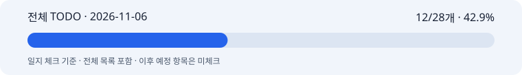

# 박지수 협업일지 · 2026-11-06

M2 목표일·인수 근거 미확인

## 1. 날짜·이름·팀명

작업일: 2026-11-06 (KST) · 이름: 박지수 · 팀: 고급프로젝트 2팀.

기록일: 2026-11-12. 누락 일지의 사후 기록이며 원본 작업일·커밋일·기록일을 구분한다. 보고일 말까지 확인 가능한 자료만 사용하고 오늘의 성과를 과거 날짜에 넣지 않는다.

## 2. 오늘의 역할과 구체적인 작업

이미지 담당. M2 목표일과 실제 검증·인수 상태를 대조하는 기록이다.

11/06은 기존 이미지 디테일·고도화 완료 목표일이다. 이번 확인 범위에서는 11/06 당일 새 구현·모델 호출·시험·게시 자료를 확정하지 못했다.

11/05에 고정한 활성 TODO는 MVP 모듈·고도화7개·공동 검증/인수로 분리돼 있다. 날짜가 지났다는 이유로 미확인 공동 항목을 체크하지 않는다.

활성 체크: 12/28개 · 42.9%. 이 수치는 일지 체크이며 코드/제품 전체 완성률이나 당일 자기평가가 아니다.

11/05 재분류 이후 현행 MVP·고도화7개·공동 검증/인수만 활성으로 센다. 과거·비적용·보류는 제외하며 전체 목록에 남긴 원문을 보존한다.

[전체 TODO](full-todo.md) · [HTML 전체 목록](full-todo.html) · [진행률 데이터](progress.json) · [날짜별 근거](evidence.md)

## 3. 오늘 작업 완료도

본인 자기평가: 미확정. 당일 0·25·50·75·100% 평가가 제공되지 않아 임의의 숫자를 만들지 않았다. 확인된 작업 결과는 2번에 적었으며 자동 TODO 비율로 대체하지 않는다.

## 4. 협업 제안·피드백

서빙·UI·텍스트와 맞출 계약/품질/다운로드/운영 항목은 기존 문서에 남아 있다. 당일 추가 회신·팀 수락은 미확인이다.

## 5. 인사이트·문제

마일스톤은 목표일이며 자동 합격일이 아니다. 기존 완료 근거와 남은 공동 판정을 그대로 보존한다.

## 6. 일정·협업의 어려움

당일 자기평가와 실제 인수 자료가 없어 M2 완료 여부는 판정하지 않는다. 단위 시험·게시와 팀 인수를 구분한다.

M1 10/30·M2 11/06은 목표일 이력이다. 미확인 표본·합격 기준·청구·공동 인수는 완료로 처리하지 않는다.

## 7. 발표·커뮤니케이션 기여

11/06 당일 새 발표·시연 기여는 확인하지 못했다. 오늘 작성한 누락 보완 일지를 당일 성과로 쓰지 않는다.

## 8. 다음 목표

당시 후속 과제: 실제 서비스 경로·제품 품질·계정 비용·팀 재현 근거를 확보하고 M2 미확인 조건을 명시한다.
