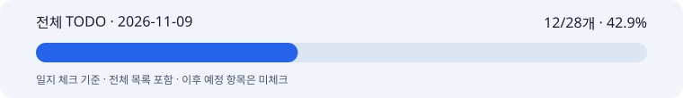

# 박지수 협업일지 · 2026-11-09

합성형 연출·광고 글꼴 저장 실험 검토

## 1. 날짜·이름·팀명

작업일: 2026-11-09 (KST) · 이름: 박지수 · 팀: 고급프로젝트 2팀.

기록일: 2026-11-12. 누락 일지의 사후 기록이며 원본 작업일·커밋일·기록일을 구분한다. 보고일 말까지 확인 가능한 자료만 사용하고 오늘의 성과를 과거 날짜에 넣지 않는다.

## 2. 오늘의 역할과 구체적인 작업

이미지 연출과 한글 합성 실험 담당. 저장 실험의 실행 결과와 서비스 적용 여부를 구분한다.

11/09자로 보관된 합성형 파일럿에서 AV·MD 두 제품의 생성 성공 기록을 확인했다. AV 28.29초·5,350토큰·추정 $0.069962, MD 30.46초·5,378토큰·추정 $0.070102다. 실제 청구액은 둘 다 미확인이다.

같은 자료에 로컬 합성 영수증과 결과가 있다. 개별 이미지 생성·합성 성공을 전체 서비스 E2E나 제품 라벨 보존 인수로 쓰지 않는다.

날짜별 공개 코드 반영·팀 수신은 이 로컬 실험 자료만으로 확인할 수 없다. 저장된 실행 기록과 원격 게시를 분리한다.

활성 체크: 12/28개 · 42.9%. 이 수치는 일지 체크이며 코드/제품 전체 완성률이나 당일 자기평가가 아니다.

11/05 재분류 이후 현행 MVP·고도화7개·공동 검증/인수만 활성으로 센다. 과거·비적용·보류는 제외하며 전체 목록에 남긴 원문을 보존한다.

[전체 TODO](full-todo.md) · [HTML 전체 목록](full-todo.html) · [진행률 데이터](progress.json) · [날짜별 근거](evidence.md)

## 3. 오늘 작업 완료도

본인 자기평가: 미확정. 당일 0·25·50·75·100% 평가가 제공되지 않아 임의의 숫자를 만들지 않았다. 확인된 작업 결과는 2번에 적었으며 자동 TODO 비율로 대체하지 않는다.

## 4. 협업 제안·피드백

카피 영역의 단순함과 원본 제품 형태·라벨 유지, 합성 글꼴·크기의 확인이 필요했다. 당일 팀원과의 최종 합의나 채택은 별도 자료가 없어 미확인이다.

## 5. 인사이트·문제

조건을 개선한 광고 이미지 한 장은 후보이며 여러 제품의 반복 품질을 보장하지 않는다. 시간·사용량·추정비용의 출처를 함께 남겨야 한다.

## 6. 일정·협업의 어려움

실제 청구와 독립 품질 평가, 팀 배포 반영을 연결한 근거가 부족하다. 로컬 실험 수치를 서비스 전체 성능으로 쓰지 않는다.

M1 10/30·M2 11/06은 목표일 이력이다. 미확인 표본·합격 기준·청구·공동 인수는 완료로 처리하지 않는다.

## 7. 발표·커뮤니케이션 기여

저장된 제품별 결과와 합성 영수증을 비교 가능한 근거로 보존했다. 당일 발표 여부는 미확인이다.

## 8. 다음 목표

당시 후속 계획: 제품 형태·재질·색·연출을 분리해 비교하고 합성 텍스트의 대비와 위치를 점검한다.
